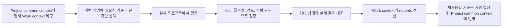

# Source에서 목표 작업으로 가는 방향

날짜: `2026-08-13`

## 이 문서의 상태

보존한 source를 읽고 무엇을 먼저 만들고 확인할지 정리한 AI 분석 기록이다. 최종 구조나 사용자 승인 결정이 아니며, 아래 첫 작업 장면도 채택 전 제안이다. 현재 상태는 [`../current/`](../current/)가 소유한다.

이 문서는 처음 `output/`에 작성됐지만, 사용자가 `output/`은 실제 목표 산출물 자리이고 분석 문서는 누적층에 둔다고 정정해 `records/`로 옮겼다.

## 당시 분석

처음부터 문서 계층이나 자동화 도구 전체를 설계하지 않는다. 실제 개발 작업 한 건이 다음 흐름을 끝까지 통과하는지를 먼저 보여 주는 편이 목표에 가깝다.

이 흐름에서 context는 복구와 선택을 담당하고, harness는 누락·위반·검증 실패를 발견해 지속 상태가 실제 결과와 다시 맞아지도록 보완한다.

## Source를 사용하는 방식

### 사용자 직접 입력은 목표와 완료 기준을 정한다

[`사용자 scaffold`](../source/00-intake/2026-08-12-user-scaffold.md)는 다음 범위를 정한다.

- 이미 개발 프로젝트가 있다고 가정한다.
- Project common context와 Work context를 복구하고 선택적으로 사용해야 한다.
- 검증 결과가 일회성 출력으로 끝나지 않고 지속 상태에 반영되어야 한다.
- 설치 패키지보다 실제 운영 구조가 먼저 보여야 한다.

다른 source가 이 범위를 바꾸지는 못한다.

### Anthropic 공식 자료는 context 품질을 평가하는 기준으로 쓴다

[`사용자 선택 발췌`](../source/10-external/anthropic-effective-context-engineering/user-selected-excerpts.md)는 context를 많이 넣는 것보다 원하는 행동에 필요한 구성을 고르고, 작업 메모리에는 현재 필요한 정보만 두며, 긴 작업은 고충실도 압축과 구조화된 기록으로 이어 가라고 설명한다.

따라서 다음을 확인하는 데 사용한다.

- 최소 진입점만 읽고 목표·현재 상태·다음 행동을 복구하는가.
- source와 records 전체를 싣지 않고 필요한 자료로 들어갈 수 있는가.
- 정리 과정에서 중요한 결정·실패·검증 결과를 먼저 빠뜨리지 않고, 그다음 중복과 소음을 줄이는가.

이 자료는 파일 계층이나 갱신 권한을 대신 결정하지 않는다.

### 사용자 선택 블로그는 harness coverage를 묻는 기준으로 쓴다

[`사용자 선택 발췌`](../source/10-external/blog-agentic-patterns/user-selected-excerpts.md)는 guide만으로는 강제되지 않으므로 기계 검사, 의미 검토, 사람 개입을 실패 유형에 맞게 조합하고, 필요한 정보는 지도에서 점진적으로 찾으며, harness는 나중에 부분별로 제거할 수 있어야 한다고 설명한다.

따라서 실제로 관찰된 실패마다 다음을 묻는 데 사용한다.

- 지침으로 예방할 문제인가.
- test나 정적 검사로 판정할 문제인가.
- 의미 검토가 필요한 문제인가.
- 사용자가 결정해야 하는 문제인가.
- 그 장치가 불필요해졌을 때 다른 상태 책임을 무너뜨리지 않고 제거할 수 있는가.

블로그의 수치, 모든 구조화 통신, 네 종류 harness의 일괄 설치를 기본 요구사항으로 채택하지 않는다.

### 사용자가 가져온 Codex 의견은 설계 누락을 찾는 질문으로 쓴다

[`context 운영 질문`](../source/20-ai-opinion/codex-context-questions.md)은 각 상태에 대해 내용, 유효성, 정본, 읽히는 시점, 갱신 주체, 검증 근거를 분리해 묻게 한다.

새 문서나 자동화를 추가할 때 이 여섯 질문에 답하지 못하면 구조를 먼저 늘리지 않는다. 이 질문 집합 자체는 아직 사용자 승인 설계안이 아니다.

### AX와 cofathon은 실패 시나리오와 실제 연결을 고르는 관찰 자료로 쓴다

[`AX source map`](../source/30-prior-work/ax-myrealtrip/source-map.md)과 [`cofathon source map`](../source/30-prior-work/cofathon/source-map.md)에서 공통으로 관찰되는 연결은 다음과 같다.

- 재진입 지침에서 현재 지도와 안정 기준으로 들어간다.
- 현재 상태, 장기 기준, 시간순 이력, 실행 가능한 검사를 다른 책임으로 둔다.
- 실제 입력과 검증 결과를 보고 현재 상태와 다음 행동을 다시 정한다.
- 반복될 판단만 다음 실행이 읽는 기준이나 검사로 올린다.

더 중요한 것은 실패다.

- Git이 clean이어도 current가 후속 실패보다 오래될 수 있다.
- fixture나 자체 test가 통과해도 실제 소비 형태에서는 실패할 수 있다.
- hook 실행과 파일 존재는 모델이 내용을 읽고 행동을 바꿨다는 증거가 아니다.
- fresh reviewer, test 개수, 설치 여부는 실제 사용자 효과와 다르다.

따라서 기존 폴더 구조를 복사하지 않고, 이 실패들을 새 운영 구조가 통과해야 할 시험 조건으로 사용한다.

## 제안한 첫 작업 장면

가장 먼저 다룰 장면은 **현재 Work context에는 검증 준비가 됐다고 적혀 있지만, 실제 검증이 실패하는 경우**다. 이는 상태 복구, 선택, 검증, 지속 상태 반영을 한 번에 확인하면서도 범위가 작다.

초기 상태:

- Project common context에는 목표와 변하지 않는 제약이 있다.
- Work context에는 현재 문제, 검증 전 상태, 근거, 다음 행동이 있다.
- records에는 그 상태까지 온 이유가 있다.

실행에서 확인할 것:

1. 새 사람이나 AI가 current 진입점만 읽고 프로젝트 목표, 현재 문제, 다음 행동을 복구한다.
2. 이번 검증에 필요한 기준과 파일만 선택하고 source 전체를 읽지 않는다.
3. 실제 검증을 실행하고 실패 근거를 얻는다.
4. 완료로 보고하지 않고 Work context의 상태·불확실성·다음 행동을 바꾼다.
5. 실패와 판단 이유를 records에 남긴다.
6. Project common context는 자동으로 바꾸지 않는다. 반복 가능한 새 기준이 발견되면 제안하고, 사람이 채택한 뒤에만 반영한다.
7. 다음 새 세션이 바뀐 현재 상태를 다시 복구한다.

## 증거는 단계별로 구분한다

- 파일이나 설정이 존재한다.
- 실제 세션에서 해당 context가 선택되고 읽혔다.
- 검증이 실행되어 결과가 남았다.
- 결과가 Work context와 다음 행동을 바꿨다.
- 다음 세션이 바뀐 상태를 읽고 그에 맞게 행동했다.

앞 단계의 증거로 뒤 단계까지 통과했다고 말하지 않는다.

## 제안한 작업 순서

1. 위 장면의 입력 상태, 기대 상태 전이, 실패 증거, 사람 결정 지점을 한 페이지로 고정한다.
2. 기존 `current/project.md`, `current/work.md`, records, source만으로 장면을 표현해 보고 실제로 빠지는 책임을 찾는다.
3. 빠짐이 확인된 곳에만 최소 harness를 붙인다. 현재 `context_maintainer`는 이 단계에서 검증할 첫 후보이지 효과가 입증된 완성 장치가 아니다.
4. fresh session으로 복구부터 상태 반영 후 재진입까지 실행한다.
5. 누락, 불필요한 로딩, 잘못된 승격, 검증과 효과의 혼동을 기록한다.
6. 반복된 실패만 project 공통 기준이나 실행 검사로 올리고 같은 장면과 대비 장면으로 다시 확인한다.
7. 이 실험 뒤에만 세 번째 context 역할이나 추가 자동화가 실제로 필요한지 판단한다.

## 지금 만들지 않는 것

- 별도 설치 패키지나 범용 CLI
- 모든 source를 한 번에 검색·주입하는 시스템
- AX의 비대한 current나 cofathon의 여러 Goal 층위를 그대로 복제한 구조
- database, catalog, trace, run receipt의 기본 의무화
- multi-agent와 LLM judge의 일괄 도입
- 근거 없이 정한 세 번째 context 역할

## 당시 제안한 다음 산출물

다음에는 첫 작업 장면의 초기 상태, 실제 사건, 기대 상태 전이, 검증 증거, 실패 판정을 구체화한다. 그 문서가 합의되기 전에는 새 context 계층이나 자동화 구현으로 넘어가지 않는다.
