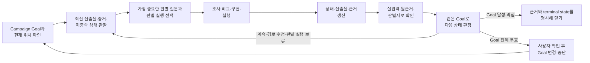

# Goal 중심 작업 루프

상태: **현재 프로젝트 전반에 적용하는 Goal·반복 운용 기준**

이 문서는 특정 프로젝트의 Goal 문장을 소유하지 않는다. 대신 **Mission·Campaign Goal·엔지니어링 최상위 Goal·loop Goal을 연결하고, 최신 상태에서 다음 판별 질문과 행동을 고르며, 결과로 기준과 필요하면 Goal 자체를 다시 여는 관계**를 정의한다.

루프는 미리 정한 작업 순서가 아니다.

> **Goal + Observable State + Dynamic Next Action + Feedback + Verifier + Terminal Conditions**

## Goal의 소유권과 수명

- **Mission** — 프로젝트가 궁극적으로 향하는 방향이다. 이 프로젝트에서는 `context/goal.md`가 소유한다.
- **Campaign Goal** — 이번 지원 실행 전체가 직접 닫을 상태다. 조사·문제 설정·솔루션·엔지니어링·제출을 가로지르며 `context/goal.md`가 소유한다.
- **엔지니어링 최상위 Goal** — 엔지니어링 단계의 한 번 이상 구현 반복이 도달할 관찰 가능한 완료 상태다. 단계가 열리면 `context/engineering/00-top-level-goal.md`가 소유한다.
- **loop Goal** — 엔지니어링 최상위 Goal에서 이번 loop가 새로 가능하게 만들거나 먼저 검증할 상태다. 필요할 때 `context/engineering/NN-short-name/goal.md`가 소유한다. 번호·주제가 붙은 폴더 하나가 loop의 Goal과 구현·검증 기록 경계다.
- **Learning Question(판별 질문)·판별 실행** — 최신 상태에서 판단을 바꿀 질문과 이를 판정할 제한된 조사·비교·실행이다. 구현 밖의 탐색이나 loop Goal을 고르기 전에도 동적으로 사용할 수 있다. 이 문서의 일반 운용 단위에는 `Probe`라는 이름을 쓰지 않는다. `Probe`는 Cofa가 공개한 공식 제품명에만 쓴다.

모든 질문·작업을 loop Goal 문서로 만들지 않는다. loop Goal은 상태 변화·평가 기준·검증 증거를 독립적으로 유지해야 할 때만 만든다. 단순 읽기·수정·명령 실행은 Goal이 아니라 Action이다.

`current.md`는 Mission·Campaign Goal과 활성 엔지니어링 최상위 Goal의 한 줄 요약·링크, 현재 미충족 상태를 유지한다. 단일 커서는 활성 leaf Goal이 있으면 그 Goal을, 없으면 최상위 구현 Goal 아래에서 다음 loop를 고르는 현재 판단점을 가리킨다. Goal의 상세 원본을 current에 복제하지 않는다.

Mission·Campaign Goal은 방향과 상위 완료 의미를, 엔지니어링 최상위 Goal은 여러 구현 loop가 함께 도달할 상태를 제공하지만 매 Action의 별도 Goal처럼 취급하지 않는다. 활성 loop Goal이 있으면 그 Goal이 현재 구현을 직접 지배한다. 구현 loop 안에서 매번 다시 정하는 **이번 반복의 목표와 평가 축**도 새 Goal 계층이나 새 문서가 아니다.

## 서로 다른 두 반복을 구분한다

### 바깥 Goal 반복

Goal 중심 반복은 최신 상태에서 **다음에 무엇을 판별할지** 고르는 바깥 운용이다. 번호가 붙은 구현 loop는 그 선택 가운데 독립된 상태 변화·평가 기준·증거 계약이 필요한 작업 단위다.

바깥 반복은 활성 Goal과 최신 증거를 보고 중요한 미충족 상태를 고른다. 조사·비교 같은 제한된 판별 실행을 할지, 독립 계약이 필요한 번호 구현 loop를 열지 정하고, 결과 뒤 활성 Goal의 상태를 다시 판정한다.

### 결과물이 생긴 뒤의 평가 보정 반복

하나의 구현 loop 안에서는 결과물뿐 아니라 **무엇을 좋은 결과로 판정하는지**도 함께 개선한다. 순서는 `이번 반복의 목표·평가 축 설정 → Build 또는 Tuning → 검증 → 사람·원근거·에이전트 평가의 차이 확인 → Eval Refinement → 다음 실행 기준에 반영 → 다음 반복의 목표·평가 축 다시 설정`이다.

여기서 `Goal Setting Again`은 평가에서 배운 품질 수준을 반영해 다음 반복의 목표와 평가 축을 다시 거는 동작이다. 같은 loop Goal의 완료 의미가 유지된다면 새 Goal 문서나 새 번호 loop를 만들지 않는다. 반대로 필수 완료 상태·증거·제약이 달라진다면 안쪽 반복으로 감추지 않고 Goal amendment로 올린다.

평가 보정의 목표는 사람의 취향을 에이전트에 그대로 복사하는 것이 아니다. 사람이 느낀 품질·임팩트 차이, 실제 사용자 조건과 원근거, 에이전트와 독립 판별자의 평가를 대조해 다음 유사 판단에서도 재사용할 수 있는 기준만 남긴다. 사람은 출력 방향, 평가 기준 승격, 최종 acceptance처럼 방향 비용이 큰 지점에서 확인하고, 모든 사소한 수정 사이에 개입하지 않는다.

평가 cycle로 해결할 수 없는 실제 입력 부재, 접근 막힘, Goal 전제의 모순, 완료 의미 변경이 드러나면 결과물을 억지로 조정하지 않는다. 같은 Goal로 계속할 수 있는지 다시 판정하고, 필요하면 바깥 Goal 중심 반복으로 돌아가 다음 판별 질문·경로 수정·Goal amendment를 고른다.

## Goal을 세우고 보정하는 감각

좋은 Campaign Goal·엔지니어링 최상위 Goal·loop Goal은 각자의 범위에서 가능한 한 높되 다음을 증거로 판정할 수 있어야 한다.

- 완료되면 이번 실행의 목적에 의미 있는 변화가 생긴다.
- 무엇이 참이 되면 완료인지 관찰 가능한 상태로 말할 수 있다.
- 성공을 확인할 증거와 끝까지 지킬 제약이 있다.
- 대상·시간·접근 가능한 자료나 실행 범위 안에서 유한하게 닫힌다.
- 후보·순서·구현 방법처럼 최신 증거에 따라 바뀌어야 할 경로는 열어 둔다.

방향만 있고 완료를 입증할 수 없다면 Mission에 가깝다. 특정 문서 읽기·후보 하나 분석·명령 하나 실행처럼 끝난 뒤 사람이 다시 목적을 정해야 한다면 Goal이 아니라 판별 질문·판별 실행·Action에 가깝다.

Goal이 없거나 너무 높거나 낮으면 core가 프로젝트 문장을 임의로 확정하지 않는다. 현재 자료에서 Mission, 유한한 완료 상태, 증거, 제약, 열린 경로를 분리해 Goal 제안을 만들고 사용자가 확인하게 한다.

## 기본 구조

전체 스캔, 특정 후보 조사, prototype, 구현 묶음은 필요할 수 있다. 하지만 이를 처음부터 `Loop 01 → Loop 02 → Loop 03`으로 고정하지 않는다. 앞선 결과가 전체 구조와 우선순위를 바꿀 수 있으므로 다음 질문은 갱신된 상태에서 다시 고른다.

## 한 번의 반복

### 1. Goal과 현재 상태를 함께 본다

- Campaign Goal의 어떤 완료 조건에 기여하는가
- 엔지니어링 최상위 Goal이나 loop Goal이 활성이라면 어떤 조건이 아직 충족되지 않았는가
- 최신 산출물에서 확인된 사실·가설·실행 결과는 무엇인가
- 판단을 바꿀 충돌·빈칸·반례·coverage gap·막힘은 무엇인가
- 현재 지도와 실제 파일·외부 상태가 일치하는가

### 2. 다음 판별 질문과 판별 실행을 고른다

쉬운 일이나 미리 만든 순서가 아니라 Goal의 중요한 미충족 상태를 가장 크게 줄일 질문을 고른다.

- 답이 달라지면 문제·해결·검증 경로가 실제로 달라지는가
- 근거 또는 실행으로 불확실성을 줄일 수 있는가
- 현재 방향이 틀렸음을 드러낼 수 있는가
- 남은 시간과 접근 가능한 자료에서 판정 가능한가
- 같은 비용이라면 더 큰 가치·정보 이득·coverage 해소를 만드는가

질문 하나를 판정하기 위해 여러 대상을 비교해야 한다면 복수 판별 실행을 둘 수 있다. 탐색 단계의 판별 질문·실행과 엔지니어링의 loop Goal은 다르다. 판별 질문·실행은 동적으로 고르는 판정 수단이고, loop Goal은 구현 loop가 닫을 상태와 증거를 유지하는 계약이다.

### 3. 이번 판별 계약을 짧게 세운다

- Goal의 어떤 미충족 상태를 줄이려는가
- 왜 이 질문을 지금 고르는가
- 반복이 끝났을 때 무엇이 관찰 가능하게 달라져 있어야 하는가
- 그 변화를 통과로 볼 평가 기준과 증거는 무엇인가
- 평가 기준이 금지 조건 목록에 머물지 않고 도달할 품질·행동 변화·재현 가능한 상태를 말하는가
- 구현 결과를 반복해서 보정하는 경우, 이번 반복의 목표와 평가 축은 무엇인가
- 범위와 지금 결정하지 않을 것은 무엇인가
- 어떤 결과가 현재 판단을 유지·수정·보류·기각하는가
- 어떤 결과면 이 판별 실행을 중단하고 다른 질문을 고르는가

매 반복마다 장문 Goal 문서를 만들지 않는다. 탐색의 현재 판별 질문·실행은 `current`나 해당 단계 현재판에 둔다. 엔지니어링 loop Goal이 필요하면 해당 goal 문서에 상태 변화·평가 기준·검증 증거·다음 loop 조건을 두고, 구현 기록·실행 결과·반복 판정도 같은 loop 폴더에 남긴다. current는 최상위 구현 Goal의 요약·링크를 유지하면서 활성 leaf Goal이 있으면 그 문서를, 없으면 다음 loop 선택 판단점을 단일 커서로 가리킨다. loop 선택·Goal 변경처럼 바깥 흐름을 바꾸는 이유만 process에 남긴다.

### 4. 실행하고 판별한다

- 설명이 아니라 원근거와 실제 실행 결과로 판별한다.
- 실제 입력이 있는 작업은 만든 샘플뿐 아니라 통제 밖 입력을 포함한다.
- 숫자·인용·현재 상태·충돌 문구는 원자료에서 다시 확인한다.
- 에이전트나 작업자는 결과뿐 아니라 왜 현재 기준에서 통과·비통과라고 봤는지 평가 근거를 남긴다.
- 필요한 경우 작업 맥락 밖의 판별자에게 결과물과 원자료 접근점을 주고, 예상 결론은 주지 않는다.
- 새 세션이나 다른 agent라는 사실만으로 독립 판별이 되지는 않는다. 판별자는 필요한 증거 범위를 스스로 정하고 main의 질문·평가 범위가 틀렸다면 기각하거나 수정할 수 있어야 한다.
- 사람의 취향이나 판별 결과도 자동 정답이 아니다. main이 원자료·실사용 조건·에이전트의 평가 근거와 대조하고, 출력 방향·공유 기준·완료 의미를 바꾸는 판단은 사용자가 확인한다.

### 5. 결과물·평가 기준·다음 반복 목표를 함께 보정한다

- **결과물 보정** — 이번 산출물에서 고칠 내용
- **평가 기준 보정** — 같은 완료 의미를 더 정확히 검사하고 다음 유사 판단에서도 재사용할 기준·rubric·test·fixture·명령
- **다음 반복 목표 재설정** — 보정한 품질 수준으로 이번 loop 안의 다음 결과가 무엇을 달리 보여야 하는지 다시 정함
- **공유 기준 승격** — 여러 loop에서도 지켜야 할 기준을 해당 core·Goal·skill·validator 같은 실제 소유 위치에 반영
- **Goal amendment** — 필수 완료 상태·증거·제약을 추가·삭제하거나 의미를 바꾸는 일

평가 기준 보정은 비통과 결과에서만 시작하지 않는다. 다음 가운데 하나가 관찰되면 결과물·평가 기준·Goal 범위를 각각 확인한다.

- 결과물이 이미 유효한 기준을 지키지 못했다.
- 에이전트나 자동 검사는 통과시켰지만 사람·원근거·실사용 조건이 중요한 부족함을 드러냈다.
- 사람의 첫 판단과 원근거 또는 외부 평가 조건이 충돌했다.
- 통과한 결과에서 다음에도 재사용할 더 높은 품질 기준이나 좋은 예시를 발견했다.

평가 기준을 바꿀 때는 한 결과에 대한 취향이나 일회성 수정 지시를 곧바로 일반 규칙으로 올리지 않는다. `어떤 관찰이 있었는가 → 기존 평가는 왜 이를 잡지 못했는가 → 다음 유사 판단에도 적용되는가`를 확인한 뒤 현재 loop Goal, skill 지시, reviewer rubric, validator, test, fixture 가운데 다음 실행이 실제로 사용하는 위치에 반영한다.

재실행에서는 같은 시나리오·입력과 Goal의 안정된 제약을 유지하되 **보정한 평가 기준**을 적용한다. 이전의 약한 결과가 이제 올바르게 판별되는지, 새 결과가 보정 기준을 만족하는지, 정상·대비 사례까지 과잉 차단하지 않는지를 함께 확인한다. `관찰 → 에이전트의 이전 평가 → 사람·원근거와의 차이 → 이전 기준 → 보정 기준 → 실제 반영 위치 → 재실행 결과`를 해당 loop 폴더에 보존한다.

이후 최신 증거와 보정 기준을 반영해 다음 반복의 목표와 평가 축을 명시적으로 다시 설정한다. transient 실행 오류처럼 목표를 유지하는 편이 맞다면 같은 목표를 유지한 이유를 남긴다. cycle마다 새 Goal 문서나 번호 loop를 만들지 않는다. 결과물 수정과 loop 내부 기준 보정은 같은 loop에 남기고, 여러 loop가 계속 지킬 기준으로 승격하거나 바깥 경로를 바꾸는 이유만 process에 남긴다.

결과물 보정, 평가 기준 보정, 다음 반복 목표 재설정은 Goal 변경이 아니다. 반면 완료 의미를 바꾸는 Goal amendment는 `이전 Goal → 새 Goal`, 바꾼 증거, 영향받는 범위를 process에 남기고 사용자가 확인해야 한다. 현재 결과를 통과시키기 위해 Goal을 약하게 만들지 않는다.

### 6. 활성 Goal과 다음 반복을 판정한다

- **ACHIEVED** — 현재 활성 Goal의 완료 증거가 모두 확인됐다. loop Goal 달성은 엔지니어링 최상위 Goal이나 Campaign Goal의 자동 달성을 뜻하지 않는다.
- **CONTINUE** — Goal은 유효하고 다음에 줄일 중요한 미충족 상태가 남았다. 질문·가설·순서·방법을 바꾸는 course correction과 한 판별 실행의 보류는 이 상태 안의 다음 행동 선택이다.
- **REPLAN** — 새 증거가 Goal의 전제나 완료 의미를 무너뜨려 사용자와 Goal 변경·중단을 판단해야 한다.
- **BLOCKED** — 한 판별 실행의 실패가 아니라, 활성 Goal 아래 남은 안전한 경로가 없거나 전체 마감·예산·접근 경계에 도달했다. 예산 소진과 반복 무진전은 별도 최상위 상태가 아니라 이 판정의 근거다.

한 판별 실행의 보류·기각은 전체 Goal이나 후보의 자동 종료가 아니다. 갱신된 상태에서 다음 판별 질문과 실행을 고른다. 후보 단위 선택·미선택·종료는 [후보 탐색의 판단 순서](./candidate-exploration-judgment-order.md)에 따라 원칙적으로 마지막 수렴에서 판정한다. 다만 핵심 전제가 확인된 사실과 모순하거나, 프로젝트의 고정 경계를 위반하거나, 실제 사용자 결정·결과가 같은 후보의 이름·출력 변형일 뿐이면 해당 기준에 따라 중간에도 멈출 수 있다. 프로젝트가 정하지 않은 반복 횟수나 시간 임계치를 임의로 만들지 않는다.

## 진전으로 세는 것

한 번의 반복은 파일 수나 작업 시간 대신 다음 가운데 하나 이상의 상태 변화를 남겨야 한다.

- **판단 상태 변화** — 새 근거·coverage·문제 이해가 생기거나 넓은 질문이 더 작고 판정 가능한 질문으로 바뀌었다.
- **후보·산출물·실행 변화** — 후보·가설·산출물의 상태나 경계가 달라지거나 실제 실행 결과가 바뀌었다.
- **평가 기준 변화** — 다음 실행이 실제로 사용하는 기준·rubric·test·fixture가 정밀해졌고, 보정 기준으로 이전 결과와 새 결과를 다시 판정해 변화가 확인됐다.

같은 자료를 반복해서 읽거나 표현만 다듬었지만 판단·증거·실행 상태가 변하지 않았다면 진전으로 세지 않는다.

## 문서 소유권

- Mission·Campaign Goal·상위 완료 상태와 증거 요구·Goal 계층 — `context/goal.md`
- 현재 위치, Campaign·최상위 구현 Goal 요약·링크, 활성 leaf Goal 또는 다음 loop 선택 판단점과 단일 커서 — `context/current.md`
- 엔지니어링 단계를 지배할 최상위 Goal — 단계가 열릴 때 `context/engineering/00-top-level-goal.md`
- 개별 구현 loop의 Goal·평가 기준·검증 증거 — 필요할 때 `context/engineering/NN-short-name/goal.md`와 해당 loop 폴더
- 현재 판별 질문·판별 실행 — `context/current.md`와 해당 단계 현재판
- loop 선택·공유 경로 수정·기준 승격·Goal amendment 이유 — `context/process/`
- 개별 구현 loop의 구현 기록·실행 결과·반복 판정 — 해당 loop 폴더
- Goal과 loop를 함께 운용하는 틀 — 이 문서

core는 실제 Goal 문장을 대신 소유하지 않지만, Goal 계층이 서로 대체되지 않고 판정할 수 없는 방향이나 잘게 쪼갠 작업으로 무너지지 않게 설정·보정·검증·재개방하는 감각은 소유한다.
