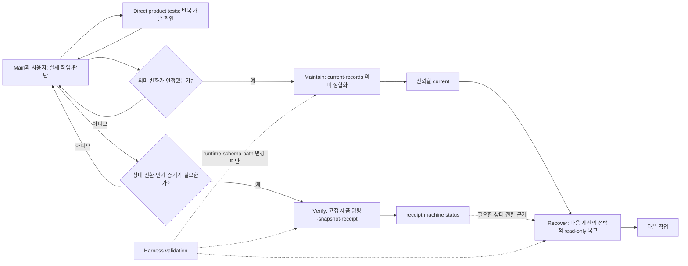

# Harness 운영 지연과 역할 진단

기록일: `2026-08-17`

## 이 작업을 시작한 발화

사용자는 다음 문제 제기로 기존 skill 구현과 다른 새 작업을 열었다.

> 근데 중요한건 그전에 수정 작업들보면 30분 26분 이렇게 오래걸리던데 이유가 뭐야?
>
> 일부러 병목개선까지도 작업했었는데 계속 이러네

이후 질문은 “Recover·Verify·Maintain 같은 Harness 운영 때문인가”, “각 주체가 구체적으로 무엇을 하는가”, “flake가 무엇인가”, “Maintain과 records는 왜 오래 걸리는가”, “Verify는 왜 오래 걸리는가”로 이어졌다.

이 기록은 그 진단을 보존한다. Workspace 004의 Reference 구현과 skill 간소화 내용을 다시 소유하지 않는다. 직전 skill 변경은 commit `f082035`에 보존됐다.

## 한 문장 결론

30분·26분의 주원인은 Recover·Verify wrapper의 실행 시간이 아니라, 큰 이식 작업 뒤 두 Workspace를 넓게 의미 정합화한 Maintain, 동일 제품 검증의 main 재실행, independent review, timing test 재실행이 한 turn에 연쇄된 것이다.

## 주체별 실제 책임

Maintain과 Verify는 고정된 선후 단계가 아니다. 의미가 바뀌었으면 Maintain이, 상태 전환 증거가 필요하면 Verify가 각각 활성화되며 둘 중 하나만 실행될 수도 있다. 다음 세션에서는 신뢰할 current가 Recover의 기본 입력이고, 필요한 경우 Verify receipt가 그 상태 전환 근거로 함께 들어온다.

### Main과 work

실제 코드·문서 변경, 사용자와의 판단, 반복 제품 test를 소유한다. Direct test 통과는 현재 변경의 빠른 피드백이지 durable handoff receipt가 아니다.

### Recover

명시한 Workspace의 selected current·output·Project context를 읽고 마지막 Verify receipt snapshot의 freshness를 확인해 bounded packet을 만든다. Read-only다. 문서의 의미가 맞는지 판단하거나 `current/records`를 고치지 않는다.

따라서 Recover가 빠르고 정확해도 입력인 current가 stale하면 stale 상태를 정확하게 다음 세션에 전달한다.

### Verify

사용자가 확인하려는 claim, canonical basis, 고정 제품 argv와 evidence path를 묶는다. 실행 전 입력을 hash하고 제품 명령을 실행한 뒤 append-only receipt와 machine status를 쓴다.

Verify가 하지 않는 일은 다음과 같다.

- 코드 변경과 context 문서의 의미가 맞는지 해석
- `current/records` 갱신
- 어떤 제품 test를 새로 만들어야 하는지 소유
- 사람 acceptance나 Workspace completion 선언

Verify wrapper는 짧아도 argv가 `pnpm exec turbo run typecheck test build --force`처럼 큰 task graph면 전체 Verify는 그 제품 명령만큼 오래 걸린다.

### Maintain

실제 파일·Git diff·test 결과·사용자 정정과 Context Owner를 대조해 `README/current/output/records`를 의미적으로 갱신한다. 현재 outer maintainer는 전용 Python CLI가 아니라 LLM agent다. 파일 write 자체보다 무엇을 current에 남기고 무엇을 history로 내릴지 판단하는 시간이 크다.

### Harness validation

Recover·Verify 구현, schema, path traversal 방어, timeout과 ephemeral cycle 같은 Harness 자체 계약의 회귀를 검사한다. 제품 변경마다 실행하는 workflow 단계가 아니다.

### Handoff

별도 만능 주체가 아니라 `Maintain으로 믿을 수 있게 만든 current + 필요할 때 Verify receipt + 다음 세션 Recover`가 함께 만든 결과다.

## 관찰한 시간 근거

### Repository에 남은 실행 근거

- 초기 병목 record에서 Reference 40개 test는 약 4초, skill helper 7개는 Python 버전별 약 2초였다. 당시 작업은 58개 파일과 receipt 10개 이동, 순차 Maintain과 review까지 포함했다. 근거: [Workspace 004 최초 문제 frame](../../004-harness-maintenance-bottleneck/records/2026-08-14-01-workspace-creation-and-problem-frame.md)
- Reference 구현 review에서는 51개 test가 4.602초에 통과했다. 근거: [Recover·Verify 구현과 검증](../../004-harness-maintenance-bottleneck/records/2026-08-14-05-reference-recover-verify-implementation-and-verification.md)
- 최신 checked-in sample Verify receipt는 `2026-08-14T10:37:03.029Z`에 시작해 `.075Z`에 끝났다. 제품 unittest 7개를 포함한 약 46ms 사건이다. 근거: [Verify receipt](../../../../reference-project/context/work/workspaces/001-default-timeout/records/receipts/verify/verify-20260814T103703075846Z-a1cde45907164974a19c22564a956127.json)
- Skill 문서 변경 때 Reference 전체 suite는 53개 중 timing test 한 건이 첫 실행에서 실패했고, isolated 5/5와 재실행 53/53이 통과했다. 근거: [Skill 간소화와 검증](../../004-harness-maintenance-bottleneck/records/2026-08-14-08-apply-context-harness-simplification-and-verification.md)

### 이번 대화의 task telemetry

아래 값은 maintainer subtask의 실행 metadata에서 확인한 wall time이다. Repository 명령으로 다시 생성한 benchmark가 아니므로 당시 운영 관찰로만 사용한다.

- V2 Maintain: Workspace 002 약 6분 58초, 이어서 Workspace 004 약 3분 23초. 중간 간격까지 포함한 순차 tail은 약 11분 11초였다.
- V3 Maintain: Workspace 002 약 3분 40초, Workspace 004 약 4분 06초. 병렬 wall tail은 약 4분 17초였다.
- 마지막 “테스트 말고 수정만” 정정: Workspace 002 약 1분 59초, Workspace 004 약 2분 39초. 병렬 wall tail은 약 2분 46초였다.

이 값은 records append가 디스크에서 느렸다는 뜻이 아니다. Maintainer가 여러 Owner 문서를 읽고 002와 004에 같은 사건의 상세·요약을 각각 재구성한 비용이다.

## 왜 병목 개선 뒤에도 길었는가

Workspace 004의 Reference 책임 재배치는 다음 결합을 줄였다.

- Recover에 explicit Workspace를 주어 global index 의존 제거
- checked-in 제품 상태를 바꾸지 않는 ephemeral Harness validation
- Recover·Maintain·Verify의 책임 분리
- Maintain adapter와 계약의 배치 정리

Skill 간소화는 Reference exact schema·status·내부 topology를 이식 절차에 다시 적는 중복을 줄였다.

그러나 둘 다 다음 비용을 자동으로 없애지는 않았다.

- 새 target에 55개 안팎의 context+harness 파일을 구성하는 실제 이식
- Terra와 main이 같은 full Harness·Product test를 각각 실행
- 같은 사건 뒤 Workspace 002 상세와 Workspace 004 일반 결론을 여러 차례 갱신
- semantic defect가 발견될 때마다 v2, v3와 correction을 다시 정합화
- independent review 대기와 결과 반영
- timing flake 뒤 isolated·full rerun

즉 구현 내부의 결합은 줄었지만, 이번 평가 workflow가 넓고 반복적이었다.

## Flaky timing test

Flaky test는 코드가 같아도 process scheduling이나 timing에 따라 간헐적으로 성공·실패하는 test다. 문제 test는 shell child가 descendant PID 파일을 쓰는 시점, 0.3초 Verify timeout, process disappearance 확인 사이의 순서를 가정한다. 일부 full run에서는 PID 파일이 생기기 전에 timeout 경로가 끝나 assertion이 실패했고, 같은 test를 단독 실행하면 통과했다.

이것은 실제 synchronization 결함이므로 별도 수정 후보지만 한 번의 실패와 재실행은 수초 수준이다. 20~30분의 근본 원인으로 해석하지 않는다.

## 현재 운영 가설

- 반복 개발: direct product test만 실행
- 상태 전환·다음 세션 인계: 필요한 claim에 한해 durable Verify 한 번
- 의미 변화가 안정된 자연스러운 경계: 바뀐 Owner만 Maintain
- schema·runtime·routing·path safety 변경: 영향 범위부터 Harness validation
- Main 재실행: receipt와 semantic diff가 모순되거나 독립 확인 가치가 있을 때만
- 여러 Workspace 기록: 상세 사건 Owner 한 곳, 다른 Workspace에는 결론과 링크만

이 운영 가설은 진단 결과이며 background 실행 계약으로 구현되지 않았다. 다음 설계 판단은 [context continuity framing](2026-08-17-02-context-continuity-and-background-maintenance-framing.md)에서 이어 간다.
