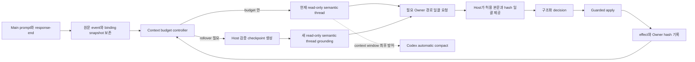

# Maintain context 개선 설계와 검증 계획

날짜: `2026-09-15`

상태: **구현 전 선택 설계**

## 설계 목표

Maintain의 핵심은 매번 처음부터 문서를 요약하는 것이 아니라, 같은 Workspace에서 앞선 선택과 열린 문제를 이해한 상태로 다음 대화를 판별하는 것이다. 이 목적은 유지한다. 바꾸는 것은 그 이해의 운반 수단이다. 전체 Codex transcript 대신 Workspace 정본, 실제 적용 effect와 host가 검증한 semantic checkpoint를 다음 thread의 bounded bootstrap으로 사용한다.

## 구조

원문 event는 비용 최적화 대상이 아니다. `Context budget controller`는 원문을 버리지 않고, 현재 semantic thread를 계속 resume할지 checkpoint로 새 thread를 시작할지만 결정한다. 모델은 계속 read-only이고 실제 write는 기존 Guard가 맡는다.

## Semantic checkpoint

Checkpoint는 자유 형식 요약 하나로 만들지 않는다. 다음 두 층을 결합한다.

### Host가 직접 확정하는 값

- Workspace ID와 binding generation
- grounding source 식별자와 hash
- 마지막 포함 event sequence와 다음 미처리 sequence
- 적용 완료 effect ID, decision 종류와 대상 Owner
- 적용 전후 Owner hash
- unresolved·failed event ID와 failure 단계
- 생성 이유: event count, 누적 context 추정, 명시적 re-grounding 등

### 모델이 의미로 정리하는 값

- 현재 목표와 성공 기준
- 유지해야 할 결정, 조건과 provenance 강도
- 아직 열린 ambiguity와 사용자 판단이 필요한 질문
- 최근 진행 상태와 다음 대화에서 구별해야 할 핵심
- 관련 Owner 경로와 각 Owner가 소유하는 의미

Host 값은 runtime·실제 파일과 대조하고, 모델 의미는 bounded schema와 크기 제한을 둔다. 새 thread는 checkpoint만 믿지 않고 현재 Workspace Owner의 hash가 맞는지 확인한 뒤 grounding을 commit한다. 실패하면 기존 binding을 유지하고 새 thread로 전환했다고 기록하지 않는다.

## 한 response-end의 처리 상한

현재 semantic runner가 관련 파일을 하나씩 탐색하면 한 event 안에서도 모델 cycle과 transcript가 늘어난다. 이를 두 단계로 제한하는 방향을 먼저 시험한다.

1. 첫 model cycle은 decision에 필요한 Owner 경로와 범위를 한꺼번에 요청한다.
2. Host는 allowlist·symlink·Workspace containment를 확인한 뒤 본문과 hash를 한 번에 제공한다.
3. 두 번째 model cycle은 최종 `no_change`, `updated`, `needs_user_decision` 또는 새 `needs_context`를 반환한다.
4. 추가 탐색이 필요하면 계속 호출하지 않고 원문 event와 부족한 이유를 pending으로 보존한다.

`2 model cycle`은 첫 구현값이다. 품질을 낮추기 위한 hard cutoff가 아니라 탐색의 무제한 증식을 실패로 드러내는 경계다. 기존 decision schema에 `needs_context`를 추가할지 별도 worker 상태로 둘지는 현재 코드 대조 뒤 결정한다.

## Instruction isolation

Semantic runner에 필요한 입력은 role 계약, bounded bootstrap 또는 checkpoint, 이번 prompt·Main response, 관련 Owner 본문이다. 일반 대화용 personality, 전체 skill catalog, collaboration 설명, 사용하지 않는 tool·plugin 설명은 의미 판단의 근거가 아니다.

구현에서는 다음을 독립적으로 측정한다.

- global·project instruction discovery를 끈 전용 실행 profile이 가능한지
- hook, skill discovery, collaboration과 사용하지 않는 도구를 제거한 실제 instruction bytes와 hash
- 첫 grounding, warm resume, rollover grounding 각각의 raw·cached·uncached token
- 사건 payload와 고정 instruction의 크기 분리

격리가 host 계약상 불가능한 부분은 제거됐다고 주장하지 않고 receipt에 남긴다.

## Rollover 정책

초기 후보는 누적 input context 64k 또는 response-end 8회 중 먼저 도달한 때다. 최근 generation이 4번의 판단만으로 단일 처리 입력 17만 token 수준까지 커지고, automatic compact가 24만 token대에서 발생한 관찰을 바탕으로 한 시험값이다.

채택 기준은 숫자를 맞추는 것이 아니라 다음 세 가지다.

- rollover 뒤 판단 품질과 provenance가 warm thread baseline에서 허용 가능한가
- compact까지 기다리는 것보다 총 uncached input과 모델 cycle이 실제로 줄었는가
- thread 교체 실패·중복 effect·Workspace 오귀속 없이 복구 가능한가

Automatic compact는 끄지 않는다. 명시적 rollover가 실패하거나 예상 밖 긴 context가 생길 때 host 자체의 마지막 capacity 보호로 남긴다.

## 두 대상 적용 순서

1. **Baseline 고정:** Reference와 Noline의 현재 code·설정 차이, 기존 effect corpus와 token receipt를 고정한다.
2. **Reference 구현:** usage receipt, instruction isolation, batched Owner read와 cycle 상한을 작은 세로 slice로 구현한다.
3. **Reference rollover:** checkpoint schema, 생성·검증·thread 교체·실패 복구를 구현한다.
4. **Replay 비교:** 기존 warm thread, automatic compact 발생 구간, 새 rollover를 같은 사건 순서로 비교한다.
5. **Noline 적용:** 검증된 Source 판본을 Noline의 Claude hook, 기존 binding과 application Workspace를 보존해 적응한다.
6. **Target acceptance:** Noline 단위 검사와 실제 host event를 별도로 확인한다. Source 결과만으로 target 완료를 주장하지 않는다.

Reference와 Noline 파일을 동시에 직접 수정하지 않는다. 먼저 공통 책임을 Source에서 검증한 뒤 이식 판본과 target-specific diff를 남긴다.

## Acceptance

### 의미와 안전

- 선택한 replay에서 기존 decision 종류, 변경 Owner, 조건·provenance가 비교 가능하다.
- 차이가 생기면 token 절감만으로 새 결과를 채택하지 않고 원래 Workspace 의미에 더 맞는지 표본 검토한다.
- 잘못된 write, Workspace 오귀속, ambiguity 누락은 0건이다.
- raw prompt·response, event sequence, checkpoint가 포함한 마지막 경계를 재현할 수 있다.
- rollover 실패, `needs_context`, budget defer를 `no_change`나 성공으로 기록하지 않는다.

### 비용과 관찰 가능성

- response-end당 model cycle은 초기 상한 2회 안에 있거나 명시적 pending 상태가 된다.
- instruction isolation 전후 첫 grounding의 uncached input을 같은 payload로 비교한다.
- rollover 전후 session 누적 raw·cached·uncached input, output, reasoning과 tool output bytes를 비교한다.
- 첫 비용 목표는 구조 적용 뒤 한 response-end의 단일 처리 입력을 64k 안쪽으로 만드는 것이다. Host 고정 instruction만으로 불가능하면 실제 구성비를 근거로 목표를 다시 정한다.

### 호환과 제거 가능성

- 기존 explicit activation, generation binding, response pairing, guarded apply와 notice 의미를 보존한다.
- checkpoint·budget controller를 제거해도 Workspace Context와 기존 Guard의 의미가 사라지지 않는다.
- Noline 고유 hook과 evidence 연결을 Reference에 제품 계약처럼 역수입하지 않는다.

## 이번 단계에서 하지 않는 것

- Workspace 013 활성화
- Reference·Noline 코드 또는 설정 변경
- 기존 runtime 삭제·압축·migration
- AI-native moment reviewer 또는 evidence collector 재활성화·중단
- reasoning effort 변경
- token 절감 수치의 사전 보장

Evidence collector의 checkpoint capture와 model interpretation 분리도 타당한 후속 개선이지만, Maintain의 두 구현을 함께 고치는 이번 기본 범위와는 분리한다. 필요하면 이 Workspace에서 별도 target으로 자동 포함하지 않고 책임 경계를 먼저 갱신한다.
