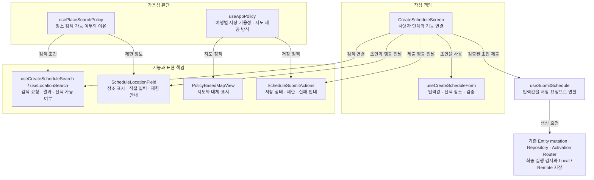

# 보존된 대화

마지막 사용자 발화가 응답할 요청이다. 아래는 당시 보고·설명이며 현재 제품 상태를 새로 확인한 결과가 아니다.

## assistant · source_line 2436

스타일 중복을 줄이려다 불필요하게 추출했습니다. `inputClassName`은 제거하고 각 JSX에 직접 적었습니다. **단순 반복보다 의미 있는 책임 분리를 기준으로 삼겠습니다.**

일정 추가 구현과 검증도 마쳤습니다.

- 검색 먼저 시작하며, 검색·직접 입력 사이에서 초안을 유지합니다.
- 독립 검증·품질 리뷰의 지적 3건을 수정했습니다.
- 전체 **423개 테스트 통과**. 시뮬레이터에서 실제 검색·장소 선택 후 제목과 날짜 유지를 확인했습니다.
- 네트워크 전환은 자동 테스트로 검증했습니다. 기존 지도 타입 오류 3건은 남아 있습니다.

시뮬레이터에는 [장소 선택 후 입력 화면](/Users/hammyeong-yeon/Desktop/10_work/noline/artifacts/ticket-06-simulator/create-schedule-20261001-final/02-selected-place-draft.jpg)을 열어뒀습니다. 저장은 누르지 않았습니다.

## user · source_line 2446

결과물 잘 설명해봐 [$work-artifact-briefing](/Users/hammyeong-yeon/Desktop/10_work/noline/.claude/skills/work-artifact-briefing/SKILL.md)  도식화 할거 해서


## assistant · source_line 2450

`work-artifact-briefing` 기준으로 현재 코드와 이전 코드를 대조하겠습니다. 화면에서 무엇이 달라졌는지, 정책·초안·검색·저장이 각각 어디까지 책임지는지 도식과 실제 확인한 화면을 연결해 설명하겠습니다.


## user · source_line 2461

멘탈모델이랑 각 코드는 동작 보다 근본역할먼저 신경써서 설명해줘


## assistant · source_line 2466

실행 순서보다 **각 코드가 무엇을 결정할 권한을 갖고, 무엇은 다른 코드에 맡기는지**부터 설명하겠습니다. 그 책임 구조를 먼저 도식으로 잡고, 네트워크가 바뀌는 사례를 대입해 보겠습니다.


## assistant · source_line 2492

이번 결과물의 핵심은 **“사용자가 작성하는 내용”, “지금 사용할 수 있는 기능”, “실제로 저장할 수 있는 조건”을 서로 다른 책임으로 다루는 것**입니다. 일정 추가 화면에 이 구분을 적용했습니다. 현재 작업 트리 기준이며, 경비와 일정 수정 화면까지 확대한 상태는 아닙니다.

먼저 멘탈모델부터 잡으면 이렇습니다.

| 구분 | 근본적으로 답하는 질문 | 바뀌는 계기 |
|---|---|---|
| **작성 상태** | 사용자가 무엇을 작성했고, 지금 어떤 단계를 보고 있는가? | 입력·장소 선택·직접 입력·돌아가기 |
| **기능의 가용성** | 지금 검색·지도·저장을 이용할 수 있는가? 제한 이유는 무엇인가? | 네트워크·인증·여행 활성 상태 |
| **영역의 표현** | 가능한 기능과 제한을 이 영역 안에서 어떻게 보여줄 것인가? | 작성 상태와 가용성을 함께 받아 표현 |
| **데이터 실행** | 이 저장 요청을 지금 실행해도 되는가? 어디에 저장하는가? | 저장을 누른 시점의 실제 조건 |

**네트워크가 바뀌면 두 번째가 바뀝니다. 그것만으로 첫 번째를 바꿀 이유는 없습니다.** 이전에는 이 경계가 섞여 있어서, 검색이 안 된다는 이유로 다른 폼을 끼워 넣거나 화면 전체를 제한 안내로 바꿨습니다.

아래는 현재 코드에서 재구성한 책임 관계입니다. 실행 순서도가 아니라 **어떤 코드가 어떤 판단을 소유하는지** 보여주는 그림입니다.



### 각 코드의 근본 역할

**1. 화면은 ‘작성 과정의 연결’을 맡습니다.**

[CreateScheduleScreen](/Users/hammyeong-yeon/Desktop/10_work/noline/apps/client/src/screens/CreateScheduleScreen.tsx:23)은 검색 화면을 볼지, 입력 폼을 볼지, 작성 중 장소를 바꾸러 갈지를 소유합니다.

```ts
const [step, setStep] =
  useState<'search' | 'form' | 'change-place'>('search');
```

이 값은 사용자 행동으로 바뀝니다. 정책 값으로부터 매번 계산하지 않습니다.

장소를 선택하면 초안에 반영하고 폼으로 이동하는 식의 **작은 연결**은 화면의 책임입니다. 검색 요청의 세부 처리나 저장 데이터 변환까지 화면이 맡지는 않습니다. 별도의 거대한 workflow 훅도 만들지 않았습니다.

**2. 초안 훅은 ‘사용자가 만들고 있는 일정’을 소유합니다.**

[useCreateScheduleForm](/Users/hammyeong-yeon/Desktop/10_work/noline/apps/client/src/features/schedule/create-schedule/useCreateScheduleForm.ts:8)이 제목·장소·주소·날짜·시간, 선택한 장소의 좌표, 입력 검증을 관리합니다. 날짜·시간 선택창의 열림 상태도 현재 이 훅에 있습니다.

여기서 중요한 건 필드 목록보다 **값 사이의 관계**입니다.

- 새 장소를 선택해도 사용자가 직접 바꾼 제목은 덮지 않습니다.
- 장소를 직접 수정하면 기존 검색 장소의 좌표 연결을 해제합니다. 다른 이름에 이전 좌표가 붙는 것을 막습니다.
- 검색 화면에 다녀와도 같은 초안을 사용합니다.
- 네트워크 상태를 읽지 않으므로 연결 변화가 초안 초기화 조건이 되지 않습니다.

즉, 검색 결과는 초안에 들어올 수 있는 입력 재료이고, **선택이 끝난 장소는 초안의 일부**입니다. 검색 기능이 나중에 막혔다고 이미 선택한 장소까지 무효가 되지는 않습니다.

**3. 정책은 ‘지금 가능한 것과 이유’를 알려줍니다.**

여기에는 서로 다른 질문이 있습니다.

- [useAppPolicy](/Users/hammyeong-yeon/Desktop/10_work/noline/apps/client/src/shared/policy/useAppPolicy.ts:23): 이 여행에 일정을 저장할 수 있는가? 어떤 지도 방식을 사용하는가?
- [usePlaceSearchPolicy](/Users/hammyeong-yeon/Desktop/10_work/noline/apps/client/src/shared/policy/place-search.ts): 외부 장소 검색을 지금 요청할 수 있는가?

장소 검색은 여행 데이터의 Local/Remote 소유권과 다른 외부 서비스이므로 따로 판단합니다. 활성 여행이라도 인터넷이 없으면 검색은 못 하지만, 일정은 Local에 저장할 수 있습니다.

**`mode`를 소비하는 기준도 여기서 달라졌습니다.** 기존 정책의 `manual-only` 값 자체를 없애지는 않았지만, 새 일정 화면은 그 값으로 폼이나 단계를 선택하지 않습니다.

```tsx
// 이전 소비 방식
mode === 'manual-only' && <ManualScheduleForm />

// 현재 소비 방식
// 사용자 단계에 따라 하나의 ScheduleForm을 사용하고,
// 검색 가능 여부는 장소 검색 기능에만 적용
```

따라서 오프라인이 됐다는 이유로 선택한 장소를 지우거나 수동 입력 폼을 추가하지 않습니다.

**4. 검색 훅은 ‘외부에서 장소 후보를 얻는 과정’을 맡습니다.**

[useLocationSearch](/Users/hammyeong-yeon/Desktop/10_work/noline/apps/client/src/features/schedule/create-schedule/useLocationSearch.ts)는 검색어·요청·결과·오류·캐시를 다룹니다.

[useCreateScheduleSearch](/Users/hammyeong-yeon/Desktop/10_work/noline/apps/client/src/features/schedule/create-schedule/useCreateScheduleSearch.ts:5)는 여기에 **일정 작성에서 필요한 사용 조건**을 연결합니다. 검색 단계인지, 현재 정책이 허용하는지, 지금 결과를 선택해도 되는지를 다룹니다.

이 둘을 나눈 이유는 기존 일정 수정에서도 검색 훅을 사용하기 때문입니다. 이번 생성 화면에 필요한 엄격한 장소 상세 조회와 캐시 구분을 기존 소비자 전체에 강제로 적용하지 않았습니다.

또한 **지도에 표시할 위치와 지금 선택할 수 있는 검색 결과를 구분**했습니다. 연결이 끊어졌다고 지도에 전달한 위치를 일괄 지우지는 않지만, 검색 결과 선택은 제한합니다.

**5. 영역 컴포넌트는 ‘자기 영역을 이해 가능한 상태로 보여주는 것’을 맡습니다.**

사용자가 지적했던 `policyError`의 책임은 이 부분에 반영했습니다.

[ScheduleLocationField](/Users/hammyeong-yeon/Desktop/10_work/noline/apps/client/src/features/schedule/create-schedule/ScheduleLocationField.tsx:20)는 `searchAccess`를 속성으로 받습니다. 이 컴포넌트가 장소를 보여주고, 검색 버튼을 제한하고, **장소 영역 안에 제한 이유를 표시**합니다. 상위 화면이 갑자기 전체 폼 대신 오류 컴포넌트를 삽입하지 않습니다.

[ScheduleSubmitActions](/Users/hammyeong-yeon/Desktop/10_work/noline/apps/client/src/features/schedule/create-schedule/ScheduleSubmitActions.tsx:15)는 저장 주변의 표현을 맡습니다. 현재 정책 제한과 마지막 저장 실패를 구분해서 보여줍니다.

`PolicyErrorDisplay`는 계속 사용하지만, 이제 이 화면에서는 **영역 컴포넌트가 사용하는 공통 안내 표현**으로 배치했습니다.

지도는 조금 다릅니다. 기존 [PolicyBasedMapView](/Users/hammyeong-yeon/Desktop/10_work/noline/apps/client/src/shared/components/PolicyBasedMapView/PolicyBasedMapView.tsx:56)가 내부에서 지도 정책을 읽고 제공자·대체 표시를 결정하는 구조를 유지했습니다. 이번에는 검색 제한과 독립적으로 지도 영역을 구성하고 빈 상태 문구를 전달했으며, 지도까지 모든 정책을 속성으로 받는 구조로 전면 개편하지는 않았습니다.

**6. 제출 훅과 데이터 계층은 서로 다른 종류의 저장 책임을 맡습니다.**

[useSubmitSchedule](/Users/hammyeong-yeon/Desktop/10_work/noline/apps/client/src/features/schedule/create-schedule/useSubmitSchedule.ts:12)은 **작성한 값을 일정 생성 요청으로 바꾸는 책임**입니다. ID 생성, 날짜·시간 변환, 좌표 전달, mutation 상태와 오류 연결을 담당합니다.

실제 저장 권한과 위치는 기존 데이터 계층에 남았습니다.

```text
useSubmitSchedule
  → useCreateSchedule: 생성 mutation과 성공 후 캐시 무효화
  → ScheduleRepository: 실제 저장 구현 연결
  → Activation Router: 실행 조건 검사, Local/Remote 선택
```

[Activation Router](/Users/hammyeong-yeon/Desktop/10_work/noline/apps/client/src/shared/services/offline-prep/router.ts:75)는 실행 시점에 다시 확인합니다. 활성 여행은 Local, 비활성 여행은 실제 온라인과 유효한 서버 인증이 있어야 Remote로 저장합니다.

화면에 표시한 정책은 안내이고, Router는 실제 실행 경계입니다. 그 사이에 연결이나 인증 상태가 바뀔 수 있으므로 두 책임 모두 필요합니다.

### 그러면 어디를 막는가?

현재 구현을 대표 상황에 대입하면 다음과 같습니다. 정상 계정 상태이며 네트워크 강제 설정이 없는 조건입니다.

| 상황 | 작성 화면·초안 | 검색 | 저장 |
|---|---|---|---|
| 활성 여행 작성 중 오프라인 | 같은 폼·입력·선택 장소 유지 | 제한 | Local 저장 가능 |
| 비활성 여행 작성 중 오프라인/unknown | 같은 폼에서 편집 지속 | 제한 | 제한 안내, Router가 실행 거부 |
| 다시 온라인 | 현재 작성 단계 유지 | 다시 사용 가능 | 현재 인증·여행 조건에 따라 실행 |
| 장소 검색 실패 | 직접 입력으로 계속 작성 가능 | 오류·재시도 제공 | 검색 실패만으로 차단하지 않음 |

**최초 진입 여부를 기억하는 별도 상태는 없습니다.** 일반 목록의 추가 버튼에서 생성 정책을 확인하고, 이미 열린 작성 화면에서는 개별 기능과 저장을 통제합니다. 유효한 여행의 직접 경로 진입으로 폼이 열려도 저장 권한이 생기는 것은 아닙니다.

현재 저장 버튼은 정책 제한만으로 비활성화하지 않습니다. 제한 이유를 표시하고, 누르면 입력 검증을 거쳐 Router가 거부합니다. 버튼 비활성화는 제출 중에 적용됩니다. 이것이 현재 구현의 정확한 동작입니다.

### 실제 결과와 남은 경계

시뮬레이터에서는 **직접 제목 입력 → 장소 검색 → Eiffel Tower 선택 → 기존 제목과 날짜 유지**를 확인했습니다. [확인한 입력 화면](/Users/hammyeong-yeon/Desktop/10_work/noline/artifacts/ticket-06-simulator/create-schedule-20261001-final/02-selected-place-draft.jpg)에서 그 결과를 볼 수 있습니다.

네트워크 변화·저장 제한·검색 복구 등은 관련 17개 자동 테스트로 확인했고, 전체 423개 테스트도 통과했습니다. 실제 기기에서 네트워크를 전환하거나 저장까지 수행한 근거는 아닙니다.

구조적으로 남은 부분도 있습니다. 제출 훅에는 기존 **저장 성공 후 경로 자동 다운로드 연결**이 아직 포함돼 있고, 지도 내부의 오프라인 준비·오류 표현도 이번에 전부 정리한 것은 아닙니다. 기존 지도 타입 오류 3건도 남았습니다.

이번에 성립시킨 기준은 **사용자의 작성 과정은 유지하면서, 사용할 수 없는 기능과 실제 저장만 해당 책임 위치에서 통제한다**는 것입니다. 그 기준을 일정 추가에 적용한 결과이며, 앱 전체가 같은 구조로 통일됐다는 뜻은 아닙니다.

## user · source_line 2499

도표가 너무 책임 영역으로 나뉘었는데 화면이랑 로직들 흐름아까 고려해서 설명해줘 단 여기에 구체적 코드 같이 끼워주고
