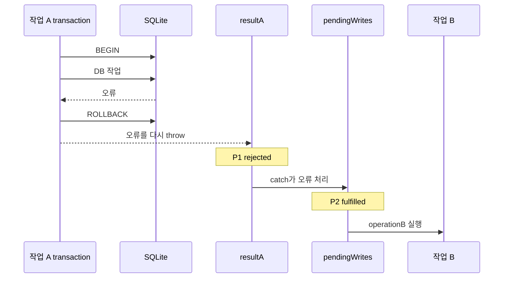

# 보존된 대화

마지막 사용자 발화가 응답할 요청이다. 아래는 당시 보고·설명이며 현재 제품 상태를 새로 확인한 결과가 아니다.

## user · source_line 3471

serializeWrite 이거 더 설명하자면 그러니까 operation이 pendingdp 에 프로미스로 묶이고 그게 result로 들어가고 근데 그게 다시 할당... 이해가 아직 안가는데?


## assistant · source_line 3476

앞 설명에서 `result`와 `pendingWrites`가 왜 서로 다른 Promise를 가리키는지 연결이 빠졌습니다. 이번에는 `explanation-recovery` 기준으로, 작업 하나가 들어올 때 변수 두 개가 각각 무엇을 가리키게 되는지만 단계별로 복구해서 설명하겠습니다.

## assistant · source_line 3487

헷갈린 지점은 **`pendingWrites`에 `result`가 다시 들어가는 것처럼 보이는 부분**입니다. 실제로는 Promise를 자기 자신에 넣는 게 아닙니다. `pendingWrites`라는 변수가 **대기열의 마지막 Promise를 새 Promise로 바꿔 가리키는 것**입니다.

우선 `catch`를 제외하고 보면 더 분명합니다.

```ts
let pendingWrites = Promise.resolve();

function serializeWrite(operation) {
  const result = pendingWrites.then(() => operation());
  pendingWrites = result;
  return result;
}
```

작업 A가 처음 들어오는 순간을 Promise에 번호를 붙여 펼쳐보겠습니다.

### 1. 최초 상태

```ts
let pendingWrites = Promise.resolve();
```

여기서 완료된 Promise를 `P0`라고 하겠습니다.

```text
pendingWrites ──> P0
                 이미 완료됨
```

### 2. 작업 A가 들어옴

```ts
const result = pendingWrites.then(() => operationA());
```

이 코드는 현재 `pendingWrites`가 가리키는 `P0`에 `.then()`을 연결하고, **새 Promise `P1`을 생성**합니다.

```text
pendingWrites ──> P0
                    \
                     └─ P1: P0가 끝나면 operationA 실행

result ───────────> P1
```

이 시점에도 `pendingWrites`는 아직 `P0`를 가리킵니다. `result`만 새 Promise `P1`을 가리킵니다.

`operationA()`가 Promise를 반환하면 `P1`은 그 작업이 끝날 때까지 기다립니다.

```text
P1 완료 시점
= P0 완료
+ operationA 완료
```

### 3. 대기열의 마지막 지점을 갱신

그다음 줄입니다.

```ts
pendingWrites = result;
```

여기서 `pendingWrites`가 가리키는 대상을 `P0`에서 `P1`로 바꿉니다.

```text
변경 전

pendingWrites ──> P0
result ─────────> P1


변경 후

pendingWrites ──> P1
result ─────────> P1
```

Promise 안에 Promise를 다시 넣은 것이 아닙니다. 변수 두 개가 같은 `P1`을 가리키게 된 것입니다.

그리고 함수를 호출한 쪽에도 `P1`을 반환합니다.

```ts
return result;
```

## 이제 작업 B가 들어오면

현재 상태는 다음과 같습니다.

```text
pendingWrites ──> P1
```

여기서 `P1`은 작업 A가 끝나는 시점을 나타냅니다.

작업 B로 `serializeWrite`를 다시 호출하면:

```ts
const result = pendingWrites.then(() => operationB());
```

현재 `pendingWrites`가 가리키는 `P1` 뒤에 작업 B를 연결합니다. 새로운 Promise `P2`가 만들어집니다.

```text
P0
 └─ operationA
     └─ P1
         └─ operationB
             └─ P2
```

변수 상태는 잠시 이렇게 됩니다.

```text
pendingWrites ──> P1
result ─────────> P2
```

이어서 다시 할당합니다.

```ts
pendingWrites = result;
```

그러면:

```text
pendingWrites ──> P2
result ─────────> P2
```

이제 다음 작업 C가 들어오면 `P2` 뒤에 연결됩니다.

즉 호출할 때마다 `pendingWrites`가 가리키는 지점이 이동합니다.

```text
최초: pendingWrites → P0
A 등록: pendingWrites → P1
B 등록: pendingWrites → P2
C 등록: pendingWrites → P3
```

## 실제 코드에는 왜 `catch`가 있는가

실제 코드는 다음과 같습니다.

```ts
function serializeWrite<T>(
  operation: () => T | Promise<T>,
): Promise<T> {
  const result = pendingWrites.then(() => operation());

  pendingWrites = result.catch(() => undefined);

  return result;
}
```

여기서는 작업 A를 등록하면 Promise가 사실 두 개 만들어집니다.

```ts
const result = pendingWrites.then(() => operationA());
```

이것이 `P1`입니다.

```text
P1 = 작업 A의 실제 성공 또는 실패
```

그다음:

```ts
pendingWrites = result.catch(() => undefined);
```

`P1.catch(...)`도 새 Promise를 반환합니다. 그것을 `P2`라고 하겠습니다.

```text
P0
 └─ operationA
     └─ P1: 실제 결과
         └─ catch
             └─ P2: 다음 작업 연결용 결과
```

최종 변수 상태는 이렇습니다.

```text
result ─────────> P1
pendingWrites ──> P2
```

두 Promise의 역할이 다릅니다.

- `P1`, 즉 `result`: 작업 A의 실제 결과
- `P2`, 즉 `pendingWrites`: 다음 작업을 연결할 안전한 마지막 지점

작업 A가 성공하면:

```text
P1 성공
→ P2도 성공
→ 다음 작업 실행
```

작업 A가 실패하면:

```text
P1 실패
→ 호출자는 실패를 받음
→ catch가 오류를 처리
→ P2는 성공 상태가 됨
→ 다음 작업은 계속 실행
```

호출자에게는 `P1`을 반환합니다.

```ts
return result;
```

따라서 호출자는 실제 오류를 받습니다.

```ts
await serializeWrite(operationA);
// operationA가 실패하면 여기서 throw
```

그러나 다음 작업은 `P2` 뒤에 연결됩니다.

```ts
const nextResult =
  pendingWrites.then(() => operationB());
```

`P2`는 실패를 처리한 상태이므로 작업 B가 정상적으로 시작됩니다.

## 두 작업을 실제 코드처럼 펼치면

```ts
// 최초
pendingWrites = P0;

// 작업 A 등록
resultA = P0.then(operationA);          // P1
pendingWrites = resultA.catch(...);     // P2
return resultA;                         // 호출자는 P1을 받음

// 작업 B 등록
resultB = P2.then(operationB);          // P3
pendingWrites = resultB.catch(...);     // P4
return resultB;                         // 호출자는 P3을 받음
```

전체 연결은 다음과 같습니다.

```text
P0
└─ operationA
   └─ P1 실제 결과 A
      └─ catch
         └─ P2 대기열 복구
            └─ operationB
               └─ P3 실제 결과 B
                  └─ catch
                     └─ P4 대기열 복구
```

중요한 것은 `pendingWrites`라는 변수 자체를 나중에 바꿔도, 이미 만들어진 `P1`, `P2`의 관계는 바뀌지 않는다는 점입니다.

```ts
const result = pendingWrites.then(...);
```

이 줄이 실행되는 순간 **그때의 `pendingWrites` Promise에 연결된 새 Promise가 확정**됩니다. 이후 `pendingWrites = ...`는 기존 Promise를 수정하지 않고, 변수가 가리키는 대상을 새 Promise로 옮길 뿐입니다.

## user · source_line 3494

그럼 promise 1 이란게 promise0 에서 then 이 체이닝된 promise1이라는거지?


## assistant · source_line 3497

맞습니다.

```ts
const result = pendingWrites.then(() => operationA());
```

이때:

- `pendingWrites`가 가리키던 기존 Promise가 `P0`
- `P0.then(...)`이 반환하는 새로운 Promise가 `P1`
- `result`가 `P1`을 가리킵니다.

```text
P0
└─ then(() => operationA())
   └─ P1
```

즉 다음 관계입니다.

```ts
const P1 = P0.then(() => operationA());
```

`P1`은 다음 순서를 나타냅니다.

1. `P0`이 끝날 때까지 기다립니다.
2. `operationA()`를 실행합니다.
3. `operationA()`가 Promise를 반환하면 그것까지 기다립니다.
4. 그 성공 또는 실패 결과가 `P1`의 결과가 됩니다.

예를 들어:

```ts
const P0 = Promise.resolve();

const P1 = P0.then(async () => {
  await saveSchedule();
  await addToSyncQueue();
});
```

관계는 다음과 같습니다.

```text
P0 완료
→ saveSchedule 실행 및 완료
→ addToSyncQueue 실행 및 완료
→ P1 완료
```

그래서 `P1`은 단순히 `P0`의 복사본이 아니라, **`P0` 뒤에 새로운 작업을 연결한 전체 실행 결과를 나타내는 새 Promise**입니다.

## user · source_line 3504

// 최초
pendingWrites = P0;

// 작업 A 등록
resultA = P0.then(operationA);          // P1
pendingWrites = resultA.catch(...);     // P2
return resultA;                         // 호출자는 P1을 받음

// 작업 B 등록
resultB = P2.then(operationB);          // P3
pendingWrites = resultB.catch(...);     // P4
return resultB;                         // 호출자는 P3을 받음

이건 이해가 되는데 중간에 에러가 터져도.. 이부분 아직 덜 이해돼


## assistant · source_line 3509

빠진 연결은 이것입니다.

> **실패한 `P1`이 성공으로 바뀌는 게 아니라, `P1`의 실패를 처리한 새로운 Promise `P2`가 성공 상태가 됩니다.**

작업 A에서 오류가 발생했다고 보겠습니다.

```ts
resultA = P0.then(operationA);      // P1
pendingWrites = resultA.catch(
  () => undefined,
);                                 // P2
```

## 1. `operationA`가 실패하면 `P1`이 실패합니다

```ts
function operationA() {
  throw new Error('A 실패');
}
```

그러면:

```text
P0 성공
→ operationA 실행
→ operationA 오류
→ P1 실패
```

```text
P1 상태: rejected
P1 오류: Error("A 실패")
```

따라서 호출자가 반환받은 `resultA`, 즉 `P1`을 기다리면 오류를 받습니다.

```ts
await resultA;
// throw Error("A 실패")
```

## 2. `catch`는 실패한 `P1` 뒤에 새 Promise를 만듭니다

```ts
const P2 = P1.catch(() => undefined);
```

`catch` callback이 오류를 받고, 아무 오류도 다시 던지지 않은 채 `undefined`를 반환합니다.

```ts
() => undefined
```

Promise 규칙상 handler가 정상적으로 값을 반환하면, `catch()`가 만든 새로운 Promise는 성공합니다.

```text
P1 실패
→ catch 실행
→ catch가 undefined를 정상 반환
→ P2 성공
```

따라서 두 Promise의 상태가 달라집니다.

```text
P1: rejected — A 실패
P2: fulfilled — 값은 undefined
```

간단히 직접 쓰면 다음과 같습니다.

```ts
const P1 = Promise.reject(new Error('A 실패'));

const P2 = P1.catch(() => undefined);
```

결과:

```ts
await P1; // 오류 발생
await P2; // 오류 없음, undefined 반환
```

`catch`가 `P1`을 고친 것이 아닙니다. 실패를 처리한 **새 Promise `P2`**를 만든 것입니다.

## 3. 작업 B는 `P1`이 아니라 `P2` 뒤에 연결됩니다

작업 A 등록이 끝난 뒤 `pendingWrites`는 `P2`를 가리킵니다.

```ts
pendingWrites = P2;
```

따라서 작업 B는 이렇게 등록됩니다.

```ts
resultB = P2.then(operationB); // P3
```

`P2`는 성공 상태이므로 `operationB`가 실행됩니다.

```text
P1 실패
→ P2의 catch가 실패 처리
→ P2 성공
→ operationB 실행
→ P3는 B의 실제 결과
```

전체 흐름은 다음과 같습니다.


동시에 호출자 쪽으로는 실패한 `P1`을 그대로 반환합니다.

```text
작업 A 호출자
← P1 실패를 받음

내부 대기열
← P2 성공을 기준으로 다음 작업 진행
```

## transaction에서는 rollback까지 끝난 후 복구됩니다

작업 A가 DB transaction이라고 하면 내부에서는 먼저 다음 과정이 실행됩니다.

```ts
try {
  await operationA();
  db.run(sql.raw('COMMIT'));
} catch (error) {
  db.run(sql.raw('ROLLBACK'));
  throw error;
}
```

순서는 다음과 같습니다.

```text
operationA 실패
→ transaction catch 실행
→ ROLLBACK 실행
→ 오류를 다시 throw
→ resultA, 즉 P1 실패
→ P2의 catch가 그 실패를 처리
→ P2 성공
→ operationB 시작
```

따라서 작업 B는 rollback보다 먼저 실행되지 않습니다.



핵심 코드 한 줄을 풀면 다음 의미입니다.

```ts
pendingWrites = resultA.catch(() => undefined);
```

```text
작업 A의 실패는 호출자에게 그대로 전달한다.
하지만 내부 대기열에서는 그 실패를 처리된 상태로 바꾸고,
rollback이 끝난 다음 작업 B를 계속 실행한다.
```

만약 `catch` 안에서 다시 오류를 던졌다면 `P2`도 실패하고 이후 작업 B는 실행되지 않습니다.

```ts
const P2 = P1.catch((error) => {
  throw error;
});
```

현재 코드는 `undefined`를 정상 반환하기 때문에 다음 작업이 이어질 수 있습니다.

## user · source_line 3516

그러니까 그냥 에러 터지면 뒤에가 다 중단되니까 뒤에 동작들을 계속 연결하기 위해서 catch에 언디파인드를 반환 그래서 그 시리얼라이즈라이트를 받는 런데이터베이스 트랜젝션은 그냥 언디파인드를 반환받고 A에 대해서 에러를 감지한다 터지는게 아니라&#x20;
그래서 그 뒤에 연속으로 오는 B는 무리없이 동작한다 맞을까?


## assistant · source_line 3521

거의 맞습니다. 한 지점만 바로잡으면 됩니다.

**`runDatabaseTransaction`은 `undefined`를 받지 않고 A의 실제 실패 Promise인 `P1`을 받습니다.**  
`undefined`를 받는 쪽은 내부 대기열인 `pendingWrites`뿐입니다.

```ts
function serializeWrite(operation) {
  const result = pendingWrites.then(() => operation()); // P1

  pendingWrites = result.catch(() => undefined);        // P2

  return result;                                        // P1 반환
}
```

작업 A가 실패하면:

```text
P1 = A의 실제 결과
   = rejected, A 오류 보유

P2 = P1.catch(() => undefined)
   = fulfilled, 값은 undefined
```

각각 사용하는 곳이 다릅니다.

```text
runDatabaseTransaction 호출자
← P1을 받음
← A 오류를 정상적으로 감지함

내부 pendingWrites
← P2를 가리킴
← 성공 상태이므로 B를 이어서 실행할 수 있음
```

실제 흐름은 다음과 같습니다.

```ts
const transactionA = runDatabaseTransaction(operationA);
// transactionA는 P1

const operationB = runDatabaseOperation(operationB);
// B는 P2 뒤에 연결
```

A가 실패하면:

```text
A 실패
→ ROLLBACK
→ P1 실패
→ transactionA를 await한 호출자에게 오류 발생

동시에

P1 실패
→ 내부 catch가 undefined 반환
→ P2 성공
→ P2 뒤에 연결된 B 실행
```

따라서 정확히 말하면:

> A의 오류는 외부 호출자에게 그대로 전달된다. 내부 DB 작업 연결에서는 그 오류를 처리한 `P2`를 별도로 만들어, A의 rollback이 끝난 뒤 B가 계속 실행되게 한다.

`runDatabaseTransaction`이 오류를 감지하지 못하는 구조가 아닙니다. 호출자는 오류를 받고, 내부 대기열만 다음 작업을 위해 정상 상태로 복구됩니다.

## user · source_line 3528

그럼 저기 p2가 이어서 된다는것까지는 이해됐는데 그럼 왜 에러가안터지고 이어진다는 말이 살짝 이해가 안돼 코드적으로 catch가 음p2가 p1의 에러를 undeinfed? 헤깔리네
