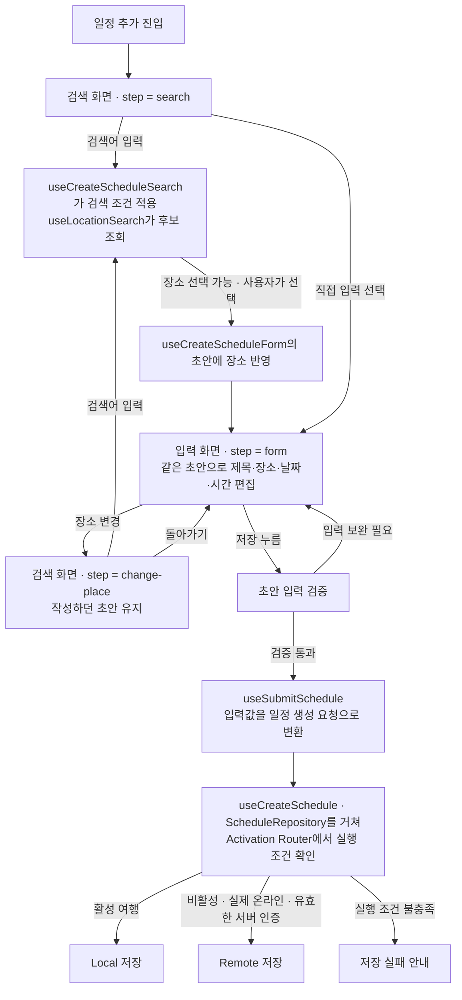

**화면 흐름의 중심은 “검색으로 장소를 고르고, 같은 초안을 편집하다가, 필요하면 장소만 다시 고른 뒤 저장한다”입니다.** `CreateScheduleScreen`은 이 작성 과정을 연결하고, 검색·초안·제출 코드는 각 단계에서 필요한 일을 맡습니다. 네트워크 변화는 이 과정 중 검색이나 저장의 가능 여부를 바꿉니다.

아래는 앞서 보존된 설명과 코드 발췌로 재구성한 흐름입니다. 현재 제품을 새로 실행해 확인한 그림은 아닙니다. 코드도 **보존된 실제 발췌**와 **연결을 설명하기 위한 의사코드**를 구분하겠습니다.



화살표는 사용자 행동과 그에 따른 처리 흐름입니다. 지도 표시와 저장 성공 이후의 처리는 이 그림에서 생략했습니다. 저장 분기는 앞선 설명의 정상 계정·네트워크 강제 설정 없음 조건을 전제로 합니다.

**처음 검색 화면이 열리는 이유부터 보면, 화면 단계와 입력값이 따로 있습니다.**

[CreateScheduleScreen.tsx:23](/Users/hammyeong-yeon/Desktop/10_work/noline/apps/client/src/screens/CreateScheduleScreen.tsx:23)에 대해 보존된 실제 발췌는 다음입니다.

```tsx
const [step, setStep] =
  useState<'search' | 'form' | 'change-place'>('search');
```

`step`은 **사용자가 작성 과정의 어디에 있는지**를 나타냅니다. 첫 값이 `search`이므로 검색부터 시작하고, `form`은 입력 화면, `change-place`는 작성 중 장소를 바꾸는 검색 단계입니다. 반면 제목·날짜·선택 장소는 `useCreateScheduleForm`이 맡습니다. 화면을 바꿔 보는 것과 작성 내용을 바꾸는 것을 구별할 수 있는 구조입니다.

검색어를 입력하면 `useCreateScheduleSearch`가 지금 검색 단계인지와 검색 정책이 허용하는지를 연결하고, `useLocationSearch`가 요청·결과·오류·캐시를 처리합니다. 즉 검색 코드는 **초안에 넣을 장소 후보를 구하는 역할**이고, 초안 코드는 **사용자가 선택하고 작성한 내용을 유지하는 역할**입니다.

**장소를 선택하는 순간, 검색 결과가 작성 중인 일정의 일부가 됩니다.**

아래는 보존된 동작 설명을 코드 형태로 옮긴 의사코드입니다. 한글 함수명은 설명용이며, 실제 handler 이름이나 호출문을 확인한 것은 아닙니다.

```tsx
// 의사코드: 검색 결과를 선택한 뒤 입력 화면으로 이어지는 연결
function 장소를선택했을때(place) {
  초안에장소반영(place);
  // 장소·주소·좌표를 반영하되, 사용자가 직접 바꾼 제목은 유지
  setStep('form');
}

function 작성중장소를바꿀때() {
  setStep('change-place');
  // 작성하던 제목·날짜·시간을 초기화하지 않음
}

function 검색에서돌아올때() {
  setStep('form');
}
```

예를 들어 제목과 날짜를 작성한 뒤 장소 변경으로 들어가 Eiffel Tower를 선택했다면, 폼으로 돌아왔을 때 바뀌는 것은 선택 장소이고 직접 작성한 제목과 날짜는 남습니다. 앞선 대화에는 이 장면을 시뮬레이터에서 확인했다는 보고가 있습니다. 이번 응답에서 다시 실행한 것은 아닙니다.

이 값 사이의 관계는 [useCreateScheduleForm.ts:8](/Users/hammyeong-yeon/Desktop/10_work/noline/apps/client/src/features/schedule/create-schedule/useCreateScheduleForm.ts:8)의 책임으로 설명돼 있습니다. 반대로 폼에서 장소를 직접 수정하면 기존 검색 장소의 좌표 연결을 해제합니다. **장소 이름은 바뀌었는데 저장되는 좌표는 이전 장소인 상태**를 피하기 위해서입니다.

**작성 중 연결이 끊기면, 현재 화면을 유지한 채 그 안의 기능 상태가 바뀝니다.**

예를 들어 `step === 'form'`이고 이미 장소를 골랐다면, 오프라인이 되더라도 그 값이나 초안을 바꿀 이유는 없습니다. 앞서 설명된 연결을 의사코드로 쓰면 다음과 같습니다.

```tsx
// 의사코드: 각 값이 영향을 주는 대상을 보여 줌
화면에보일단계 = step;
폼에보일입력값 = 초안;
장소영역의검색제한과안내 = usePlaceSearchPolicy의결과;
저장영역의제한안내 = useAppPolicy의저장정책;

// 정책이 바뀌었다는 이유로 step이나 초안을 다시 만들지 않음
```

이때 [ScheduleLocationField.tsx:20](/Users/hammyeong-yeon/Desktop/10_work/noline/apps/client/src/features/schedule/create-schedule/ScheduleLocationField.tsx:20)는 전달받은 `searchAccess`로 검색 버튼을 제한하고, 장소 영역 안에 이유를 표시합니다. 사용자는 같은 폼에서 계속 편집할 수 있습니다. 검색 단계에서 연결이 끊겨도 검색 결과 선택은 제한되지만, 직접 입력으로 이어갈 수 있다는 설명입니다.

지도는 별도로 `PolicyBasedMapView`가 지도 정책을 읽어 제공 방식과 대체 표시를 결정합니다. **검색을 못 한다는 사실만으로 이미 선택한 장소나 지도에 전달된 위치를 일괄 삭제하지 않는 것**이 이 흐름에서 중요한 연결입니다.

**저장을 누르면, 초안 유지와는 다른 판단이 시작됩니다.**

입력 검증을 통과한 값을 [useSubmitSchedule.ts:12](/Users/hammyeong-yeon/Desktop/10_work/noline/apps/client/src/features/schedule/create-schedule/useSubmitSchedule.ts:12)가 생성 요청으로 바꿉니다. 여기서 ID 생성, 날짜·시간 변환, 좌표 전달을 맡습니다. 이후 생성 mutation인 `useCreateSchedule`, 저장 구현을 연결하는 `ScheduleRepository`를 거쳐 [Activation Router의 실행 검사](/Users/hammyeong-yeon/Desktop/10_work/noline/apps/client/src/shared/services/offline-prep/router.ts:75)로 이어진다고 보고돼 있습니다.

```ts
// 의사코드: 앞서 보고된 Router의 핵심 저장 분기
if (활성여행) {
  Local에저장(생성요청);
} else if (실제온라인 && 유효한서버인증) {
  Remote에저장(생성요청);
} else {
  실행거부();
}
```

그래서 같은 오프라인 작성 장면이어도 활성 여행이면 Local 저장이 가능하고, 비활성 여행이면 초안 편집은 이어가되 저장 실행은 거부됩니다. 화면의 정책 안내는 사용자가 조건을 알게 하고, Router의 검사는 **버튼을 누른 시점에 실제 실행해도 되는지**를 결정합니다.

여기서 버튼 동작도 구분해야 합니다. 보존된 설명상 저장 버튼은 정책 제한만으로 비활성화되지 않습니다. 제한 이유를 보여 주면서 클릭은 허용하고, 입력 검증 뒤 실행 조건이 안 되면 Router가 거부합니다. 제출 중에만 버튼을 비활성화하며, `ScheduleSubmitActions`가 정책 제한과 마지막 저장 실패를 구분해 표시합니다.

이 설명의 근거는 당시 대화에 보존된 연결과 동작 보고까지입니다. 검색·선택 후 초안 유지의 시뮬레이터 확인과 네트워크 관련 자동 테스트 통과가 보고됐지만, 실제 기기에서 네트워크를 전환하고 저장까지 마친 장면은 확인 근거에 포함되지 않습니다.
