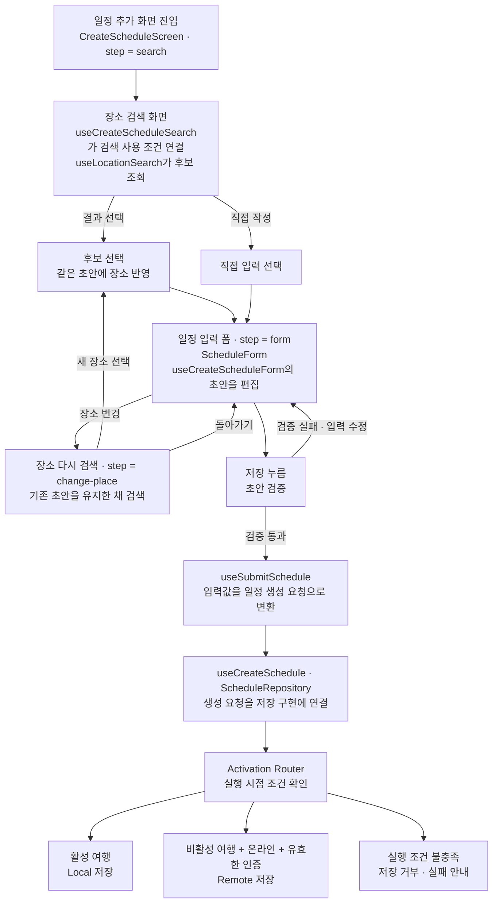

**화면을 따라 보면, 하나의 일정 초안을 둔 채 검색과 입력 폼을 오가고, 저장할 때 그 초안을 생성 요청으로 넘기는 구조입니다.** 각 코드의 역할을 그 흐름 안에 붙여 보겠습니다.

아래는 앞서 보존된 설명과 코드 발췌를 바탕으로 재구성한 흐름입니다. 제품 소스를 새로 확인하거나 실행한 결과는 아닙니다.



화살표는 사용자 행동과 저장 요청이 이어지는 대표 흐름입니다. 지도 표시, 검색 내부의 캐시·오류 처리, 저장 후 부수 동작은 생략했습니다.

**처음에는 검색 화면이지만, 작성 과정 전체를 붙잡는 코드는 `CreateScheduleScreen`입니다.**

보존된 실제 코드 발췌에는 화면 단계가 이렇게 있습니다.

```tsx
const [step, setStep] =
  useState<'search' | 'form' | 'change-place'>('search');
```

`search`는 처음 장소를 찾는 단계, `form`은 일정을 편집하는 단계, `change-place`는 작성 도중 장소를 다시 찾는 단계입니다. 화면의 근본 역할은 **사용자의 행동을 초안 변경과 화면 전환으로 연결하는 것**입니다. 검색어를 서버에 보내는 세부 처리나 저장 데이터 변환은 다른 코드에 맡깁니다.

아래는 그 연결을 읽기 쉽게 줄인 **의사코드**입니다. 실제 함수명과 속성명을 그대로 옮긴 코드는 아닙니다.

```tsx
// CreateScheduleScreen의 연결 관계를 설명하는 의사코드
초안 = useCreateScheduleForm();
검색 = useCreateScheduleSearch(/* 현재 단계, 검색 정책 */);

장소를_선택하면(장소) {
  초안에_장소를_반영(장소);
  setStep('form');
}

직접_입력을_선택하면() {
  setStep('form');
}

장소를_다시_찾으면() {
  setStep('change-place');
}
```

여기서 검색의 역할은 **초안에 넣을 장소 후보를 가져오는 것**입니다. `useLocationSearch`가 검색어·요청·결과를 다루고, `useCreateScheduleSearch`가 현재 단계와 검색 정책에 맞춰 요청·선택 가능 여부를 연결합니다. 후보를 선택한 뒤에는 그 장소가 초안의 일부가 됩니다.

관련 위치: [화면과 단계 연결](/Users/hammyeong-yeon/Desktop/10_work/noline/apps/client/src/screens/CreateScheduleScreen.tsx:23), [일정 작성에 검색을 연결하는 훅](/Users/hammyeong-yeon/Desktop/10_work/noline/apps/client/src/features/schedule/create-schedule/useCreateScheduleSearch.ts:5).

**입력 폼에 도착하면, 중심은 `useCreateScheduleForm`이 가진 같은 초안입니다.**

사용자가 제목을 쓰고 날짜를 바꾼 뒤 장소 검색으로 다시 나가도, 작성 내용은 이 초안에 남습니다. 폼은 이를 보여주고 편집하는 자리이며, `ScheduleLocationField`는 그중 장소 표시·직접 입력·검색 제한 안내를 맡습니다.

예를 들어 제목을 직접 “저녁 산책”으로 바꾸고 장소 검색에서 Eiffel Tower를 선택했다고 해보겠습니다. 이는 설명용 제목입니다. 보존된 설명대로라면 다음 관계가 성립합니다.

| 사용자 행동 | 초안에 반영되는 것 | 화면 |
|---|---|---|
| 제목·날짜 입력 | 사용자가 작성한 제목·날짜 | 입력 폼 |
| 장소 다시 검색 | 기존 초안 유지 | 장소 검색 |
| Eiffel Tower 선택 | 장소·주소·좌표 반영, 직접 바꾼 제목과 날짜 유지 | 입력 폼으로 복귀 |
| 장소 이름을 직접 수정 | 장소 수정, 이전 검색 장소의 좌표 연결 해제 | 같은 입력 폼 |

초안 훅의 역할은 값을 보관하는 데 그치지 않습니다. **“사용자가 바꾼 제목을 새 검색 결과가 덮지 않게 한다”, “수정한 장소에 이전 좌표가 남지 않게 한다”는 값 사이의 관계도 지킵니다.**

관련 위치: [초안과 입력 검증](/Users/hammyeong-yeon/Desktop/10_work/noline/apps/client/src/features/schedule/create-schedule/useCreateScheduleForm.ts:8), [장소 입력 영역](/Users/hammyeong-yeon/Desktop/10_work/noline/apps/client/src/features/schedule/create-schedule/ScheduleLocationField.tsx:20).

**작성 중 네트워크가 바뀌면, 이 화면 흐름 위에서 검색과 저장의 사용 조건이 바뀝니다.**

가령 장소를 고른 뒤 오프라인이 되어도 `step`을 바꾸거나 초안을 지울 이유는 없습니다. `usePlaceSearchPolicy`가 검색을 제한하고 장소 영역에서 그 이유를 보여줍니다. 이미 선택한 장소와 제목·날짜는 유지합니다. 지도 표시도 검색 결과를 지금 선택할 수 있는지와 별도로 다룹니다.

저장 가능 여부는 여행 상태에 따라 갈립니다. 정상 계정이며 네트워크 강제 설정이 없는 조건에서 활성 여행은 오프라인에서도 Local 저장이 가능하고, 비활성 여행은 저장이 제한됩니다. 다시 온라인이 되어도 사용자가 보고 있던 작성 단계는 유지됩니다.

즉, 정책은 **현재 화면에서 어떤 기능을 사용할 수 있는지**를 알려줍니다. 화면 단계를 정하는 사용자 행동과는 별개의 입력입니다. 기존 `manual-only` 정책값은 남아 있지만, 이 일정 추가 화면은 그 값으로 다른 폼을 끼워 넣지 않는다고 설명되어 있습니다.

**저장을 누르면 초안이 화면 밖으로 넘어갈 데이터로 바뀝니다.**

```tsx
// 저장 연결을 설명하는 의사코드
저장을_누르면() {
  if (초안_검증_실패) return; // 입력을 고치도록 함

  useSubmitSchedule로_제출(초안);
  // ID 생성, 날짜·시간 변환, 좌표 전달
  // → useCreateSchedule → ScheduleRepository → Activation Router
}
```

`useSubmitSchedule`은 **작성 내용을 저장 요청으로 번역하는 코드**입니다. 실제 저장을 허용할지와 Local/Remote 중 어디에 쓸지는 `Activation Router`가 실행 시점에 결정합니다. 버튼을 보는 순간과 누르는 순간 사이에도 연결·인증 상태가 바뀔 수 있기 때문입니다.

당시 설명에 따르면 정책 제한만으로 저장 버튼을 비활성화하지는 않습니다. 제한 이유를 표시하며, 눌렀을 때 입력 검증을 통과해도 실행 조건이 충족되지 않으면 Router가 거부합니다. 제출 중에는 버튼을 비활성화하고, `ScheduleSubmitActions`가 현재 정책 제한과 마지막 저장 실패를 구분해 보여줍니다.

관련 위치: [초안을 저장 요청으로 변환](/Users/hammyeong-yeon/Desktop/10_work/noline/apps/client/src/features/schedule/create-schedule/useSubmitSchedule.ts:12), [실행 조건과 저장 위치 결정](/Users/hammyeong-yeon/Desktop/10_work/noline/apps/client/src/shared/services/offline-prep/router.ts:75), [저장 상태와 실패 안내](/Users/hammyeong-yeon/Desktop/10_work/noline/apps/client/src/features/schedule/create-schedule/ScheduleSubmitActions.tsx:15).

보존된 실행 보고가 뒷받침하는 화면 흐름은 **직접 입력한 제목·날짜를 유지하면서 장소 검색 후 폼으로 돌아오는 구간**입니다. 네트워크 변화와 저장 제한은 자동 테스트로 확인했다고 보고되어 있고, 시뮬레이터에서 저장까지 수행한 근거는 없습니다. 따라서 위 저장 흐름은 당시 코드 설명을 재구성한 것이며, 실제 저장 완료를 관찰한 흐름으로 읽으면 안 됩니다.
