# 인증 작업 브리핑 — 질문·입력·두 응답 전체

GPT-6.1-sol, medium으로 기존 스킬과 수정 스킬을 각각 한 번 적용한 실제 출력이다. 아래 응답은 발췌·요약·재작성하지 않았다. 제목과 구분선은 비교 문서에서 붙였고 각 응답 본문은 원문 그대로다. 기대 답·수정 의도·후속 사용자 평가는 생성 담당자에게 제공하지 않았다.

## 이 장면의 조건

인증 관련 작업을 자세히 설명해 달라는 장면이다. 당시 전체 AI 조사·설명 기록을 자료로 제공했다. 제품 코드를 직접 읽거나 실행한 비교가 아니라 보존 기록을 재구성하는 응답 비교다. 두 판본에 같은 질문·자료를 제공했고 역할 우선·흐름 보완을 요구했던 후속 사용자 발화는 넣지 않았다.

## 이번에 답하게 한 질문 전체

보존 자료를 바탕으로 당시 인증 관련 작업을 이해할 수 있게 자세히 설명해줘. 도식화할 건 하고.

## 기존 스킬의 실제 응답 전체

당시 인증 작업의 핵심은 **서버 인증이 끊겨도 사용자의 계정과 활성 여행의 기기 데이터를 유지하고, 같은 계정으로 다시 로그인해 저장까지 성공하면 서버 이용을 재개하는 것**입니다. 이를 위해 ‘어느 계정의 데이터인가’와 ‘지금 서버 요청을 보낼 인증 수단이 있는가’를 나눠 다뤘습니다.

이 설명은 제공된 [당시 코드 조사 기록](../../inputs/briefing/source.md)을 바탕으로 합니다. 기록 작성자가 당시 작업 트리에서 확인했다고 보고한 구조를 설명하며, 제품 코드나 실행 결과를 새로 확인한 것은 아닙니다. 아래 도식도 그 기록에서 재구성한 관계이며 실기기 실행을 관찰한 흐름은 아닙니다. 원문에 적힌 ‘현재’는 당시 조사 시점을 뜻합니다.

**인증 만료가 곧 로그아웃은 아니었습니다.**

기존에는 `isAuthenticated`, `isSessionExpired` 두 값의 조합으로 상태를 읽었지만, 조사 당시 구현은 `status` 하나에 다음 다섯 상태를 담았습니다.

| 상태 | 알고 있는 것과 허용되는 일 |
|---|---|
| `initializing` | 저장된 세션을 아직 판정하지 못한 상태입니다. 앱 초기 준비를 기다립니다. |
| `signed-out` | 세션 기록이 없거나 명시적 세션 삭제가 끝났습니다. 로그인 화면으로 갑니다. |
| `signed-in` | 계정과 access token 또는 refresh token이 있습니다. 다른 네트워크·여행 조건도 맞으면 서버 기능을 이용합니다. |
| `reauth-required` | 계정은 알지만 사용할 인증 수단이 없습니다. 활성 여행의 기기 작업은 유지하고 보호된 서버 요청은 막습니다. |
| `restore-failed` | 저장소 읽기·해석이나 계정 일치 확인에 실패했습니다. 데이터를 보존하고 복원 재시도를 안내합니다. |

이 중 작업의 중심은 `reauth-required`입니다. 계정을 잊지 않으므로 그 계정의 활성 여행을 계속 수정할 수 있고, 토큰은 제거하므로 새 보호 요청은 서버로 나가지 않습니다.

`signed-in`도 의미를 좁혀 읽어야 합니다. 서버가 방금 인증을 승인했다는 뜻이 아니라, 저장된 토큰으로 요청하거나 자동 갱신을 시도할 수 있다는 뜻입니다. 반대로 `signed-out`이어도 SQLite에 여행 데이터가 남아 있을 수 있습니다. 따라서 로그인 상태만 보고 남은 데이터의 소유자를 추정하지 않습니다. 기록상 위치는 `auth.ts`의 상태 선언과 적용 부분입니다.

**앱 시작에서는 저장된 세션과 남은 여행 데이터가 같은 계정인지 먼저 맞춥니다.**

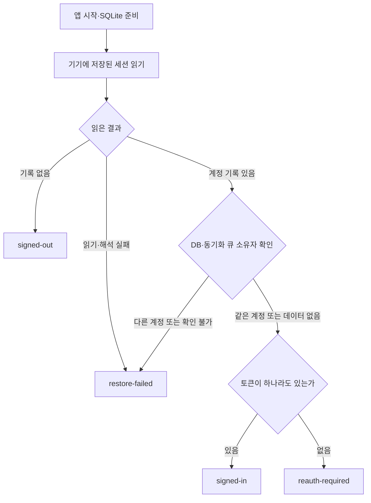

이 도식은 앱 시작 시 판정만 보여 줍니다. `AppInitialization`은 DB 준비 후 복원을 호출하고 화면을 여는 순서를 맡고, 세션을 해석해 상태를 결정하는 책임은 `auth.ts`의 Store에 있습니다. Store는 실행 중 인증 상태를 보관하고 변경 절차를 수행하는 코드입니다. 복원이 겹쳐 호출되면 진행 중인 작업을 공유하며, `restore-failed`에서 사용자가 재시도할 때 다시 읽습니다.

저장 대상은 두 가지입니다. **SecureStore에는 세션을, SQLite에는 여행 데이터와 동기화 큐를 저장합니다.** SecureStore는 기기의 보안 저장소이고, SQLite는 기기 안의 데이터베이스입니다.

`token-storage.ts`는 `noline_session`이라는 하나의 JSON 값에 계정 ID, 사용자 정보, access token, refresh token 등을 저장합니다. 토큰은 둘 다 비어 있어도 됩니다. 예를 들어 계정 A와 빈 토큰 두 개를 저장하면, 다음 실행에서 A의 `reauth-required`로 복원할 수 있습니다. 계정을 기억하기 위해 쓸 수 없는 토큰까지 보관할 필요가 없는 구조입니다. 다만 이전 형식에서 사용자 ID만 남은 기록은 정상 세션으로 추정하지 않고 복원 실패로 처리했다고 기록돼 있습니다.

실행 중 요청에 쓸 토큰은 Store 내부 세션에서 가져옵니다. 매 요청마다 SecureStore를 다시 읽지 않습니다. 그래서 인증 만료를 메모리에 반영한 이후에는, 기기 저장이 아직 끝나지 않았더라도 현재 실행의 새 요청이 옛 토큰을 다시 꺼내 쓰지 않습니다.

**계정 사용 판단과 데이터 접근 판단은 서로 이어지는 다른 책임입니다.**

기록에 나온 주요 파일의 관계는 다음과 같습니다. 화살표는 호출·참조 방향이며, 인증과 로컬 데이터 접근에 필요한 부분만 표시했습니다.

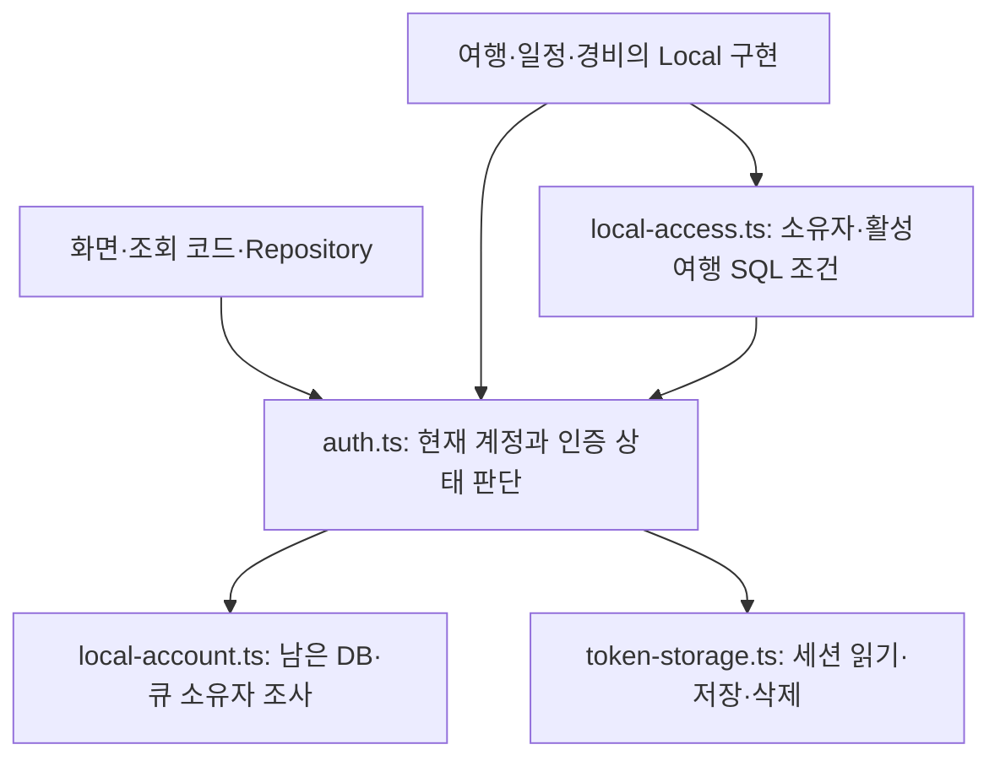

`auth.ts`에는 용도가 다른 세 함수가 있습니다.

| 함수 | 판단과 사용 방식 |
|---|---|
| `selectLocalUserId(state)` | `signed-in` 또는 `reauth-required`이면 계정 ID를 반환합니다. 사용할 계정이 없으면 `null`을 반환해 조회를 생략하는 데 쓸 수 있습니다. |
| `requireLocalUserId(requestedUserId?)` | 같은 기준으로 계정을 구하되, 계정이 없거나 요청의 계정 ID가 다르면 오류를 냅니다. 생성·수정처럼 잘못된 계정으로 진행하면 안 되는 작업에서 사용합니다. |
| `requireRemoteSession()` | `signed-in`인지 확인합니다. 인터넷 연결이나 서버가 인정하는 토큰인지까지 확인하지는 않습니다. |

`selectLocalUserId`는 실제로 `auth.ts`에 있습니다. 새로운 상태를 저장하는 action이 아니라 주어진 상태에서 값을 계산하는 함수로 정의돼 있습니다. `requireLocalUserId`도 이를 호출하므로, 로컬 작업에 사용할 계정 기준을 공유합니다.

`local-access.ts`는 그 계정 ID를 받아 SQL 조건을 만듭니다. 예를 들어 현재 계정이 소유한 행인지, 해당 여행이 삭제되지 않았고 활성 상태인지 검사합니다. 인증 상태를 다시 정의하는 역할은 아닙니다.

`local-account.ts`는 더 앞선 질문인 ‘이미 남아 있는 데이터는 누구 것인가’를 조사합니다. DB와 큐를 보고 `empty`, `same`, `different`, `unresolved`를 반환하며, Store가 그 결과로 새 세션을 받아들일지 정합니다. 큐의 소유권은 별도 계정 컬럼 하나로 판단하는 대신 원본 행과 payload를 대조한다고 기록돼 있습니다.

이 배치에서 Store는 단순한 상태 보관함보다 책임이 큽니다. 세션 수락 조건, 저장, 상태 반영을 함께 맡습니다. 기록은 이 구조가 로그인 판단이 호출자마다 달라지는 것을 막는다고 설명하지만, 유일한 설계 방법이라고 주장하지는 않습니다.

**서버가 처음 401을 반환하면 자동 복구를 시도하고, 복구 불가가 확인돼야 재로그인을 요구합니다.**

일반 API와 동기화 API는 같은 인증 interceptor를 사용합니다. Interceptor는 HTTP 요청 전후에 끼어들어 인증 확인과 토큰 갱신을 처리하는 코드입니다.

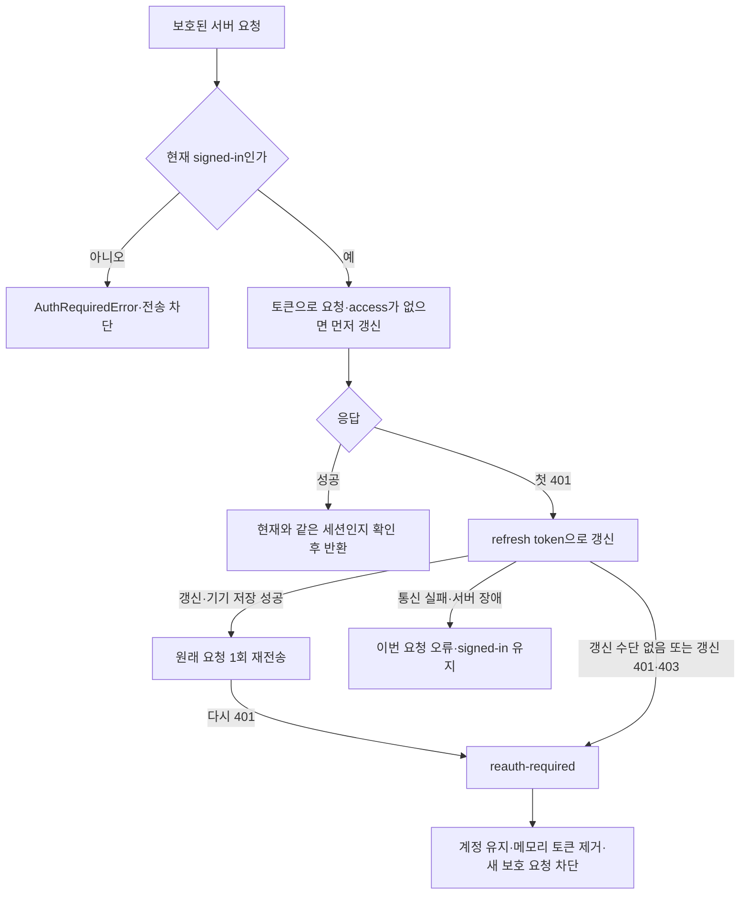

여기서 access token은 실제 요청에 쓰는 토큰이고, refresh token은 새 토큰을 발급받는 데 쓰는 토큰입니다. 같은 세션에서 여러 요청이 동시에 갱신을 요구하면 진행 중인 갱신 작업을 공유합니다. 서버가 새 토큰을 줘도 **기기 저장까지 성공해야** 갱신 성공으로 적용합니다.

통신 실패나 서버 장애는 인증 거부와 다릅니다. 갱신 요청이 timeout이나 500으로 실패했다는 이유만으로 계정을 `reauth-required`로 바꾸지는 않습니다. 기록상 이 책임은 `auth-interceptor.ts`와 Store의 `requireReauthentication`에 연결돼 있습니다.

조회 라이브러리의 재시도는 위 자동 갱신과 별개입니다. React Query는 `AuthRequiredError`를 재시도하지 않고, 그 외 조회 오류는 기본 1회 재시도하며, mutation은 재시도하지 않는 설정이었다고 기록돼 있습니다. 2·4·8초 간격의 5xx 재시도는 동기화 HTTP 클라이언트에만 있던 설정이므로 일반 API 전체의 정책으로 읽으면 안 됩니다.

**인증이 만료된 뒤에도 활성 여행 수정은 기기에 저장됩니다.**

기록의 설명용 사례를 따라 계정 A의 활성 여행 T에서 일정 제목을 수정한다고 하겠습니다. 상태는 `reauth-required`, 계정은 A, 토큰은 모두 빈 상태입니다.

Repository가 T를 대상으로 Router를 호출하면 `requireLocalUserId()`는 A를 반환합니다. Router는 T가 활성 여행이므로 Local 구현을 선택합니다. Local 구현은 A가 소유한 활성 여행의 일정인지 SQL로 검사하고, 일정 수정과 동기화 큐 추가를 하나의 DB transaction으로 처리합니다. 즉, 변경과 나중에 서버로 보낼 작업 기록을 함께 저장합니다. 이 경로에는 서버 요청이 없습니다.

| 같은 계정의 작업 | 당시 기록상 결과 |
|---|---|
| `reauth-required`에서 활성 여행 수정 | 로컬 조건을 통과하면 기기에 수정·큐 저장 가능 |
| `reauth-required`에서 비활성 여행 작업 | Remote 경로의 인증 확인에서 거절, 인터넷 연결 여부와 무관 |
| `reauth-required`에서 새 동기화 시작 | `signed-in` 조건을 충족하지 않아 시작하지 않음 |

화면 정책도 이 구분과 연결돼 있습니다. 탭은 로컬 세션이 있으면 유지하고, 만료 배너는 변경이 기기에 저장되며 동기화에는 재로그인이 필요하다고 안내합니다. 화면을 열어 두는 것, 로컬 저장을 허용하는 것, 서버 요청과 동기화를 차단하는 것이 각각 코드에 연결됐다는 설명입니다. 관련 위치로 `router.ts`, `schedule-local.ts`, 탭 layout, `useAppPolicy`, 동기화 `lifecycle.ts`가 제시돼 있습니다.

**재로그인 완료의 기준은 서버 응답 수신보다 뒤에 있습니다.**

Google·Apple 인증 후 서버가 계정과 새 토큰을 반환해도 즉시 `signed-in`을 공개하지 않습니다. `completeLogin`은 진행 중인 동기화·정리·로컬 저장이 끝나기를 기다리고 새 작업을 제한한 뒤, Store에 세션 적용을 요청합니다. Store는 남은 데이터와 큐의 소유자를 확인하고 SecureStore 저장이 성공해야 새 세션을 공개합니다.

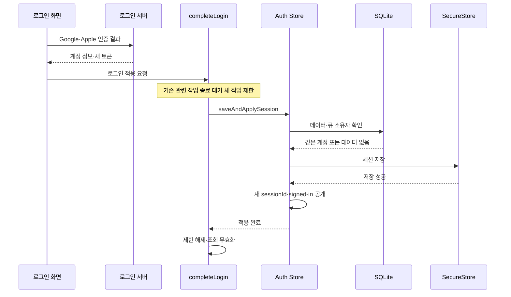

성공하면 기존 여행 데이터와 큐를 유지하고, 조회를 다시 읽도록 무효화합니다. 동기화는 로그인만으로 무조건 시작되는 것이 아니라 DB 준비, 실제 온라인 상태, debug override 해제 등의 조건도 맞아야 합니다. 같은 계정이고 복귀할 화면이 있으면 이전 화면으로 돌아갑니다.

다른 계정이거나 큐 소유자를 확인할 수 없으면 적용을 거절하고 기존 데이터를 유지합니다. 기기 저장이 실패하면 기존 `reauth-required` 상태를 유지합니다. 로그인 취소는 적용 절차에 들어가지 않습니다. 적용하지 못한 토큰은 서버에 폐기를 시도하며, 저장 완료 후 조회 갱신만 실패한 경우에는 로그인 전체를 실패로 되돌리지 않는다고 기록돼 있습니다.

**작업 순서 제어와 `sessionId`는 서로 다른 충돌을 다룹니다.**

Store의 `pendingWrites`는 복원, 로그인 적용, 토큰 갱신 저장, 만료 상태 저장, 세션 삭제의 순서를 지킵니다. 예를 들어 로그아웃으로 토큰을 삭제한 뒤 이전 갱신 저장이 늦게 실행돼 옛 토큰이 되살아나는 상황을 막는 역할입니다.

`session-lifecycle.ts`의 `withSessionChange`는 로그인·로그아웃·탈퇴 전체를 조율합니다. 진행 중인 동기화와 정리, 이미 접수된 로컬 저장을 기다리고 새 작업을 제한합니다. 로그아웃이 미전송 작업을 확인한 직후 새 일정 저장이 끼어들어 그 데이터를 바로 삭제하는 문제는 토큰 저장 순서만으로 막을 수 없기 때문입니다. 다만 Store action 자체가 공개돼 있어 모든 호출자가 이 절차를 거치도록 타입으로 강제한 것은 아니며, 당시 서비스들이 이를 사용하도록 연결됐다는 범위입니다.

`sessionId`는 이미 전송된 요청의 늦은 결과를 구별합니다. A의 이전 로그인에서 토큰 갱신을 요청한 뒤 로그아웃하고 같은 A로 다시 로그인하면, 계정 ID만으로는 이전 응답을 구별할 수 없습니다. 새 로그인마다 달라지는 메모리상의 `Symbol`을 비교해 이전 세션의 결과를 현재 세션에 적용하지 않도록 했습니다. 정상적인 토큰 갱신은 같은 세션으로 처리합니다. 이 확인은 토큰 접근과 갱신 적용, 보호된 HTTP 성공 응답, 여행 활성화 데이터의 DB 저장 직전에도 연결돼 있었다고 기록돼 있습니다.

이 기능은 **늦은 결과의 적용을 막는 것**입니다. 이미 서버로 보낸 요청이 서버에서 수행한 작업까지 취소하지는 않습니다.

**기록이 뒷받침하는 보장에는 경계가 있습니다.**

만료 처리는 현재 실행의 메모리부터 차단하지만, 그 결과를 SecureStore에 쓰지 못한 채 종료하면 다음 실행에서 옛 토큰 기록을 읽을 수 있습니다. 그러면 일단 `signed-in`으로 복원된 뒤 요청 과정에서 인증 거부를 다시 확인할 수 있습니다. 재실행 후에도 반드시 `reauth-required`라고 보장하는 구조는 아니었습니다.

로그아웃도 두 저장소를 한 번에 성공·실패시키는 작업은 아닙니다. 기록상 순서는 SQLite 초기화, 기기 인증 기록 삭제, 화면 선택·캐시 정리입니다. SQLite 정리 후 인증 기록 삭제가 실패하면 데이터는 이미 정리됐지만 세션 삭제는 실패한 중간 상태가 남을 수 있습니다. 그때 서버 인증을 다시 허용하지 않고 종료 재시도가 가능한 계정 상태를 남긴다고 설명돼 있습니다. 앱 강제 종료 뒤 정리를 이어가는 기능은 당시 범위에서 제외돼 있었습니다.

테스트에 대해서는, 원문 작성자가 이전 검증 로그에서 **30개 테스트 묶음·277개 테스트 통과**를 확인했다고 보고했습니다. 저장 상태 복원, 같은 계정 재로그인 저장 실패, 동시 로그인과 늦은 응답, 자동 갱신과 복구 불가 판정, 만료 후 로컬 수정과 큐 저장, 계정 간 접근 거절, 화면 복귀 등을 다뤘다고 합니다. Store·HTTP 테스트는 저장소와 통신을 대체했고, 로컬 접근 테스트는 실제 Drizzle SQL과 Node 메모리 SQLite를 사용했다는 범위입니다.

원문 작성 당시에도 테스트를 다시 실행하지 않았고, 이번 설명에서도 실행하지 않았습니다. 따라서 이 기록으로 실제 OAuth, native SecureStore 실패, 서버 토큰 교체, 실기기 화면까지 검증됐다고 말할 수 없습니다. 일부 Ticket의 ‘커밋 완료’ 표시와 당시 커밋을 해제한 작업 트리가 달랐다는 보고도 있어, 해당 표시만으로 최종 완료 상태를 확정할 수 없습니다.

당시 구조를 더 읽을 때는 질문에 따라 출발점을 고르면 됩니다. 계정과 인증 상태는 `auth.ts`, 저장 형식은 `token-storage.ts`, 남은 데이터 소유자는 `local-account.ts`, 행 접근 조건은 `local-access.ts`, 서버 인증 복구는 `auth-interceptor.ts`, 세션 변경과 DB 작업의 충돌 방지는 `session-lifecycle.ts`가 기록상 핵심 위치입니다.


---

## 수정 스킬의 실제 응답 전체

당시 인증 작업의 핵심은 **서버 인증이 끊겨도 사용자의 계정과 활성 여행 작업을 유지하고, 같은 계정으로 재로그인한 세션을 기기에 저장한 뒤 서버 이용을 다시 허용하는 것**입니다. 이를 위해 ‘누구의 작업인가’, ‘서버에 요청할 인증 수단이 있는가’, ‘이 여행 데이터를 로컬에서 다뤄도 되는가’를 따로 판단하도록 구성했습니다.

아래는 당시 코드 조사 후 남겨진 [보존 설명](</Users/hammyeong-yeon/Desktop/ai-workspace/context/workspaces/014-ai-development-workflow-design/records/experiments/artifact-explanation-intent-2026-10-21/inputs/briefing/source.md>)을 재구성한 설명입니다. 원문에 등장하는 ‘현재’는 **그 조사가 이뤄진 당시 작업 트리**를 뜻합니다. 이번에 제품 코드나 실행 결과를 직접 확인한 것은 아니며, 도식도 보존 기록이 설명하는 연결을 나타냅니다.

**계정을 유지하는 것과 서버 인증을 유지하는 것을 분리했습니다.**

이전에는 `isAuthenticated`, `isSessionExpired`라는 두 참·거짓 값을 조합해 상태를 읽었습니다. 당시 구현은 `status` 하나로 다음 다섯 상태를 표현했습니다.

| 상태 | 의미와 사용자에게 생기는 차이 |
|---|---|
| `initializing` | 저장된 세션을 판정하는 중이므로 초기 준비를 기다립니다. |
| `signed-out` | 세션 기록이 없거나 명시적 삭제가 끝난 상태로, 로그인 화면을 표시합니다. 여행 DB가 비었다는 뜻까지 포함하지는 않습니다. |
| `signed-in` | 계정과 access 또는 refresh token이 있어 서버 요청이나 자동 갱신을 시도할 수 있습니다. 서버가 방금 토큰을 검증했다는 뜻은 아닙니다. |
| `reauth-required` | 계정은 알지만 서버 인증 수단을 사용할 수 없습니다. 활성 여행의 로컬 작업은 유지하고 보호된 서버 요청은 차단합니다. |
| `restore-failed` | 저장소 읽기·해석 또는 남은 데이터와 계정의 일치 확인에 실패했습니다. 데이터를 보존하고 로그인 화면에서 복원을 재시도합니다. |

여기서 가장 중요한 상태가 `reauth-required`입니다. 토큰이 없다는 이유만으로 계정까지 없애면, 남아 있는 여행을 누구의 작업으로 다뤄야 할지 불분명해집니다. 당시 구조에서는 계정 ID를 유지하므로 소유권을 확인하며 로컬 작업을 계속할 수 있습니다.

기기에는 저장 대상도 둘로 나뉩니다. **SecureStore**는 운영체제의 보안 저장소로, 계정 정보와 토큰을 `noline_session`이라는 JSON 값에 보관합니다. **SQLite**는 여행·일정·경비와 나중에 서버로 보낼 변경 목록인 동기화 큐를 보관합니다. 인증 만료는 SQLite의 여행 데이터를 지우는 동작이 아닙니다.

예를 들어 SecureStore에 `userId=A`, 두 토큰은 모두 `null`인 세션을 저장할 수 있습니다. 다음 실행에서는 이를 A 계정의 `reauth-required`로 복원합니다. 다만 이전 버전의 낱개 저장 키에서 사용자 ID만 발견한 경우까지 같은 정상 형식으로 간주하지는 않고, 복원 실패로 처리했습니다.

앱 시작 시에는 `AppInitialization`이 SQLite 준비를 먼저 끝내고 인증 Store에 복원을 요청합니다. **Store는 실행 중인 세션을 보관하고 세션을 받아들일 조건을 판단하는 주체**입니다. 기록상 복원 흐름은 다음과 같습니다.

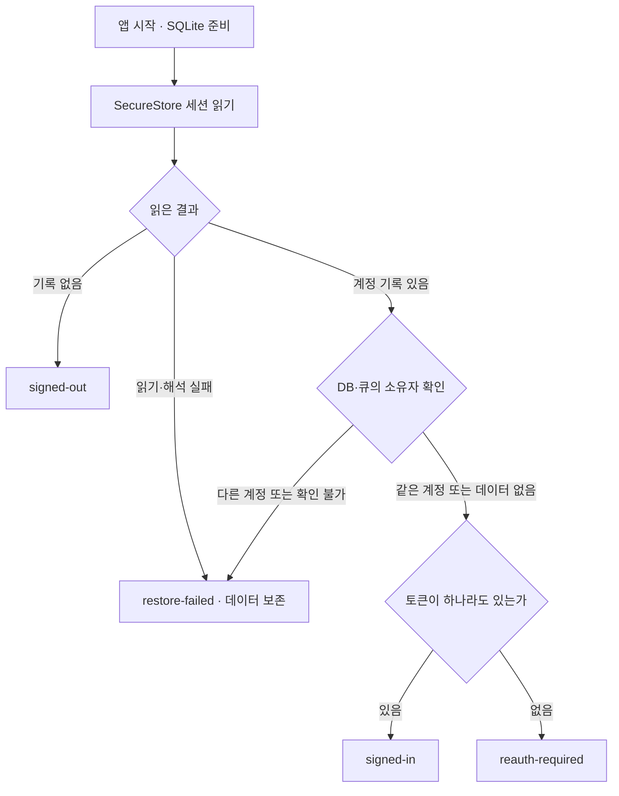

이것은 보존 기록의 시작 경로만 펼친 도식이며 실기기 실행 추적은 아닙니다. 복원이 진행 중이면 호출자들이 같은 Promise, 즉 같은 비동기 작업의 완료 결과를 공유했습니다. 화면 이동이나 네트워크 변화마다 저장소를 다시 복원하지 않고, `restore-failed`에서 사용자가 재시도할 때 다시 읽는 구조였습니다. 이 부분의 근거는 보존 설명의 1·2절입니다.

**인증 Store는 사용할 계정을 정하고, 로컬 접근 코드는 그 계정의 데이터인지 확인합니다.**

비슷한 이름의 파일들이 있지만 질문이 다릅니다.

| 파일 | 맡은 질문과 실제 연결 |
|---|---|
| `auth.ts` | 지금 어떤 계정으로 로컬 작업을 할 수 있고, 서버 요청을 시도할 수 있는가? 계정 판단과 세션 수락·저장·상태 반영을 맡습니다. |
| `token-storage.ts` | 세션을 기기에 어떤 형식으로 읽고 저장하고 삭제하는가? Store가 이 기능을 사용합니다. |
| `local-account.ts` | 이미 남아 있는 DB와 큐는 누구 것인가? Store가 로그인·복원을 받아들이기 전에 조사 결과를 사용합니다. |
| `local-access.ts` | 지금 접근하는 행이 현재 계정 소유이고 활성 여행에 속하는가? Store에서 얻은 계정 ID로 SQL 조건을 만들고, 여행·일정·경비의 로컬 구현이 사용합니다. |

특히 `selectLocalUserId`는 당시 `auth.ts`에 있었습니다. 별도 상태를 저장하는 action이 아니라, 전달받은 상태에서 계정 ID를 계산하는 함수입니다. `signed-in`과 `reauth-required`에서 계정 ID를 반환하고 그 밖에는 `null`을 반환합니다.

`requireLocalUserId`도 같은 계정 기준을 사용하지만, 사용할 계정이 없으면 오류를 냅니다. 생성 요청이 현재 계정과 다른 `userId`를 지정해도 거절합니다. 조회를 생략할 수 있는 소비자와, 허용되지 않은 쓰기를 중단해야 하는 소비자가 서로 다른 처리 방식을 쓰는 것입니다.

그다음 `local-access.ts`가 실제 행의 `userId`, 삭제 여부, 여행 활성 여부를 SQL 조건으로 확인합니다. 따라서 이 파일이 계정 ID를 읽는 것은 SQL 비교에 쓰기 위해서입니다. 어떤 인증 상태에서 계정을 허용할지를 여기서 다시 정하지는 않습니다.

로그인 때의 소유자 검사는 별도입니다. `local-account.ts`는 DB와 큐를 조사해 `empty`, `same`, `different`, `unresolved` 중 하나를 반환합니다. 큐에 별도 계정 컬럼을 추가한 방식이 아니라 큐가 가리키는 원본 행과 payload를 대조했습니다. **‘현재 계정이 A다’와 ‘남아 있는 데이터도 A의 것이다’는 각각 확인해야 하는 조건**입니다. 이 책임 구분은 보존 설명 3절에 나옵니다.

**서버 요청은 자동 갱신을 시도하고, 복구할 수 없을 때 재로그인을 요구합니다.**

`auth-interceptor.ts`는 일반 API와 동기화 API가 공유하는 요청 전후 처리입니다. 요청 전에 사용할 세션을 확인하고, 인증 거부가 오면 토큰 갱신과 원래 요청의 재전송을 담당합니다.

기록상 첫 401, 즉 서버의 인증 거부 응답만으로 즉시 `reauth-required`로 바꾸지는 않았습니다. refresh token으로 갱신하고, 새 세션을 기기에 저장한 다음 원래 요청을 한 번 다시 보냅니다. 갱신 수단이 없거나 갱신이 401·403으로 거부되거나 재전송도 401이면 복구 불가로 판단합니다. 갱신 중 통신 실패나 서버 장애가 생겼다면 이번 요청을 실패시키되 `signed-in`은 유지합니다.

이때 세 가지 순서가 중요합니다.

- 같은 세션의 여러 요청이 동시에 갱신을 요구하면 진행 중인 갱신 결과를 공유합니다.
- 서버가 새 토큰을 줘도 기기 저장이 성공해야 갱신을 성공으로 적용합니다.
- 복구 불가로 판단하면 메모리 토큰을 먼저 비우고 상태를 바꿔 새 보호 요청을 막은 뒤 그 상태를 기기에 저장합니다.

요청용 토큰은 실행 중 Store 내부의 `currentSession`에서 얻습니다. 매 요청마다 SecureStore를 다시 읽는 방식이 아니므로, 만료를 메모리에 반영한 뒤 디스크에 옛 토큰이 남아 있어도 같은 실행의 새 요청이 이를 다시 가져다 쓰지는 않습니다.

여기서 인증 갱신에 따른 재전송과 일반 오류 재시도는 구별해야 합니다. React Query는 `AuthRequiredError`에 대해서는 조회를 재시도하지 않고, 다른 조회 오류는 기본 한 번 재시도하며 mutation 재시도는 0회였습니다. 별도로 기록된 2·4·8초의 5xx 재시도는 동기화 HTTP 클라이언트의 설정입니다. 모든 일반 API에 적용되는 정책으로 읽으면 안 됩니다. 이 구분의 근거는 보존 설명 4절입니다.

**인증 만료 후에도 가능한 작업은 ‘현재 계정의 활성 여행에 대한 로컬 작업’입니다.**

설명용으로 A 계정의 여행 T에서 일정 제목을 바꾸는 경우를 보겠습니다. `status=reauth-required`, `userId=A`, 두 토큰은 없는 상태입니다. 여행 T가 활성화돼 있고 A 소유라면, Router가 로컬 구현을 선택하고 해당 구현이 소유권·활성 조건을 확인한 뒤 일정 수정과 큐 추가를 같은 DB transaction에서 처리합니다. Transaction은 두 변경을 한 묶음으로 저장하는 단위입니다.

같은 일정 수정 요청이라도 T가 비활성 여행이면 결과가 달라집니다.

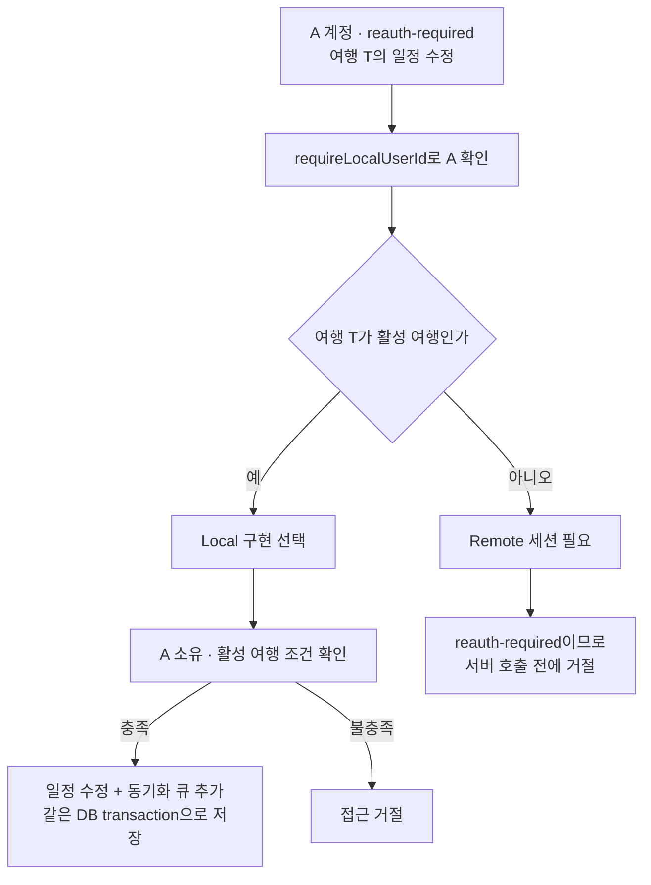

이 도식도 기록에서 재구성한 해당 수정 경로입니다. 인터넷 연결 여부만으로 서버 작업이 허용되는 것은 아닙니다.

화면과 동기화도 이 구분을 따릅니다. 탭 진입은 로컬 세션을 인정하므로 화면을 유지하고, 만료 배너는 변경이 기기에 저장되며 동기화에는 재로그인이 필요하다고 안내합니다. 화면 정책은 활성 여행의 로컬 작업과 비활성 여행의 제한을 구분합니다. 동기화 시작 조건은 `signed-in`을 요구하므로 만료 후 새 동기화는 시작하지 않습니다. 화면 안내뿐 아니라 Router와 SQL 접근 조건에서도 제한이 적용되는 구조입니다. 근거는 보존 설명 5절입니다.

**재로그인의 완료 지점은 서버 응답 수신보다 뒤에 있습니다.**

Google·Apple 인증 후 서버가 계정 정보와 토큰을 돌려줘도, 앱은 곧바로 로그인 완료를 공개하지 않았습니다. `completeLogin` 서비스가 세션 변경 절차를 조율하고, Store의 `saveAndApplySession`이 남은 데이터의 계정 검사와 기기 저장을 수행합니다.

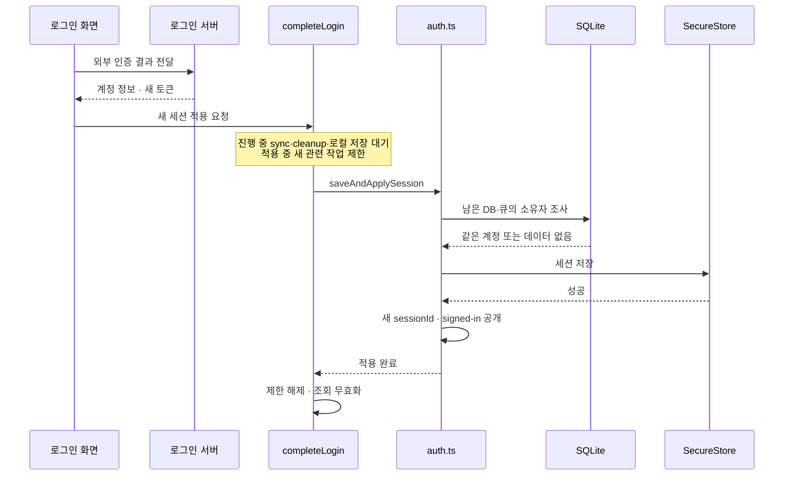

성공 경로만 표시한 것으로, 기록의 호출 관계를 재구성한 도식입니다. 같은 계정이면 여행 데이터와 큐를 유지하고 새 인증 수단으로 서버 이용을 재개할 수 있습니다. 조회를 다시 읽게 하고, DB 준비·실제 온라인 상태·debug override 해제 등 다른 조건까지 충족하면 동기화를 시작합니다. 같은 계정이고 돌아갈 화면이 있으면 이전 화면으로 복귀합니다.

반면 다른 계정이거나 큐 소유자를 확인할 수 없으면 세션 적용을 거절합니다. 기기 저장이 실패하면 기존 `reauth-required` 상태를 유지합니다. 로그인 취소는 적용 절차에 들어가지 않습니다. 적용하지 못한 토큰은 서버에 폐기를 시도하며, 세션 저장이 끝난 뒤 조회 갱신만 실패했다고 로그인 자체를 실패로 되돌리지는 않습니다. 근거는 보존 설명 6절입니다.

**작업 순서 제어와 `sessionId`는 서로 다른 충돌을 막습니다.**

`auth.ts`의 `pendingWrites`는 복원·로그인 적용·토큰 갱신 저장·만료 저장·세션 삭제를 순서대로 처리합니다. 예를 들어 로그아웃으로 인증 기록을 삭제한 뒤 앞서 시작한 옛 토큰 저장이 끝나 기록을 되살리는 일을 막는 역할입니다.

`session-lifecycle.ts`의 `withSessionChange`는 로그인·로그아웃·탈퇴 전체와 DB 작업의 겹침을 조율합니다. 새 동기화와 로컬 transaction 접수를 제한하고, 이미 진행 중인 동기화·정리·저장을 기다린 다음 세션을 바꿉니다. 로그아웃에서 미전송 작업이 없음을 확인한 직후 새 일정 저장이 끼어들어 곧바로 삭제되는 문제는 토큰 저장 순서만으로 해결할 수 없기 때문입니다.

다만 기록상 Store action 자체는 공개돼 있어 모든 호출자가 반드시 이 절차를 거치도록 타입으로 강제된 것은 아닙니다. 당시 로그인·로그아웃·탈퇴 서비스가 이를 사용하도록 연결됐다는 범위로 이해해야 합니다.

이미 서버로 나간 요청에는 추가 구분이 필요합니다. A의 옛 세션에서 갱신 요청을 보낸 뒤 로그아웃하고 다시 A로 로그인하면, 계정 ID는 같아도 이전 응답을 새 세션에 적용해서는 안 됩니다. 이를 구별하는 실행 중 식별자가 `sessionId`이며, 메모리의 `Symbol`로 생성됐습니다. 토큰 접근·갱신 적용·보호된 HTTP 성공 응답과 여행 활성화의 DB 저장 직전에 세션 동일성을 확인했습니다. 정상 갱신은 같은 세션 안에서 이뤄집니다.

따라서 이 장치의 의미는 **늦게 온 옛 세션의 결과를 현재 세션에 적용하지 않는 것**입니다. 이미 전송된 요청이 서버에서 수행한 일까지 취소한다는 뜻은 아닙니다. 근거는 보존 설명 7절입니다.

**기록으로 확인할 수 있는 구현 설명과 검증의 한계도 남아 있습니다.**

첫째, 만료 상태의 기기 저장이 실패한 채 앱이 종료되면 다음 실행은 디스크에 남은 옛 토큰으로 일단 `signed-in`을 복원할 수 있습니다. 이후 요청에서 다시 인증 거부를 확인할 수 있지만, 다음 실행부터 반드시 `reauth-required`라는 보장은 기록에 없습니다.

둘째, 로그아웃은 SQLite 초기화, 기기 인증 기록 삭제, 화면 선택·캐시 정리 순서입니다. 서로 다른 저장소를 한 번에 성공시키거나 되돌리는 작업은 아닙니다. DB 정리는 성공하고 인증 기록 삭제가 실패하면 데이터는 이미 정리된 상태일 수 있으며, 코드는 서버 인증을 허용하지 않고 종료 재시도가 가능한 계정 상태를 남긴다고 기록돼 있습니다. 강제 종료 뒤 정리를 이어가는 장치는 당시 구현 범위에서 제외됐습니다.

셋째, 원문은 다섯 상태 복원, 재로그인 저장 실패, 동시 로그인·늦은 갱신 응답, 자동 갱신과 복구 불가, 만료 후 로컬 수정과 큐 저장, 다른 계정 접근 거절, 화면 복귀 등을 다룬 테스트를 보고합니다. 이전 검증 로그에서 **30개 테스트 묶음·277개 테스트 통과를 확인했다**는 보고도 있습니다. Store·HTTP 테스트는 저장소와 통신을 대체했고, 로컬 접근 테스트는 실제 Drizzle SQL과 Node 메모리 SQLite를 사용했다고 합니다. 이번에는 해당 로그나 코드를 다시 확인하지 않았으므로, 이 숫자는 보존 기록의 보고로 남습니다. 실제 OAuth·native SecureStore 실패·서버 토큰 교체·실기기 화면의 검증으로 확대할 수 없습니다.

마지막으로 원문은 일부 Ticket의 ‘커밋 완료’ 문구와 당시 커밋을 해제한 작업 트리가 달랐다고 명시합니다. 그러므로 이 자료는 **당시 작업 트리에서 조사됐다고 보고된 인증 구조와 테스트 범위를 이해하는 근거**이며, 현재 제품 상태나 전체 인증 작업의 최종 완료를 확정하는 자료는 아닙니다.


---

## 입력 원문 전체 — 앞선 대화와 자료

# 요청

보존 자료를 바탕으로 당시 인증 관련 작업을 이해할 수 있게 자세히 설명해줘. 도식화할 건 하고.

# 자료 범위

source.md는 당시 AI가 코드 조사 후 남긴 전체 설명이다. 현재 제품 코드나 실행 결과를 새로 확인한 것이 아니다. 이 기록으로 당시 구조를 설명하며 확인 범위를 유지한다.


---

## 두 판본에 공통으로 제공한 보존 자료 전체

이 부분은 입력 자료다. 이번 실행에서 생성된 답변은 아래의 「기존 스킬의 실제 응답 전체」부터 시작한다. 원자료의 과거 제품 경로는 당시 참조이며 현재 코드 확인을 뜻하지 않는다.

# 작업물 이해 브리핑 — 현재 인증 구현

현재 인증 작업의 중심은 다음 동작입니다.

> **서버 인증을 복구할 수 없게 되어도 계정과 활성 여행은 유지한다. 같은 계정으로 재로그인하고 기기 저장까지 성공하면 서버 이용을 다시 허용한다.**

이를 위해 **계정 정보, 서버 요청에 쓸 토큰, 여행 데이터의 소유권**을 구분해서 다루고 있습니다.

아래 설명은 **커밋을 해제한 현재 작업 트리의 코드**를 직접 읽은 결과입니다. 도식은 코드의 호출과 조건을 재구성한 것으로, 실기기 실행 기록은 아닙니다. 동기화·화면 정책은 인증과 연결되는 부분만 설명합니다.

---

## 1. 먼저, 인증 상태가 무엇을 뜻하는가

이전 커밋에서는 `isAuthenticated`, `isSessionExpired`라는 두 boolean을 함께 읽어 상태를 해석했습니다. 현재는 `status` 하나로 다섯 상태를 표현합니다.

가장 중요한 차이는 **“사용할 계정을 알고 있지만 서버 인증은 다시 필요한 상태”**인 `reauth-required`가 있다는 점입니다.

| 상태 | 코드에서의 의미 | 앱의 동작 |
|---|---|---|
| `initializing` | 저장된 세션을 아직 판정하지 못함 | 초기 준비를 기다림 |
| `signed-out` | 세션 기록이 없거나 명시적 세션 삭제가 완료됨 | 로그인 화면 |
| `signed-in` | 계정과 access 또는 refresh token이 있음 | 기존 네트워크·여행 활성화 조건에 따라 이용 |
| `reauth-required` | 계정은 유지하지만 쓸 인증 수단이 없음 | 활성 여행 Local 작업 유지, 보호된 서버 요청 차단 |
| `restore-failed` | 저장소 읽기·해석·계정 일치 확인에 실패함 | 데이터 보존, 로그인 화면에서 복원 재시도 |

여기서 **`signed-in`은 서버가 방금 토큰의 유효성을 확인했다는 뜻이 아닙니다.** 저장된 토큰으로 요청하거나 자동 갱신을 시도할 수 있다는 뜻입니다. 앱을 열 때 서버 응답부터 기다리지 않도록 한 것입니다.

또한 `signed-out`이라고 해서 SQLite가 반드시 비어 있다는 뜻도 아닙니다. 인증 기록이 없는데 여행 데이터가 남아 있을 수 있으므로, 새 로그인 때 별도로 소유자를 검사합니다.

근거: [상태 선언과 적용 — auth.ts](/Users/hammyeong-yeon/Desktop/10_work/noline/apps/client/src/shared/store/auth.ts:13)

### 앱 시작 때의 판정

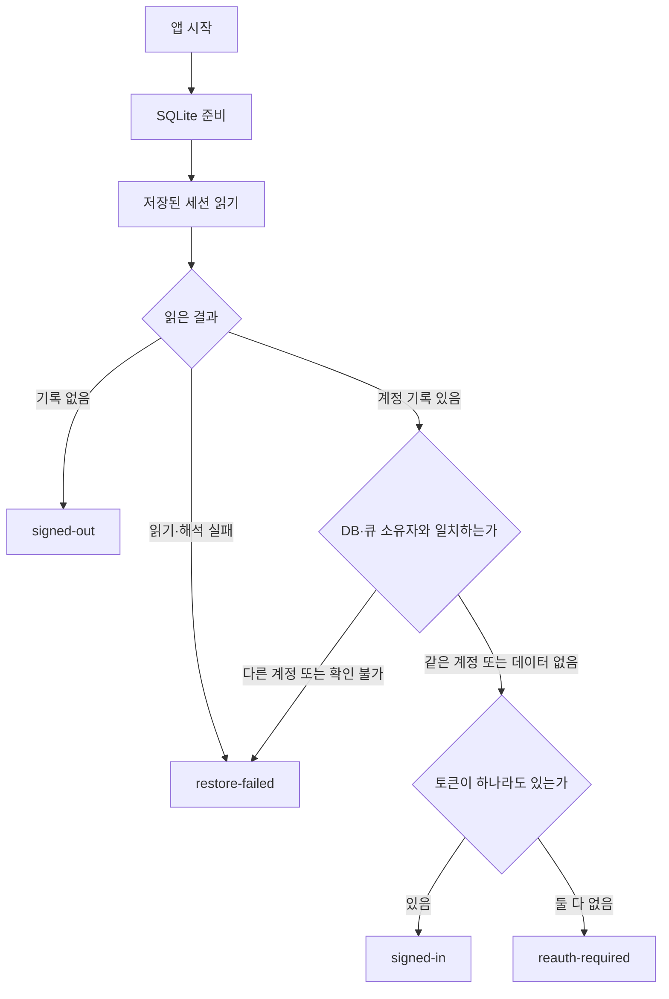

`AppInitialization`은 **DB 준비 후 Store의 복원을 호출하고 화면을 여는 순서**를 맡습니다. 세션 내용을 해석하고 상태를 정하는 일은 Store가 맡습니다.

복원은 한 번 시작하면 같은 Promise를 공유합니다. 화면 이동·네트워크 변경·재로그인 때마다 처음부터 복원하지 않습니다. `restore-failed`에서 사용자가 재시도할 때만 다시 읽습니다.

근거: [앱 준비 연결](/Users/hammyeong-yeon/Desktop/10_work/noline/apps/client/src/application/AppInitialization.tsx:30), [복원과 재시도](/Users/hammyeong-yeon/Desktop/10_work/noline/apps/client/src/shared/store/auth.ts:100)

---

## 2. 계정과 토큰은 어디에 있는가

현재는 세 위치의 역할을 구분해야 합니다.

### 기기에 영구 저장하는 세션

`token-storage.ts`는 Expo SecureStore라는 기기 보안 저장소에 다음 내용을 **하나의 JSON 값**으로 저장합니다.

```text
noline_session
  version
  userId
  userInfo
  accessToken
  refreshToken
```

토큰 두 개는 `null`일 수 있습니다. 그래서 다음 기록도 정상적인 형식입니다.

```text
userId: A
accessToken: null
refreshToken: null
```

이 기록은 다음 실행에서 **A의 `reauth-required` 상태**로 복원됩니다. 계정을 기억하기 위해 만료된 토큰까지 남겨 둘 필요가 없습니다.

이전 버전의 낱개 저장 키도 읽습니다. 다만 이전 기록에서 사용자 ID만 남아 있는 경우를 정상 세션으로 추정하지 않고 복원 실패로 처리합니다.

근거: [저장 형식과 이전 기록 읽기](/Users/hammyeong-yeon/Desktop/10_work/noline/apps/client/src/shared/services/auth/token-storage.ts:20)

### 앱 실행 중 사용하는 세션

`auth.ts` 안에서는 두 방식으로 정보를 제공합니다.

- 화면이 구독할 값: `status`, `userId`, `userInfo`, `sessionId`
- 요청에 쓸 토큰: Store 내부의 `currentSession`에 보관하고 `getAccessToken(sessionId)` 등으로 제공

토큰을 얻을 때는 **그 요청의 세션이 아직 현재 세션인지** 확인합니다. 요청마다 SecureStore를 다시 읽어 토큰을 가져오는 구조가 아닙니다.

따라서 인증 만료를 메모리에 반영한 뒤에는, 기기에 이전 토큰이 남아 있더라도 현재 실행의 요청이 그것을 다시 꺼내 쓰지 않습니다.

근거: [세션 내부 보관](/Users/hammyeong-yeon/Desktop/10_work/noline/apps/client/src/shared/store/auth.ts:67), [현재 세션의 토큰 제공](/Users/hammyeong-yeon/Desktop/10_work/noline/apps/client/src/shared/store/auth.ts:239)

### 여행 데이터

여행·일정·경비와 동기화 큐는 SQLite에 있습니다. 인증 만료 처리는 이 데이터를 삭제하지 않습니다.

**SecureStore의 세션 기록과 SQLite의 여행 데이터는 서로 다른 저장 대상**입니다. 이후의 계정 검사와 로그아웃 순서가 필요한 이유도 여기에 있습니다.

---

## 3. 헷갈렸던 Store와 `local-access`의 책임

**`selectLocalUserId`를 Store에 둘 수 없어서 분리한 것은 아닙니다. 현재는 `auth.ts`에 있습니다.**

다만 Store의 상태 속성이나 action으로 넣지 않고, 같은 파일의 함수로 정의했습니다.

```ts
export function selectLocalUserId(state) {
  return hasLocalSession(state) ? state.userId : null;
}
```

새로운 데이터를 저장하는 함수가 아니라 **주어진 상태에서 사용할 계정 ID를 계산하는 함수**이기 때문입니다.

현재 관계는 이렇습니다. 아래 화살표는 호출·참조 관계입니다.

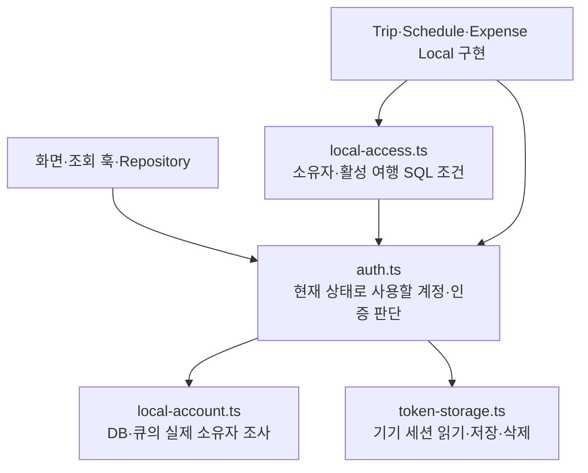

### `auth.ts`: 현재 상태에서 어떤 계정을 사용할 수 있는가

서로 가까운 함수 세 개의 차이는 다음과 같습니다.

- **`selectLocalUserId(state)`**  
  `signed-in`이나 `reauth-required`이면 계정 ID를 반환합니다. 그 외에는 `null`입니다. 계정이 없을 때 조회를 생략하거나 빈 결과를 돌려줄 소비자가 사용합니다.

- **`requireLocalUserId(requestedUserId?)`**  
  같은 판단을 사용하되, 계정이 없으면 오류를 던집니다. 생성 요청에 실린 `userId`가 현재 계정과 달라도 거절합니다.

- **`requireRemoteSession()`**  
  `signed-in`인지 확인합니다. 네트워크 연결이나 서버에서의 토큰 유효성까지 확인하는 함수는 아닙니다.

`select`와 `require`는 **허용하는 계정 기준은 같고, 허용되지 않았을 때 처리 방식이 다릅니다.** 현재 `requireLocalUserId`는 실제로 `selectLocalUserId`를 호출합니다.

근거: [계정 판단 함수](/Users/hammyeong-yeon/Desktop/10_work/noline/apps/client/src/shared/store/auth.ts:28)

### `local-access.ts`: 그 계정이 이 데이터에 접근해도 되는가

이 파일은 Store에서 계정 ID를 받은 다음 DB 조건을 만듭니다.

- `ownedRow`: 행의 `userId`가 현재 계정과 같아야 함
- `activeTripScope`: 현재 계정 소유이고, 삭제되지 않았으며, 활성화된 여행이어야 함
- `ownedActiveRow`: 위 두 조건을 함께 적용
- `assertActiveLocalTrip`: 해당 여행이 조건에 맞지 않으면 수정·생성을 거절

즉, 여기에서 계정 ID를 읽는 이유는 **SQL의 비교값으로 필요하기 때문**입니다. 어떤 인증 상태에서 ID를 사용할지 다시 정의하지 않습니다.

근거: [SQL 접근 조건](/Users/hammyeong-yeon/Desktop/10_work/noline/apps/client/src/shared/services/auth/local-access.ts:6)

### `local-account.ts`: 남아 있는 데이터는 누구 것인가

이 파일은 로그인 전후의 계정 혼합을 막기 위해 DB와 큐를 조사합니다.

결과는 `empty`, `same`, `different`, `unresolved` 중 하나입니다. 큐에 별도 계정 컬럼을 추가한 형태가 아니라, 큐가 가리키는 원본 행의 소유자와 payload를 대조합니다.

**Store가 이 조사 결과를 받아 로그인 허용 여부를 결정합니다.** 따라서 현재 Store는 단순한 메모리 변수 보관함보다 책임이 큽니다. **세션을 받아들일 조건, 저장, 상태 반영**을 함께 맡고 있습니다.

이 배치가 기술적으로 유일한 방법인 것은 아닙니다. 현재 코드에서는 같은 로그인 판단이 호출자마다 달라지는 것을 막기 위해 Store 안에서 필수 검사를 수행하고 있습니다.

근거: [DB·큐 소유자 조사](/Users/hammyeong-yeon/Desktop/10_work/noline/apps/client/src/shared/services/auth/local-account.ts:43), [Store의 로그인 수락 조건](/Users/hammyeong-yeon/Desktop/10_work/noline/apps/client/src/shared/store/auth.ts:152)

---

## 4. 언제 인증이 만료됐다고 판단하는가

**첫 401만으로 바로 재로그인 상태로 보내지 않습니다.**

일반 API와 동기화 API가 같은 인증 interceptor를 사용합니다. Interceptor는 HTTP 요청 전후에 세션을 확인하고, 필요한 경우 토큰 갱신을 처리하는 코드입니다.

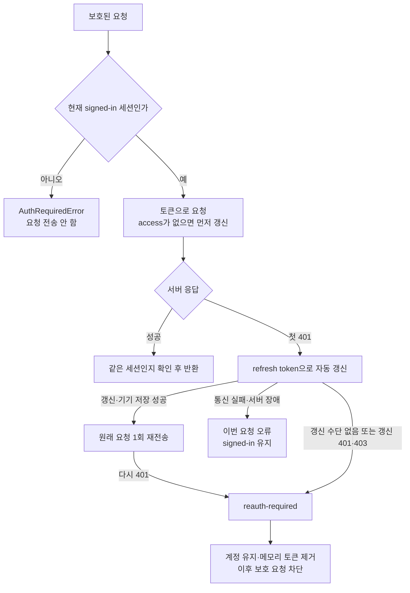

핵심 동작은 네 가지입니다.

1. **동시 갱신을 공유합니다.**  
   같은 세션의 요청 여러 개가 갱신을 필요로 하면 진행 중인 갱신 Promise를 공유합니다.

2. **갱신 토큰도 저장 성공 후 사용합니다.**  
   서버가 새 토큰을 줬더라도 기기 저장이 실패하면 갱신 성공으로 처리하지 않습니다.

3. **복구 불가가 확인되면 메모리부터 차단합니다.**  
   `requireReauthentication`이 토큰을 비우고 상태를 즉시 바꾼 뒤, 그 결과를 기기에 저장합니다. 다른 저장 작업이 진행 중이어도 새 보호 요청은 먼저 막힙니다.

4. **네트워크 오류와 인증 거부를 구분합니다.**  
   갱신 중 timeout·500 등이 발생했다는 이유만으로 계정을 재로그인 상태로 바꾸지 않습니다.

근거: [공유 인증 interceptor](/Users/hammyeong-yeon/Desktop/10_work/noline/apps/client/src/shared/services/auth/auth-interceptor.ts:25), [만료의 즉시 반영](/Users/hammyeong-yeon/Desktop/10_work/noline/apps/client/src/shared/store/auth.ts:220)

### 재시도는 각각 의미가 다릅니다

인증 갱신 후 원래 요청을 한 번 보내는 것과 React Query가 실패한 조회를 다시 실행하는 것은 별개입니다.

현재 React Query는 다음처럼 설정돼 있습니다.

- `AuthRequiredError`: 조회 재시도 안 함
- 그 외 조회 오류: 기본 1회 재시도
- mutation: React Query 재시도 0회

`fetcher`도 `AuthRequiredError`를 일반 서버 오류로 바꾸지 않고 전달합니다. 그래서 재로그인이 필요한 요청을 일반 실패처럼 계속 재실행하지 않습니다.

참고로 2·4·8초의 5xx 재시도는 **현재 동기화 HTTP 클라이언트에 있는 설정**입니다. 모든 일반 API 요청에 적용되는 것은 아닙니다.

근거: [오류 전달](/Users/hammyeong-yeon/Desktop/10_work/noline/apps/client/src/shared/api/fetcher.ts:39), [Query 재시도](/Users/hammyeong-yeon/Desktop/10_work/noline/apps/client/src/shared/lib/queryClient.ts:11), [동기화 HTTP 재시도](/Users/hammyeong-yeon/Desktop/10_work/noline/apps/client/src/shared/services/sync/api.ts:30)

---

## 5. 만료됐는데 일정 수정은 어떻게 가능한가

설명용으로 **A 계정의 활성 여행 T에서 일정 제목을 수정하는 상황**을 보겠습니다.

현재 상태는 다음과 같습니다.

```text
status = reauth-required
userId = A
accessToken = null
refreshToken = null
여행 T = A 계정의 활성 여행
```

이때 수정은 다음 순서로 실행됩니다.

1. Repository가 대상 `tripId=T`로 Router를 호출합니다.
2. Router의 `requireLocalUserId()`는 A를 반환합니다.
3. T가 활성 여행이므로 Local 구현을 선택합니다.
4. Local 구현이 **A 소유의 활성 여행 일정인지** SQL 조건으로 확인합니다.
5. 일정 수정과 동기화 큐 추가를 같은 DB transaction에서 처리합니다.

이 경로에는 서버 요청이 없습니다. 따라서 서버 인증이 막혀 있어도 기기에 저장할 수 있습니다.

반면 T가 **비활성 여행**이면 Router는 Remote 경로에 필요한 인증을 확인합니다. 이때 `reauth-required`이므로 서버 호출 전에 거절합니다. 인터넷이 연결돼 있어도 결과는 같습니다.

근거: [대상 여행에 따른 분기](/Users/hammyeong-yeon/Desktop/10_work/noline/apps/client/src/shared/services/offline-prep/router.ts:74), [일정 수정과 큐 저장](/Users/hammyeong-yeon/Desktop/10_work/noline/apps/client/src/entities/schedule/lib/schedule-local.ts:109)

### 화면이 계속 열려 있는 이유도 같은 기준입니다

- 탭 진입은 `hasLocalSession`을 사용하므로 `reauth-required`에서도 유지됩니다.
- 만료 배너가 “변경은 기기에 저장되고, 동기화에는 재로그인이 필요하다”고 안내합니다.
- `useAppPolicy`는 활성 여행의 로컬 작업과 비활성 여행의 제한을 구분합니다.
- Sync 시작 조건은 `signed-in`을 요구하므로 새 동기화를 시작하지 않습니다.

즉 **화면 유지, Local 실행 허용, Remote 차단, sync 차단이 각각 연결돼 있습니다.** 버튼을 숨기는 것만으로 접근을 제한하는 구조는 아닙니다.

근거: [탭 접근](/Users/hammyeong-yeon/Desktop/10_work/noline/apps/client/app/(tabs)/_layout.tsx:6), [만료 안내](/Users/hammyeong-yeon/Desktop/10_work/noline/apps/client/src/shared/components/SessionExpiredBanner.tsx:8), [정책의 인증 조건](/Users/hammyeong-yeon/Desktop/10_work/noline/apps/client/src/shared/policy/useAppPolicy.ts:34), [sync 시작 조건](/Users/hammyeong-yeon/Desktop/10_work/noline/apps/client/src/shared/services/sync/lifecycle.ts:70)

---

## 6. 같은 계정으로 재로그인하면 무엇이 바뀌는가

로그인 화면에서 Google·Apple 인증을 거쳐 서버 로그인 응답을 받습니다. **이 응답을 받았다는 사실만으로 앱의 로그인 완료 상태를 공개하지는 않습니다.**

그다음 `completeLogin`이 아래 절차를 수행합니다.

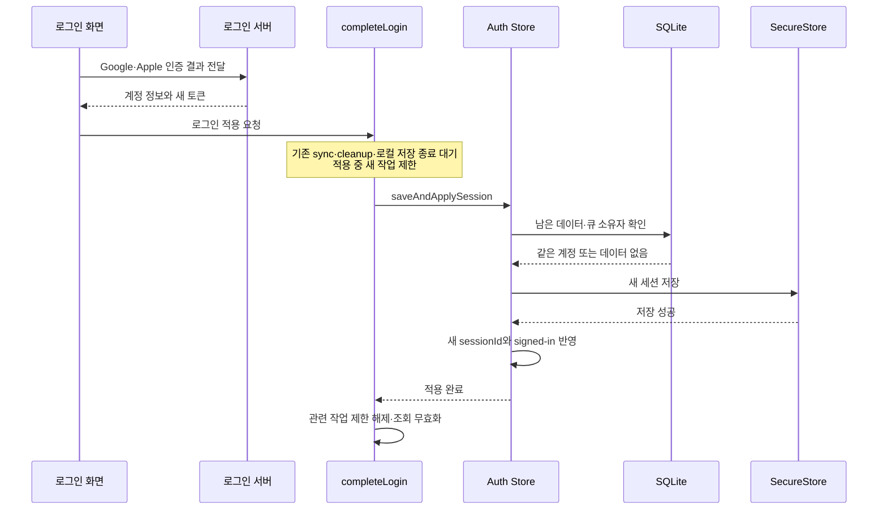

### 성공했을 때

- 여행 데이터와 큐는 그대로 둡니다.
- 새 토큰을 저장합니다.
- 새 `sessionId`로 `signed-in`을 공개합니다.
- 조회를 무효화해 다시 읽게 합니다.
- DB 준비·실제 online·debug override 해제 등 조건이 맞으면 SyncProvider가 동기화를 시작합니다.
- 같은 계정이고 돌아갈 화면이 있으면 로그인 화면에서 이전 화면으로 돌아갑니다.

### 실패했을 때

- **다른 계정**: 로그인 적용을 거절하고 기존 계정·데이터를 유지합니다.
- **큐 소유자를 확인할 수 없음**: 임의로 지우지 않고 로그인 적용을 거절합니다.
- **기기 저장 실패**: 기존 `reauth-required` 상태를 유지합니다.
- **로그인 취소**: 새 세션 적용 절차에 들어가지 않습니다.

기기에 적용하지 못한 로그인 토큰은 서버에 폐기를 시도합니다. 그리고 세션 저장이 끝난 후의 조회 갱신 실패는 로그인 실패로 되돌리지 않습니다.

근거: [로그인 서비스](/Users/hammyeong-yeon/Desktop/10_work/noline/apps/client/src/shared/services/auth/login-service.ts:7), [Store의 검사·저장·적용](/Users/hammyeong-yeon/Desktop/10_work/noline/apps/client/src/shared/store/auth.ts:152), [이전 화면 복귀](/Users/hammyeong-yeon/Desktop/10_work/noline/apps/client/app/_layout.tsx:46)

---

## 7. 왜 순서를 제어하는 코드가 두 군데 있는가

이 부분이 현재 구현에서 가장 복잡하게 느껴질 수 있습니다.

### Store의 저장 순서

`auth.ts`의 `pendingWrites`는 다음 작업을 순서대로 실행합니다.

- 초기 복원
- 로그인 계정 검사·저장·적용
- 토큰 갱신 저장
- 만료 상태 저장
- 세션 삭제

예를 들어 이전 토큰 저장과 로그아웃 삭제가 겹쳐서 **삭제한 뒤 옛 토큰이 다시 저장되는 상황**을 막기 위한 것입니다.

### 로그인·로그아웃 전체 절차의 순서

`session-lifecycle.ts`의 `withSessionChange`는 더 넓은 범위를 조율합니다.

- 로그인 적용·로그아웃·회원 탈퇴끼리 순서를 지킴
- 새 sync를 막고 진행 중 sync 종료를 기다림
- pending cleanup 종료를 기다림
- 새 로컬 transaction을 거절하고 이미 접수된 저장을 기다림
- 실제 세션 변경 절차 실행
- 성공·실패 후 제한 해제

예를 들어 로그아웃이 “미전송 작업 없음”을 확인한 직후 새 일정 저장이 끼어들면, 새로 저장한 일정이 바로 삭제될 수 있습니다. 이 구간을 보호하는 것은 토큰 저장 순서만으로 해결되지 않습니다.

반대로 자동 토큰 갱신마다 여행 데이터 정리 절차 전체를 실행할 필요는 없습니다.

**그래서 두 곳은 보호하는 작업 범위가 다릅니다.** 다만 현재 Store action은 공개되어 있으므로, 모든 호출자가 반드시 `withSessionChange`를 거치도록 타입으로 강제한 구조는 아닙니다. 현재 로그인·로그아웃·탈퇴 서비스가 이를 사용하도록 연결돼 있습니다.

근거: [Store 저장 순서](/Users/hammyeong-yeon/Desktop/10_work/noline/apps/client/src/shared/store/auth.ts:71), [세션 변경 전체 순서](/Users/hammyeong-yeon/Desktop/10_work/noline/apps/client/src/shared/services/auth/session-lifecycle.ts:5), [로컬 저장 접수 제한](/Users/hammyeong-yeon/Desktop/10_work/noline/apps/client/src/shared/db/index.ts:41)

### `sessionId`가 추가로 필요한 이유

작업 순서와 별개로, 이미 네트워크에 나가 있던 응답이 늦게 도착할 수 있습니다.

```text
A의 이전 세션에서 토큰 갱신 요청
사용자가 로그아웃
같은 A로 새 로그인
이전 갱신 응답 도착
```

여기서는 `userId`를 비교하면 둘 다 A라서 구별하지 못합니다.

현재 코드는 메모리에서 생성한 `Symbol`을 `sessionId`로 사용합니다. 새 로그인, 인증 거부, 세션 종료 때 이전 요청을 현재 요청으로 인정하지 않도록 만듭니다. 정상적인 토큰 갱신은 같은 세션 안에서 처리합니다.

이 검사는 토큰 접근, 갱신 적용, 보호된 HTTP 성공 응답에 연결돼 있습니다. 서버에서 여행을 받은 뒤 DB에 저장하는 활성화 작업도 transaction 안에서 다시 확인합니다.

이것이 의미하는 보장은 **이전 세션의 결과를 현재 세션에 적용하지 않는 것**입니다. 이미 전송된 요청이 서버에서 수행한 작업 자체를 취소하는 기능은 아닙니다.

근거: [세션 동일성 검사](/Users/hammyeong-yeon/Desktop/10_work/noline/apps/client/src/shared/store/auth.ts:96), [응답 검사](/Users/hammyeong-yeon/Desktop/10_work/noline/apps/client/src/shared/services/auth/auth-interceptor.ts:79), [활성화 저장 직전 검사](/Users/hammyeong-yeon/Desktop/10_work/noline/apps/client/src/entities/trip/data/useActivateTrip.ts:79)

---

## 8. 현재 설명에서 보장 범위를 구분해야 하는 부분

### 만료 상태의 기기 저장이 실패할 수 있습니다

현재 실행에서는 메모리를 먼저 바꿔 보호 요청을 차단합니다.

하지만 **그 상태를 SecureStore에 저장하지 못한 채 앱이 종료되면**, 다음 실행에서는 이전 토큰이 남은 기록을 읽을 수 있습니다. 그러면 일단 `signed-in`으로 복원되고 이후 요청에서 다시 인증 거부를 확인할 수 있습니다.

따라서 “저장 실패 여부와 관계없이 다음 실행에서도 반드시 `reauth-required`다”라고 말할 수는 없습니다.

### 로그아웃은 두 저장소를 한 번에 되돌리는 작업이 아닙니다

현재 순서는 **SQLite 초기화 → 기기 인증 기록 삭제 → 화면의 선택·캐시 정리**입니다.

SQLite 초기화가 성공한 뒤 인증 기록 삭제가 실패하면, 데이터는 이미 정리됐지만 세션 삭제는 실패한 상태가 남을 수 있습니다. 이때 코드가 서버 인증을 다시 허용하지 않고 종료 재시도가 가능한 계정 상태를 남깁니다.

앱 강제 종료 뒤 정리를 이어가는 장치는 기존 합의대로 구현 범위에서 제외돼 있습니다.

근거: [로그아웃의 실제 정리 순서](/Users/hammyeong-yeon/Desktop/10_work/noline/apps/client/src/shared/services/auth/logout-service.ts:147)

### 테스트가 확인한 것과 실제 기기 확인은 다릅니다

현재 테스트에는 다음 사례가 있습니다.

- 저장 기록에 따른 다섯 상태 복원
- 같은 계정 재로그인 저장 실패 후 기존 상태 유지
- 동시 로그인과 늦은 갱신 응답
- 첫 401의 자동 갱신과 복구 불가 판정
- 만료 뒤 활성 여행의 Local 수정·큐 저장
- 다른 계정 데이터 접근 거절
- 재로그인 화면 진입과 이전 화면 복귀

Store·HTTP 테스트는 SecureStore와 통신을 대체한 환경을 사용합니다. Local 접근 테스트는 실제 Drizzle SQL과 Node 메모리 SQLite를 사용합니다.

이전 인증 분리 검증 로그의 **30개 테스트 묶음·277개 테스트 통과**도 확인했습니다. 이번에는 코드를 설명하기 위해 원자료를 읽었으며 테스트를 다시 실행하지 않았습니다. 실제 OAuth, native SecureStore 실패, 서버 토큰 교체와 실기기 화면까지 검증됐다는 뜻은 아닙니다.

또 Ticket에 남은 일부 “커밋 완료” 문구는 방금 커밋을 해제한 Git 상태와 다릅니다. 이번 설명에서는 현재 작업 트리를 기준으로 삼았습니다.

---

현재 코드를 읽을 때의 기준을 압축하면 이렇습니다.

- **현재 계정·인증 상태와 세션 수락 조건** → `auth.ts`
- **기기에 무엇을 어떻게 저장하는가** → `token-storage.ts`
- **남은 데이터가 누구 것인가** → `local-account.ts`
- **이 행이 현재 계정의 접근 가능한 데이터인가** → `local-access.ts`
- **서버 요청의 갱신·거부·늦은 응답 처리** → `auth-interceptor.ts`
- **로그인·로그아웃과 DB 작업이 겹치지 않게 하는 절차** → `session-lifecycle.ts`

**계정 ID를 얻는 기준은 Store에 모여 있고, DB 소유권과 활성 조건은 그 기준을 사용합니다.** 현재 구조를 이해할 때 가장 먼저 고정할 관계는 이것입니다.

---

