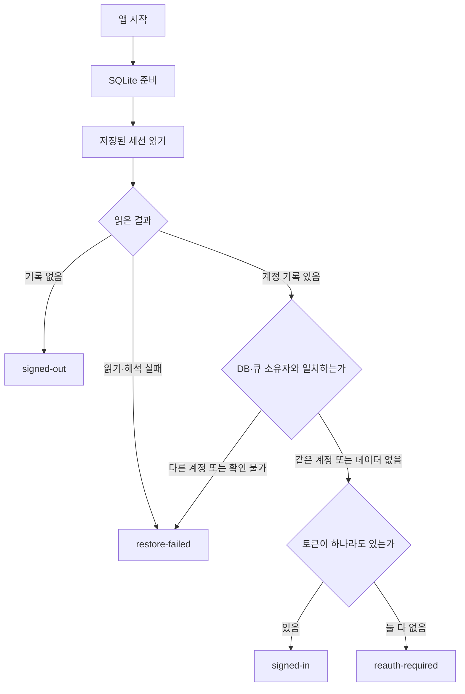
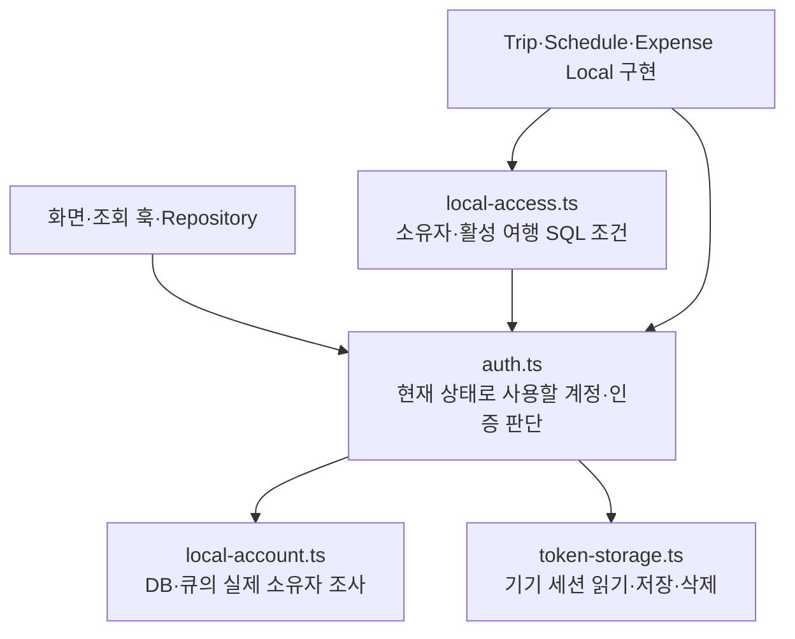
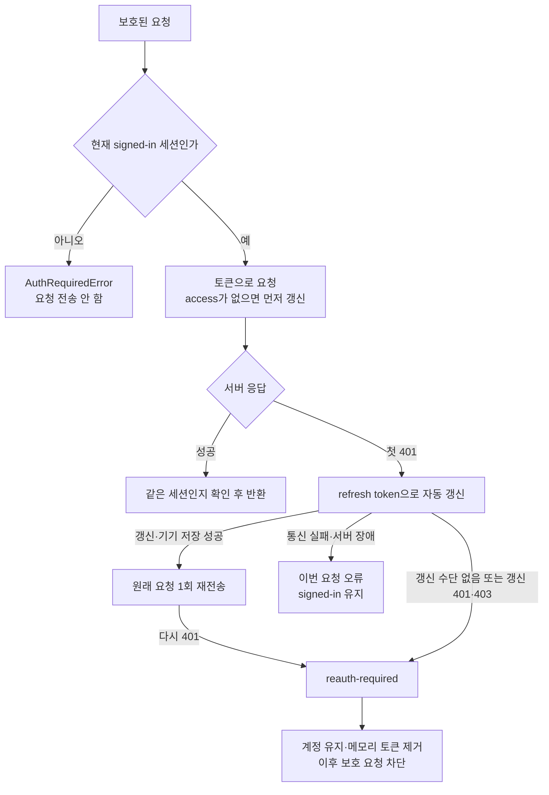
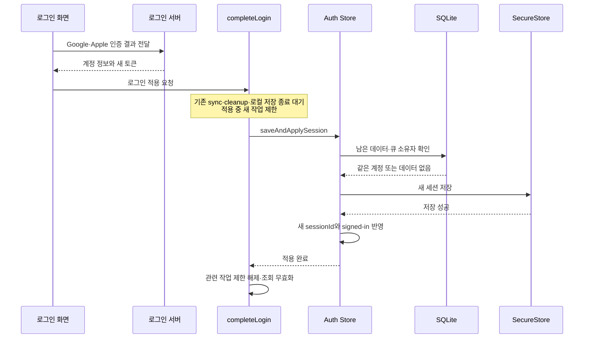
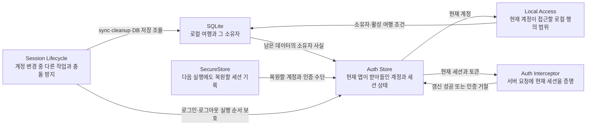
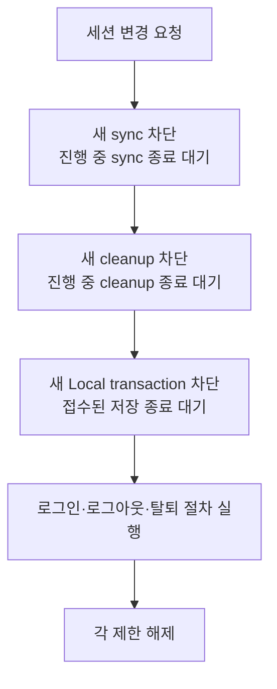
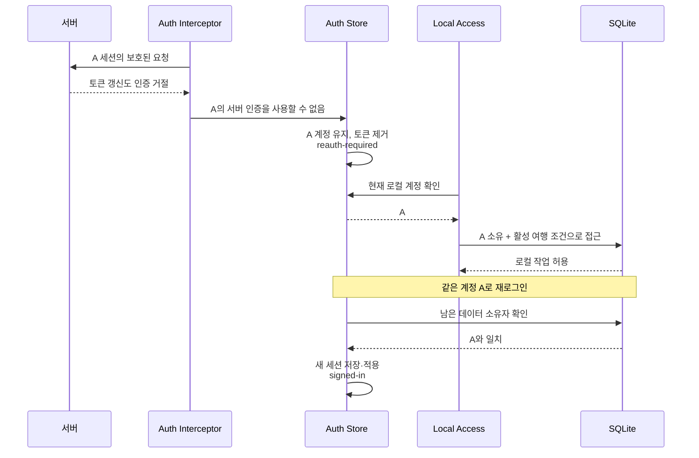

# 대화 원문

## 앞선 인증 설명
# 작업물 이해 브리핑 — 현재 인증 구현

현재 인증 작업의 중심은 다음 동작입니다.

> **서버 인증을 복구할 수 없게 되어도 계정과 활성 여행은 유지한다. 같은 계정으로 재로그인하고 기기 저장까지 성공하면 서버 이용을 다시 허용한다.**

이를 위해 **계정 정보, 서버 요청에 쓸 토큰, 여행 데이터의 소유권**을 구분해서 다루고 있습니다.

아래 설명은 **커밋을 해제한 현재 작업 트리의 코드**를 직접 읽은 결과입니다. 도식은 코드의 호출과 조건을 재구성한 것으로, 실기기 실행 기록은 아닙니다. 동기화·화면 정책은 인증과 연결되는 부분만 설명합니다.

---

## 1. 먼저, 인증 상태가 무엇을 뜻하는가

이전 커밋에서는 `isAuthenticated`, `isSessionExpired`라는 두 boolean을 함께 읽어 상태를 해석했습니다. 현재는 `status` 하나로 다섯 상태를 표현합니다.

가장 중요한 차이는 **“사용할 계정을 알고 있지만 서버 인증은 다시 필요한 상태”**인 `reauth-required`가 있다는 점입니다.

| 상태 | 코드에서의 의미 | 앱의 동작 |
|---|---|---|
| `initializing` | 저장된 세션을 아직 판정하지 못함 | 초기 준비를 기다림 |
| `signed-out` | 세션 기록이 없거나 명시적 세션 삭제가 완료됨 | 로그인 화면 |
| `signed-in` | 계정과 access 또는 refresh token이 있음 | 기존 네트워크·여행 활성화 조건에 따라 이용 |
| `reauth-required` | 계정은 유지하지만 쓸 인증 수단이 없음 | 활성 여행 Local 작업 유지, 보호된 서버 요청 차단 |
| `restore-failed` | 저장소 읽기·해석·계정 일치 확인에 실패함 | 데이터 보존, 로그인 화면에서 복원 재시도 |

여기서 **`signed-in`은 서버가 방금 토큰의 유효성을 확인했다는 뜻이 아닙니다.** 저장된 토큰으로 요청하거나 자동 갱신을 시도할 수 있다는 뜻입니다. 앱을 열 때 서버 응답부터 기다리지 않도록 한 것입니다.

또한 `signed-out`이라고 해서 SQLite가 반드시 비어 있다는 뜻도 아닙니다. 인증 기록이 없는데 여행 데이터가 남아 있을 수 있으므로, 새 로그인 때 별도로 소유자를 검사합니다.

근거: [상태 선언과 적용 — auth.ts](/Users/hammyeong-yeon/Desktop/10_work/noline/apps/client/src/shared/store/auth.ts:13)

### 앱 시작 때의 판정



`AppInitialization`은 **DB 준비 후 Store의 복원을 호출하고 화면을 여는 순서**를 맡습니다. 세션 내용을 해석하고 상태를 정하는 일은 Store가 맡습니다.

복원은 한 번 시작하면 같은 Promise를 공유합니다. 화면 이동·네트워크 변경·재로그인 때마다 처음부터 복원하지 않습니다. `restore-failed`에서 사용자가 재시도할 때만 다시 읽습니다.

근거: [앱 준비 연결](/Users/hammyeong-yeon/Desktop/10_work/noline/apps/client/src/application/AppInitialization.tsx:30), [복원과 재시도](/Users/hammyeong-yeon/Desktop/10_work/noline/apps/client/src/shared/store/auth.ts:100)

---

## 2. 계정과 토큰은 어디에 있는가

현재는 세 위치의 역할을 구분해야 합니다.

### 기기에 영구 저장하는 세션

`token-storage.ts`는 Expo SecureStore라는 기기 보안 저장소에 다음 내용을 **하나의 JSON 값**으로 저장합니다.

```text
noline_session
  version
  userId
  userInfo
  accessToken
  refreshToken
```

토큰 두 개는 `null`일 수 있습니다. 그래서 다음 기록도 정상적인 형식입니다.

```text
userId: A
accessToken: null
refreshToken: null
```

이 기록은 다음 실행에서 **A의 `reauth-required` 상태**로 복원됩니다. 계정을 기억하기 위해 만료된 토큰까지 남겨 둘 필요가 없습니다.

이전 버전의 낱개 저장 키도 읽습니다. 다만 이전 기록에서 사용자 ID만 남아 있는 경우를 정상 세션으로 추정하지 않고 복원 실패로 처리합니다.

근거: [저장 형식과 이전 기록 읽기](/Users/hammyeong-yeon/Desktop/10_work/noline/apps/client/src/shared/services/auth/token-storage.ts:20)

### 앱 실행 중 사용하는 세션

`auth.ts` 안에서는 두 방식으로 정보를 제공합니다.

- 화면이 구독할 값: `status`, `userId`, `userInfo`, `sessionId`
- 요청에 쓸 토큰: Store 내부의 `currentSession`에 보관하고 `getAccessToken(sessionId)` 등으로 제공

토큰을 얻을 때는 **그 요청의 세션이 아직 현재 세션인지** 확인합니다. 요청마다 SecureStore를 다시 읽어 토큰을 가져오는 구조가 아닙니다.

따라서 인증 만료를 메모리에 반영한 뒤에는, 기기에 이전 토큰이 남아 있더라도 현재 실행의 요청이 그것을 다시 꺼내 쓰지 않습니다.

근거: [세션 내부 보관](/Users/hammyeong-yeon/Desktop/10_work/noline/apps/client/src/shared/store/auth.ts:67), [현재 세션의 토큰 제공](/Users/hammyeong-yeon/Desktop/10_work/noline/apps/client/src/shared/store/auth.ts:239)

### 여행 데이터

여행·일정·경비와 동기화 큐는 SQLite에 있습니다. 인증 만료 처리는 이 데이터를 삭제하지 않습니다.

**SecureStore의 세션 기록과 SQLite의 여행 데이터는 서로 다른 저장 대상**입니다. 이후의 계정 검사와 로그아웃 순서가 필요한 이유도 여기에 있습니다.

---

## 3. 헷갈렸던 Store와 `local-access`의 책임

**`selectLocalUserId`를 Store에 둘 수 없어서 분리한 것은 아닙니다. 현재는 `auth.ts`에 있습니다.**

다만 Store의 상태 속성이나 action으로 넣지 않고, 같은 파일의 함수로 정의했습니다.

```ts
export function selectLocalUserId(state) {
  return hasLocalSession(state) ? state.userId : null;
}
```

새로운 데이터를 저장하는 함수가 아니라 **주어진 상태에서 사용할 계정 ID를 계산하는 함수**이기 때문입니다.

현재 관계는 이렇습니다. 아래 화살표는 호출·참조 관계입니다.



### `auth.ts`: 현재 상태에서 어떤 계정을 사용할 수 있는가

서로 가까운 함수 세 개의 차이는 다음과 같습니다.

- **`selectLocalUserId(state)`**  
  `signed-in`이나 `reauth-required`이면 계정 ID를 반환합니다. 그 외에는 `null`입니다. 계정이 없을 때 조회를 생략하거나 빈 결과를 돌려줄 소비자가 사용합니다.

- **`requireLocalUserId(requestedUserId?)`**  
  같은 판단을 사용하되, 계정이 없으면 오류를 던집니다. 생성 요청에 실린 `userId`가 현재 계정과 달라도 거절합니다.

- **`requireRemoteSession()`**  
  `signed-in`인지 확인합니다. 네트워크 연결이나 서버에서의 토큰 유효성까지 확인하는 함수는 아닙니다.

`select`와 `require`는 **허용하는 계정 기준은 같고, 허용되지 않았을 때 처리 방식이 다릅니다.** 현재 `requireLocalUserId`는 실제로 `selectLocalUserId`를 호출합니다.

근거: [계정 판단 함수](/Users/hammyeong-yeon/Desktop/10_work/noline/apps/client/src/shared/store/auth.ts:28)

### `local-access.ts`: 그 계정이 이 데이터에 접근해도 되는가

이 파일은 Store에서 계정 ID를 받은 다음 DB 조건을 만듭니다.

- `ownedRow`: 행의 `userId`가 현재 계정과 같아야 함
- `activeTripScope`: 현재 계정 소유이고, 삭제되지 않았으며, 활성화된 여행이어야 함
- `ownedActiveRow`: 위 두 조건을 함께 적용
- `assertActiveLocalTrip`: 해당 여행이 조건에 맞지 않으면 수정·생성을 거절

즉, 여기에서 계정 ID를 읽는 이유는 **SQL의 비교값으로 필요하기 때문**입니다. 어떤 인증 상태에서 ID를 사용할지 다시 정의하지 않습니다.

근거: [SQL 접근 조건](/Users/hammyeong-yeon/Desktop/10_work/noline/apps/client/src/shared/services/auth/local-access.ts:6)

### `local-account.ts`: 남아 있는 데이터는 누구 것인가

이 파일은 로그인 전후의 계정 혼합을 막기 위해 DB와 큐를 조사합니다.

결과는 `empty`, `same`, `different`, `unresolved` 중 하나입니다. 큐에 별도 계정 컬럼을 추가한 형태가 아니라, 큐가 가리키는 원본 행의 소유자와 payload를 대조합니다.

**Store가 이 조사 결과를 받아 로그인 허용 여부를 결정합니다.** 따라서 현재 Store는 단순한 메모리 변수 보관함보다 책임이 큽니다. **세션을 받아들일 조건, 저장, 상태 반영**을 함께 맡고 있습니다.

이 배치가 기술적으로 유일한 방법인 것은 아닙니다. 현재 코드에서는 같은 로그인 판단이 호출자마다 달라지는 것을 막기 위해 Store 안에서 필수 검사를 수행하고 있습니다.

근거: [DB·큐 소유자 조사](/Users/hammyeong-yeon/Desktop/10_work/noline/apps/client/src/shared/services/auth/local-account.ts:43), [Store의 로그인 수락 조건](/Users/hammyeong-yeon/Desktop/10_work/noline/apps/client/src/shared/store/auth.ts:152)

---

## 4. 언제 인증이 만료됐다고 판단하는가

**첫 401만으로 바로 재로그인 상태로 보내지 않습니다.**

일반 API와 동기화 API가 같은 인증 interceptor를 사용합니다. Interceptor는 HTTP 요청 전후에 세션을 확인하고, 필요한 경우 토큰 갱신을 처리하는 코드입니다.



핵심 동작은 네 가지입니다.

1. **동시 갱신을 공유합니다.**  
   같은 세션의 요청 여러 개가 갱신을 필요로 하면 진행 중인 갱신 Promise를 공유합니다.

2. **갱신 토큰도 저장 성공 후 사용합니다.**  
   서버가 새 토큰을 줬더라도 기기 저장이 실패하면 갱신 성공으로 처리하지 않습니다.

3. **복구 불가가 확인되면 메모리부터 차단합니다.**  
   `requireReauthentication`이 토큰을 비우고 상태를 즉시 바꾼 뒤, 그 결과를 기기에 저장합니다. 다른 저장 작업이 진행 중이어도 새 보호 요청은 먼저 막힙니다.

4. **네트워크 오류와 인증 거부를 구분합니다.**  
   갱신 중 timeout·500 등이 발생했다는 이유만으로 계정을 재로그인 상태로 바꾸지 않습니다.

근거: [공유 인증 interceptor](/Users/hammyeong-yeon/Desktop/10_work/noline/apps/client/src/shared/services/auth/auth-interceptor.ts:25), [만료의 즉시 반영](/Users/hammyeong-yeon/Desktop/10_work/noline/apps/client/src/shared/store/auth.ts:220)

### 재시도는 각각 의미가 다릅니다

인증 갱신 후 원래 요청을 한 번 보내는 것과 React Query가 실패한 조회를 다시 실행하는 것은 별개입니다.

현재 React Query는 다음처럼 설정돼 있습니다.

- `AuthRequiredError`: 조회 재시도 안 함
- 그 외 조회 오류: 기본 1회 재시도
- mutation: React Query 재시도 0회

`fetcher`도 `AuthRequiredError`를 일반 서버 오류로 바꾸지 않고 전달합니다. 그래서 재로그인이 필요한 요청을 일반 실패처럼 계속 재실행하지 않습니다.

참고로 2·4·8초의 5xx 재시도는 **현재 동기화 HTTP 클라이언트에 있는 설정**입니다. 모든 일반 API 요청에 적용되는 것은 아닙니다.

근거: [오류 전달](/Users/hammyeong-yeon/Desktop/10_work/noline/apps/client/src/shared/api/fetcher.ts:39), [Query 재시도](/Users/hammyeong-yeon/Desktop/10_work/noline/apps/client/src/shared/lib/queryClient.ts:11), [동기화 HTTP 재시도](/Users/hammyeong-yeon/Desktop/10_work/noline/apps/client/src/shared/services/sync/api.ts:30)

---

## 5. 만료됐는데 일정 수정은 어떻게 가능한가

설명용으로 **A 계정의 활성 여행 T에서 일정 제목을 수정하는 상황**을 보겠습니다.

현재 상태는 다음과 같습니다.

```text
status = reauth-required
userId = A
accessToken = null
refreshToken = null
여행 T = A 계정의 활성 여행
```

이때 수정은 다음 순서로 실행됩니다.

1. Repository가 대상 `tripId=T`로 Router를 호출합니다.
2. Router의 `requireLocalUserId()`는 A를 반환합니다.
3. T가 활성 여행이므로 Local 구현을 선택합니다.
4. Local 구현이 **A 소유의 활성 여행 일정인지** SQL 조건으로 확인합니다.
5. 일정 수정과 동기화 큐 추가를 같은 DB transaction에서 처리합니다.

이 경로에는 서버 요청이 없습니다. 따라서 서버 인증이 막혀 있어도 기기에 저장할 수 있습니다.

반면 T가 **비활성 여행**이면 Router는 Remote 경로에 필요한 인증을 확인합니다. 이때 `reauth-required`이므로 서버 호출 전에 거절합니다. 인터넷이 연결돼 있어도 결과는 같습니다.

근거: [대상 여행에 따른 분기](/Users/hammyeong-yeon/Desktop/10_work/noline/apps/client/src/shared/services/offline-prep/router.ts:74), [일정 수정과 큐 저장](/Users/hammyeong-yeon/Desktop/10_work/noline/apps/client/src/entities/schedule/lib/schedule-local.ts:109)

### 화면이 계속 열려 있는 이유도 같은 기준입니다

- 탭 진입은 `hasLocalSession`을 사용하므로 `reauth-required`에서도 유지됩니다.
- 만료 배너가 “변경은 기기에 저장되고, 동기화에는 재로그인이 필요하다”고 안내합니다.
- `useAppPolicy`는 활성 여행의 로컬 작업과 비활성 여행의 제한을 구분합니다.
- Sync 시작 조건은 `signed-in`을 요구하므로 새 동기화를 시작하지 않습니다.

즉 **화면 유지, Local 실행 허용, Remote 차단, sync 차단이 각각 연결돼 있습니다.** 버튼을 숨기는 것만으로 접근을 제한하는 구조는 아닙니다.

근거: [탭 접근](/Users/hammyeong-yeon/Desktop/10_work/noline/apps/client/app/(tabs)/_layout.tsx:6), [만료 안내](/Users/hammyeong-yeon/Desktop/10_work/noline/apps/client/src/shared/components/SessionExpiredBanner.tsx:8), [정책의 인증 조건](/Users/hammyeong-yeon/Desktop/10_work/noline/apps/client/src/shared/policy/useAppPolicy.ts:34), [sync 시작 조건](/Users/hammyeong-yeon/Desktop/10_work/noline/apps/client/src/shared/services/sync/lifecycle.ts:70)

---

## 6. 같은 계정으로 재로그인하면 무엇이 바뀌는가

로그인 화면에서 Google·Apple 인증을 거쳐 서버 로그인 응답을 받습니다. **이 응답을 받았다는 사실만으로 앱의 로그인 완료 상태를 공개하지는 않습니다.**

그다음 `completeLogin`이 아래 절차를 수행합니다.



### 성공했을 때

- 여행 데이터와 큐는 그대로 둡니다.
- 새 토큰을 저장합니다.
- 새 `sessionId`로 `signed-in`을 공개합니다.
- 조회를 무효화해 다시 읽게 합니다.
- DB 준비·실제 online·debug override 해제 등 조건이 맞으면 SyncProvider가 동기화를 시작합니다.
- 같은 계정이고 돌아갈 화면이 있으면 로그인 화면에서 이전 화면으로 돌아갑니다.

### 실패했을 때

- **다른 계정**: 로그인 적용을 거절하고 기존 계정·데이터를 유지합니다.
- **큐 소유자를 확인할 수 없음**: 임의로 지우지 않고 로그인 적용을 거절합니다.
- **기기 저장 실패**: 기존 `reauth-required` 상태를 유지합니다.
- **로그인 취소**: 새 세션 적용 절차에 들어가지 않습니다.

기기에 적용하지 못한 로그인 토큰은 서버에 폐기를 시도합니다. 그리고 세션 저장이 끝난 후의 조회 갱신 실패는 로그인 실패로 되돌리지 않습니다.

근거: [로그인 서비스](/Users/hammyeong-yeon/Desktop/10_work/noline/apps/client/src/shared/services/auth/login-service.ts:7), [Store의 검사·저장·적용](/Users/hammyeong-yeon/Desktop/10_work/noline/apps/client/src/shared/store/auth.ts:152), [이전 화면 복귀](/Users/hammyeong-yeon/Desktop/10_work/noline/apps/client/app/_layout.tsx:46)

---

## 7. 왜 순서를 제어하는 코드가 두 군데 있는가

이 부분이 현재 구현에서 가장 복잡하게 느껴질 수 있습니다.

### Store의 저장 순서

`auth.ts`의 `pendingWrites`는 다음 작업을 순서대로 실행합니다.

- 초기 복원
- 로그인 계정 검사·저장·적용
- 토큰 갱신 저장
- 만료 상태 저장
- 세션 삭제

예를 들어 이전 토큰 저장과 로그아웃 삭제가 겹쳐서 **삭제한 뒤 옛 토큰이 다시 저장되는 상황**을 막기 위한 것입니다.

### 로그인·로그아웃 전체 절차의 순서

`session-lifecycle.ts`의 `withSessionChange`는 더 넓은 범위를 조율합니다.

- 로그인 적용·로그아웃·회원 탈퇴끼리 순서를 지킴
- 새 sync를 막고 진행 중 sync 종료를 기다림
- pending cleanup 종료를 기다림
- 새 로컬 transaction을 거절하고 이미 접수된 저장을 기다림
- 실제 세션 변경 절차 실행
- 성공·실패 후 제한 해제

예를 들어 로그아웃이 “미전송 작업 없음”을 확인한 직후 새 일정 저장이 끼어들면, 새로 저장한 일정이 바로 삭제될 수 있습니다. 이 구간을 보호하는 것은 토큰 저장 순서만으로 해결되지 않습니다.

반대로 자동 토큰 갱신마다 여행 데이터 정리 절차 전체를 실행할 필요는 없습니다.

**그래서 두 곳은 보호하는 작업 범위가 다릅니다.** 다만 현재 Store action은 공개되어 있으므로, 모든 호출자가 반드시 `withSessionChange`를 거치도록 타입으로 강제한 구조는 아닙니다. 현재 로그인·로그아웃·탈퇴 서비스가 이를 사용하도록 연결돼 있습니다.

근거: [Store 저장 순서](/Users/hammyeong-yeon/Desktop/10_work/noline/apps/client/src/shared/store/auth.ts:71), [세션 변경 전체 순서](/Users/hammyeong-yeon/Desktop/10_work/noline/apps/client/src/shared/services/auth/session-lifecycle.ts:5), [로컬 저장 접수 제한](/Users/hammyeong-yeon/Desktop/10_work/noline/apps/client/src/shared/db/index.ts:41)

### `sessionId`가 추가로 필요한 이유

작업 순서와 별개로, 이미 네트워크에 나가 있던 응답이 늦게 도착할 수 있습니다.

```text
A의 이전 세션에서 토큰 갱신 요청
사용자가 로그아웃
같은 A로 새 로그인
이전 갱신 응답 도착
```

여기서는 `userId`를 비교하면 둘 다 A라서 구별하지 못합니다.

현재 코드는 메모리에서 생성한 `Symbol`을 `sessionId`로 사용합니다. 새 로그인, 인증 거부, 세션 종료 때 이전 요청을 현재 요청으로 인정하지 않도록 만듭니다. 정상적인 토큰 갱신은 같은 세션 안에서 처리합니다.

이 검사는 토큰 접근, 갱신 적용, 보호된 HTTP 성공 응답에 연결돼 있습니다. 서버에서 여행을 받은 뒤 DB에 저장하는 활성화 작업도 transaction 안에서 다시 확인합니다.

이것이 의미하는 보장은 **이전 세션의 결과를 현재 세션에 적용하지 않는 것**입니다. 이미 전송된 요청이 서버에서 수행한 작업 자체를 취소하는 기능은 아닙니다.

근거: [세션 동일성 검사](/Users/hammyeong-yeon/Desktop/10_work/noline/apps/client/src/shared/store/auth.ts:96), [응답 검사](/Users/hammyeong-yeon/Desktop/10_work/noline/apps/client/src/shared/services/auth/auth-interceptor.ts:79), [활성화 저장 직전 검사](/Users/hammyeong-yeon/Desktop/10_work/noline/apps/client/src/entities/trip/data/useActivateTrip.ts:79)

---

## 8. 현재 설명에서 보장 범위를 구분해야 하는 부분

### 만료 상태의 기기 저장이 실패할 수 있습니다

현재 실행에서는 메모리를 먼저 바꿔 보호 요청을 차단합니다.

하지만 **그 상태를 SecureStore에 저장하지 못한 채 앱이 종료되면**, 다음 실행에서는 이전 토큰이 남은 기록을 읽을 수 있습니다. 그러면 일단 `signed-in`으로 복원되고 이후 요청에서 다시 인증 거부를 확인할 수 있습니다.

따라서 “저장 실패 여부와 관계없이 다음 실행에서도 반드시 `reauth-required`다”라고 말할 수는 없습니다.

### 로그아웃은 두 저장소를 한 번에 되돌리는 작업이 아닙니다

현재 순서는 **SQLite 초기화 → 기기 인증 기록 삭제 → 화면의 선택·캐시 정리**입니다.

SQLite 초기화가 성공한 뒤 인증 기록 삭제가 실패하면, 데이터는 이미 정리됐지만 세션 삭제는 실패한 상태가 남을 수 있습니다. 이때 코드가 서버 인증을 다시 허용하지 않고 종료 재시도가 가능한 계정 상태를 남깁니다.

앱 강제 종료 뒤 정리를 이어가는 장치는 기존 합의대로 구현 범위에서 제외돼 있습니다.

근거: [로그아웃의 실제 정리 순서](/Users/hammyeong-yeon/Desktop/10_work/noline/apps/client/src/shared/services/auth/logout-service.ts:147)

### 테스트가 확인한 것과 실제 기기 확인은 다릅니다

현재 테스트에는 다음 사례가 있습니다.

- 저장 기록에 따른 다섯 상태 복원
- 같은 계정 재로그인 저장 실패 후 기존 상태 유지
- 동시 로그인과 늦은 갱신 응답
- 첫 401의 자동 갱신과 복구 불가 판정
- 만료 뒤 활성 여행의 Local 수정·큐 저장
- 다른 계정 데이터 접근 거절
- 재로그인 화면 진입과 이전 화면 복귀

Store·HTTP 테스트는 SecureStore와 통신을 대체한 환경을 사용합니다. Local 접근 테스트는 실제 Drizzle SQL과 Node 메모리 SQLite를 사용합니다.

이전 인증 분리 검증 로그의 **30개 테스트 묶음·277개 테스트 통과**도 확인했습니다. 이번에는 코드를 설명하기 위해 원자료를 읽었으며 테스트를 다시 실행하지 않았습니다. 실제 OAuth, native SecureStore 실패, 서버 토큰 교체와 실기기 화면까지 검증됐다는 뜻은 아닙니다.

또 Ticket에 남은 일부 “커밋 완료” 문구는 방금 커밋을 해제한 Git 상태와 다릅니다. 이번 설명에서는 현재 작업 트리를 기준으로 삼았습니다.

---

현재 코드를 읽을 때의 기준을 압축하면 이렇습니다.

- **현재 계정·인증 상태와 세션 수락 조건** → `auth.ts`
- **기기에 무엇을 어떻게 저장하는가** → `token-storage.ts`
- **남은 데이터가 누구 것인가** → `local-account.ts`
- **이 행이 현재 계정의 접근 가능한 데이터인가** → `local-access.ts`
- **서버 요청의 갱신·거부·늦은 응답 처리** → `auth-interceptor.ts`
- **로그인·로그아웃과 DB 작업이 겹치지 않게 하는 절차** → `session-lifecycle.ts`

**계정 ID를 얻는 기준은 Store에 모여 있고, DB 소유권과 활성 조건은 그 기준을 사용합니다.** 현재 구조를 이해할 때 가장 먼저 고정할 관계는 이것입니다.

## 사용자
보니까 코드 메서드나 단위들이 다 동작 위주라서 도식화든 설명한것들이 덜 와닿는것 같아  코드 주체 자체에 대한 근본적인 역할 정의 뭐 이런게 나와야 되지 앟ㅎ을까 싶어 설명중간에 그런게 잘 녹아야 동작을 봐도 아 이런거구나 하고 그러는데


## AI
맞아. 이전 설명은 **메서드가 어떻게 호출되는지**는 보여줬지만, 그 메서드를 가진 코드 주체가 **무엇을 대표하고 어떤 사실에 권한을 갖는지**를 먼저 세우지 못했어. 그래서 흐름을 따라가도 “왜 이 책임이 여기 있는가”가 잘 안 잡힌 거야.

인증 코드는 먼저 아래 세 가지를 구분해야 이해돼.

1. **이 기기의 로컬 데이터는 어느 계정 것인가**
2. **현재 앱이 어느 계정을 사용자로 받아들이고 있는가**
3. **그 계정으로 지금 서버 요청까지 할 수 있는가**

이 세 사실은 서로 관련돼 있지만 같은 사실은 아니야.

---

## 현재 인증 코드의 근본 구조



이 그림에서 중심은 메서드가 아니라 **각 주체가 소유하는 사실**이야.

---

## 1. Auth Store는 무엇인가

Auth Store의 근본 역할은 다음 문장으로 정의할 수 있어.

> **현재 앱 실행에서 어느 계정을 받아들였고, 그 계정으로 가능한 인증 범위가 어디까지인지를 소유한다.**

Store가 소유하는 것은 단순한 로그인 boolean이 아니야.

- 현재 받아들인 계정: `userId`
- 현재 인증 범위: `status`
- 현재 세션 세대: `sessionId`
- 서버 요청에 사용할 현재 토큰
- 새 로그인 세션을 받아들일 조건
- 토큰 갱신·인증 거절 결과를 현재 상태에 반영하는 순서

그래서 `selectLocalUserId`, `requireLocalUserId`, `requireRemoteSession`이 [auth.ts](/Users/hammyeong-yeon/.codex/worktrees/1570/noline/apps/client/src/shared/store/auth.ts:28)에 같이 있는 거야. 세 함수 모두 **현재 Auth Store 상태로 무엇을 허용할지** 답한다.

- `selectLocalUserId`: 지금 로컬 계정으로 인정할 ID가 있는가
- `requireLocalUserId`: 로컬 작업을 실행할 계정이 확정됐는가
- `requireRemoteSession`: 서버 작업까지 허용된 상태인가

이 함수들이 서로 다른 시스템을 조회하는 것은 아니야. **같은 Store 상태에 서로 다른 강도의 답을 요구하는 함수들**이야.

---

## 2. SecureStore의 세션 기록은 무엇인가

[token-storage.ts](/Users/hammyeong-yeon/.codex/worktrees/1570/noline/apps/client/src/shared/services/auth/token-storage.ts:20)가 다루는 세션 기록의 역할은 다음과 같아.

> **앱이 종료된 뒤에도 다시 복원할 계정과 인증 수단을 한 묶음으로 보존한다.**

이 기록에는 `userId`, 사용자 정보, access token, refresh token이 들어가.

여기서 `userId`는 로컬 데이터를 조회해서 추정한 값이 아니야. 이전에 서버 로그인을 완료하고 기기에 저장한 계정이야.

토큰이 둘 다 없어도 `userId`가 남은 세션 기록은 의미가 있어.

```text
userId = A
accessToken = null
refreshToken = null
```

이것은 다음 실행에서 다음과 같이 해석돼.

> “이 기기가 사용하던 계정은 A로 확인된다. 현재 서버 인증 수단은 없으므로 A의 로컬 데이터만 사용하고 재로그인을 요구한다.”

그 결과가 `reauth-required`야.

---

## 3. `local-account.ts`는 무엇인가

[local-account.ts](/Users/hammyeong-yeon/.codex/worktrees/1570/noline/apps/client/src/shared/services/auth/local-account.ts:43)의 역할은 다음과 같아.

> **현재 SQLite와 동기화 큐에 실제로 남아 있는 데이터가 어느 계정 것인지 조사한다.**

이 코드는 “로그인된 계정이 누구인가”를 결정하지 않아. SQLite에 있는 사실을 조사해서 다음 네 결과 중 하나를 반환해.

- `empty`: 남은 데이터가 없음
- `same`: 로그인하려는 계정과 같은 데이터만 있음
- `different`: 다른 계정 데이터가 있음
- `unresolved`: 큐나 원본 행의 소유자를 안전하게 확인할 수 없음

Auth Store는 이 조사 결과를 사용해 새 로그인을 받아들일지 결정해.

예를 들어 서버 로그인에 성공해 B 계정 토큰을 받았더라도 SQLite에 A의 여행과 미전송 작업이 남아 있으면 Store는 B를 현재 계정으로 적용하지 않아.

여기서 역할 관계는 이래.

```text
local-account: “DB에 남은 것은 A 계정 데이터입니다.”
Auth Store:     “그러면 B 로그인을 현재 세션으로 받아들일 수 없습니다.”
```

`local-account`는 사실을 조사하고, Store가 세션 수락을 결정해.

---

## 4. `local-access.ts`는 무엇인가

[local-access.ts](/Users/hammyeong-yeon/.codex/worktrees/1570/noline/apps/client/src/shared/services/auth/local-access.ts:6)의 역할은 다음과 같아.

> **현재 Store가 인정한 계정이 SQLite에서 접근할 수 있는 행의 범위를 SQL 조건으로 표현한다.**

이 파일은 두 가지 사실을 결합해.

- Auth Store가 인정한 현재 계정
- SQLite에 기록된 행의 소유자와 여행 활성화 상태

예를 들면 `ownedActiveRow`는 이런 의미야.

```text
현재 계정이 A이고
이 일정의 userId도 A이며
이 일정이 속한 여행이 A가 활성화한 여행이면
이 행을 로컬에서 읽거나 수정할 수 있다.
```

따라서 `local-access`가 `requireLocalUserId()`를 호출하는 것은 별도의 인증 정책을 갖기 위해서가 아니야. **Store가 확정한 계정을 SQL의 소유자 조건에 넣기 위해서**야.

---

## 5. Auth Interceptor는 무엇인가

[auth-interceptor.ts](/Users/hammyeong-yeon/.codex/worktrees/1570/noline/apps/client/src/shared/services/auth/auth-interceptor.ts:61)의 역할은 다음과 같아.

> **보호된 서버 요청이 현재 세션의 인증 수단으로만 실행되게 하고, 서버의 인증 거절을 Auth Store의 상태 변화로 연결한다.**

Interceptor가 맡는 판단은 다음과 같아.

- 이 요청이 시작된 세션이 아직 현재 세션인가
- 현재 access token을 사용할 수 있는가
- access token이 거절되면 refresh로 복구 가능한가
- refresh도 인증 사유로 거절됐는가
- 늦게 도착한 응답이 이전 세션 결과인가

Interceptor는 로컬 여행의 활성 여부를 판단하지 않아. 서버 요청에 사용할 인증 자격이 현재 유효한지만 다뤄.

인증 복구가 불가능하다고 확인하면 Store에 이렇게 전달해.

```text
현재 계정 A는 유지
A의 서버 인증 수단은 제거
상태는 reauth-required
```

그래서 인증 만료가 곧 계정 상실이나 로컬 데이터 삭제가 되지 않아.

---

## 6. `sessionId`는 무엇인가

`sessionId`는 사용자 ID와 다른 종류의 값이야.

> **현재 실행 중인 인증 세션 한 번을 식별하는 값이다.**

A 계정으로 로그아웃 후 다시 A 계정으로 로그인하면 `userId`는 둘 다 A야. 하지만 두 로그인은 서로 다른 세션이야.

```text
A 계정의 이전 세션: sessionId = S1
A 계정의 새 세션:   sessionId = S2
```

S1에서 시작한 토큰 갱신 응답이 늦게 도착했을 때 사용자 ID만 비교하면 새 세션에 적용될 수 있어. `sessionId`를 비교하면 S1과 S2를 구분해서 이전 결과를 버릴 수 있어.

즉 `userId`는 **데이터 소유자**, `sessionId`는 **비동기 요청이 속한 실행 세대**를 나타내.

---

## 7. `session-lifecycle.ts`는 무엇인가

[session-lifecycle.ts](/Users/hammyeong-yeon/.codex/worktrees/1570/noline/apps/client/src/shared/services/auth/session-lifecycle.ts:5)의 역할은 다음과 같아.

> **로그인·로그아웃·회원 탈퇴처럼 계정과 로컬 데이터의 관계가 바뀌는 작업을 하나의 보호된 절차로 실행한다.**

로그아웃을 예로 들면 토큰만 지우는 것으로 끝나지 않아.

- 진행 중 sync가 서버 세션을 사용하고 있을 수 있음
- cleanup이 로컬 데이터를 수정하고 있을 수 있음
- 일정 저장이 아직 transaction 안에서 진행 중일 수 있음
- 미전송 작업 검사와 DB 삭제 사이에 새 저장이 시작될 수 있음

`withSessionChange`는 이 작업들의 경계를 정리해.



Auth Store의 저장 큐도 순서를 제어하지만 보호 대상이 달라.

- Store 저장 큐: 세션 기록 읽기·저장·삭제·토큰 갱신의 순서
- Session lifecycle: sync·cleanup·SQLite 작업까지 포함한 사용자 작업 전체의 순서

---

## 8. Activation Router는 이 구조에서 무엇인가

[router.ts](/Users/hammyeong-yeon/.codex/worktrees/1570/noline/apps/client/src/shared/services/offline-prep/router.ts:46)의 역할은 다음과 같아.

> **요청한 여행 데이터의 진실의 원천이 SQLite인지 서버인지 선택한다.**

Router가 인증 시스템에서 받는 정보는 실행 가능 조건이야.

- Local 경로: 사용할 로컬 계정이 있어야 함
- Remote 경로: 서버 요청이 가능한 세션이어야 함
- 대상 여행: 활성 여행이면 Local, 비활성 여행이면 Remote

그래서 `reauth-required`에서 결과가 다음처럼 갈려.

```text
A의 활성 여행
→ Local이 진실의 원천
→ Store에 A 계정이 남아 있음
→ Local CRUD 가능

A의 비활성 여행
→ Server가 진실의 원천
→ 서버 인증 수단이 없음
→ 재로그인 전까지 접근 불가
```

---

## 역할로 다시 본 인증 만료와 재로그인

이제 메서드 호출보다 각 주체가 어떤 사실을 다루는지로 흐름을 보면 이래.



이 설명에서 핵심은 다음이야.

> **인증 만료는 “A 계정을 잊는다”가 아니라 “A 계정의 서버 사용 권한을 현재 실행에서 닫는다”는 상태 변화다.**

그래서 A의 활성 여행은 계속 쓰고, 비활성 여행과 동기화는 멈추며, A로 재로그인하면 기존 로컬 데이터와 큐를 이어서 사용해.

앞으로 인증 코드를 설명할 때는 **주체의 정체 → 그 주체가 소유하는 사실 → 다른 주체에게 제공하는 판단 → 대표 동작** 순서로 설명하는 게 맞아. 이전 설명은 이 중 첫 두 단계가 약해서 동작 목록처럼 보였어.

## 지금 답할 사용자 질문
이전설명이 정말 동작 포인트만 있던걸까? 아마 [$work-artifact-briefing](/Users/hammyeong-yeon/.codex/worktrees/1570/noline/.claude/skills/work-artifact-briefing/SKILL.md)  이 스킬도 고려되지 않았을까 싶은데 좀 더 디테일하게 생각해볼래?
