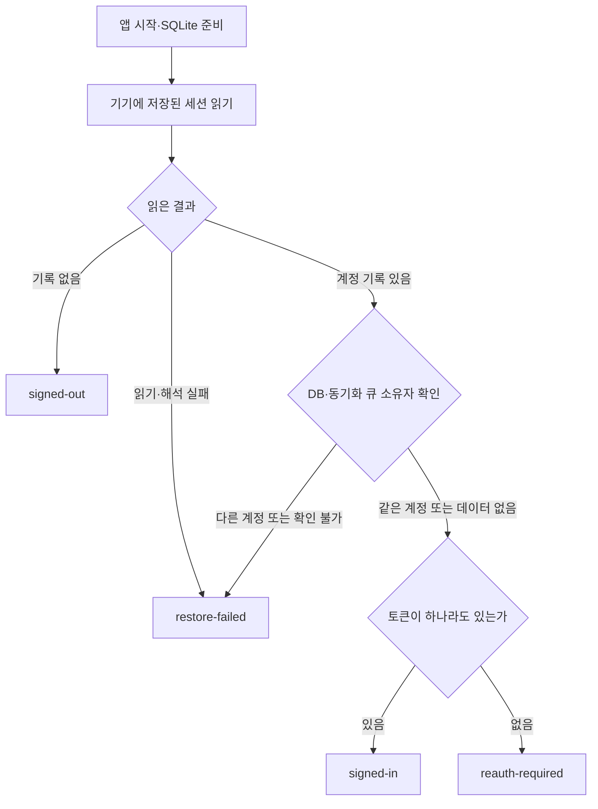
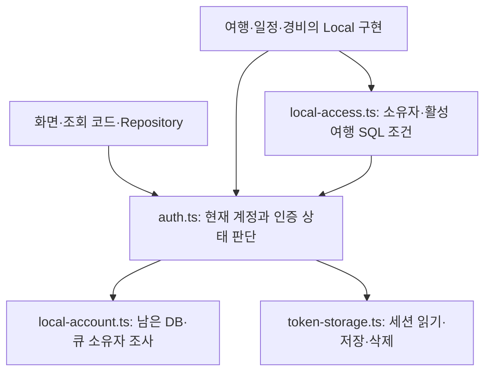
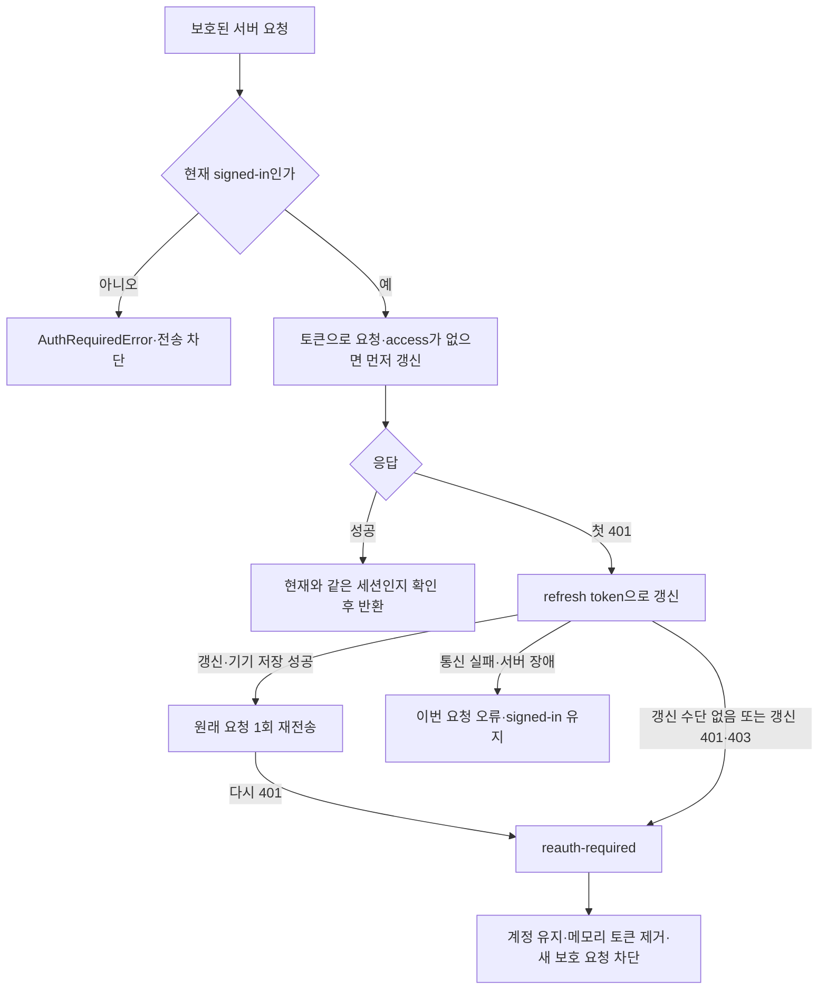
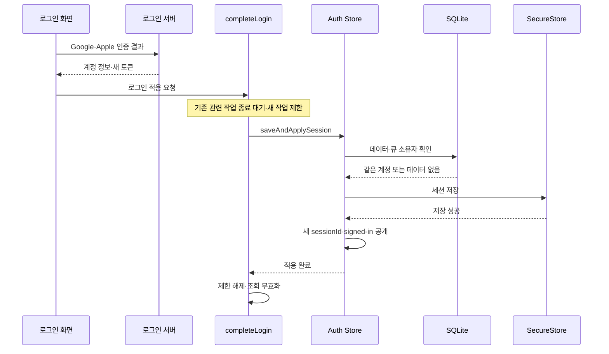

당시 인증 작업의 핵심은 **서버 인증이 끊겨도 사용자의 계정과 활성 여행의 기기 데이터를 유지하고, 같은 계정으로 다시 로그인해 저장까지 성공하면 서버 이용을 재개하는 것**입니다. 이를 위해 ‘어느 계정의 데이터인가’와 ‘지금 서버 요청을 보낼 인증 수단이 있는가’를 나눠 다뤘습니다.

이 설명은 제공된 [당시 코드 조사 기록](../../inputs/briefing/source.md)을 바탕으로 합니다. 기록 작성자가 당시 작업 트리에서 확인했다고 보고한 구조를 설명하며, 제품 코드나 실행 결과를 새로 확인한 것은 아닙니다. 아래 도식도 그 기록에서 재구성한 관계이며 실기기 실행을 관찰한 흐름은 아닙니다. 원문에 적힌 ‘현재’는 당시 조사 시점을 뜻합니다.

**인증 만료가 곧 로그아웃은 아니었습니다.**

기존에는 `isAuthenticated`, `isSessionExpired` 두 값의 조합으로 상태를 읽었지만, 조사 당시 구현은 `status` 하나에 다음 다섯 상태를 담았습니다.

| 상태 | 알고 있는 것과 허용되는 일 |
|---|---|
| `initializing` | 저장된 세션을 아직 판정하지 못한 상태입니다. 앱 초기 준비를 기다립니다. |
| `signed-out` | 세션 기록이 없거나 명시적 세션 삭제가 끝났습니다. 로그인 화면으로 갑니다. |
| `signed-in` | 계정과 access token 또는 refresh token이 있습니다. 다른 네트워크·여행 조건도 맞으면 서버 기능을 이용합니다. |
| `reauth-required` | 계정은 알지만 사용할 인증 수단이 없습니다. 활성 여행의 기기 작업은 유지하고 보호된 서버 요청은 막습니다. |
| `restore-failed` | 저장소 읽기·해석이나 계정 일치 확인에 실패했습니다. 데이터를 보존하고 복원 재시도를 안내합니다. |

이 중 작업의 중심은 `reauth-required`입니다. 계정을 잊지 않으므로 그 계정의 활성 여행을 계속 수정할 수 있고, 토큰은 제거하므로 새 보호 요청은 서버로 나가지 않습니다.

`signed-in`도 의미를 좁혀 읽어야 합니다. 서버가 방금 인증을 승인했다는 뜻이 아니라, 저장된 토큰으로 요청하거나 자동 갱신을 시도할 수 있다는 뜻입니다. 반대로 `signed-out`이어도 SQLite에 여행 데이터가 남아 있을 수 있습니다. 따라서 로그인 상태만 보고 남은 데이터의 소유자를 추정하지 않습니다. 기록상 위치는 `auth.ts`의 상태 선언과 적용 부분입니다.

**앱 시작에서는 저장된 세션과 남은 여행 데이터가 같은 계정인지 먼저 맞춥니다.**

이 도식은 앱 시작 시 판정만 보여 줍니다. `AppInitialization`은 DB 준비 후 복원을 호출하고 화면을 여는 순서를 맡고, 세션을 해석해 상태를 결정하는 책임은 `auth.ts`의 Store에 있습니다. Store는 실행 중 인증 상태를 보관하고 변경 절차를 수행하는 코드입니다. 복원이 겹쳐 호출되면 진행 중인 작업을 공유하며, `restore-failed`에서 사용자가 재시도할 때 다시 읽습니다.

저장 대상은 두 가지입니다. **SecureStore에는 세션을, SQLite에는 여행 데이터와 동기화 큐를 저장합니다.** SecureStore는 기기의 보안 저장소이고, SQLite는 기기 안의 데이터베이스입니다.

`token-storage.ts`는 `noline_session`이라는 하나의 JSON 값에 계정 ID, 사용자 정보, access token, refresh token 등을 저장합니다. 토큰은 둘 다 비어 있어도 됩니다. 예를 들어 계정 A와 빈 토큰 두 개를 저장하면, 다음 실행에서 A의 `reauth-required`로 복원할 수 있습니다. 계정을 기억하기 위해 쓸 수 없는 토큰까지 보관할 필요가 없는 구조입니다. 다만 이전 형식에서 사용자 ID만 남은 기록은 정상 세션으로 추정하지 않고 복원 실패로 처리했다고 기록돼 있습니다.

실행 중 요청에 쓸 토큰은 Store 내부 세션에서 가져옵니다. 매 요청마다 SecureStore를 다시 읽지 않습니다. 그래서 인증 만료를 메모리에 반영한 이후에는, 기기 저장이 아직 끝나지 않았더라도 현재 실행의 새 요청이 옛 토큰을 다시 꺼내 쓰지 않습니다.

**계정 사용 판단과 데이터 접근 판단은 서로 이어지는 다른 책임입니다.**

기록에 나온 주요 파일의 관계는 다음과 같습니다. 화살표는 호출·참조 방향이며, 인증과 로컬 데이터 접근에 필요한 부분만 표시했습니다.

`auth.ts`에는 용도가 다른 세 함수가 있습니다.

| 함수 | 판단과 사용 방식 |
|---|---|
| `selectLocalUserId(state)` | `signed-in` 또는 `reauth-required`이면 계정 ID를 반환합니다. 사용할 계정이 없으면 `null`을 반환해 조회를 생략하는 데 쓸 수 있습니다. |
| `requireLocalUserId(requestedUserId?)` | 같은 기준으로 계정을 구하되, 계정이 없거나 요청의 계정 ID가 다르면 오류를 냅니다. 생성·수정처럼 잘못된 계정으로 진행하면 안 되는 작업에서 사용합니다. |
| `requireRemoteSession()` | `signed-in`인지 확인합니다. 인터넷 연결이나 서버가 인정하는 토큰인지까지 확인하지는 않습니다. |

`selectLocalUserId`는 실제로 `auth.ts`에 있습니다. 새로운 상태를 저장하는 action이 아니라 주어진 상태에서 값을 계산하는 함수로 정의돼 있습니다. `requireLocalUserId`도 이를 호출하므로, 로컬 작업에 사용할 계정 기준을 공유합니다.

`local-access.ts`는 그 계정 ID를 받아 SQL 조건을 만듭니다. 예를 들어 현재 계정이 소유한 행인지, 해당 여행이 삭제되지 않았고 활성 상태인지 검사합니다. 인증 상태를 다시 정의하는 역할은 아닙니다.

`local-account.ts`는 더 앞선 질문인 ‘이미 남아 있는 데이터는 누구 것인가’를 조사합니다. DB와 큐를 보고 `empty`, `same`, `different`, `unresolved`를 반환하며, Store가 그 결과로 새 세션을 받아들일지 정합니다. 큐의 소유권은 별도 계정 컬럼 하나로 판단하는 대신 원본 행과 payload를 대조한다고 기록돼 있습니다.

이 배치에서 Store는 단순한 상태 보관함보다 책임이 큽니다. 세션 수락 조건, 저장, 상태 반영을 함께 맡습니다. 기록은 이 구조가 로그인 판단이 호출자마다 달라지는 것을 막는다고 설명하지만, 유일한 설계 방법이라고 주장하지는 않습니다.

**서버가 처음 401을 반환하면 자동 복구를 시도하고, 복구 불가가 확인돼야 재로그인을 요구합니다.**

일반 API와 동기화 API는 같은 인증 interceptor를 사용합니다. Interceptor는 HTTP 요청 전후에 끼어들어 인증 확인과 토큰 갱신을 처리하는 코드입니다.

여기서 access token은 실제 요청에 쓰는 토큰이고, refresh token은 새 토큰을 발급받는 데 쓰는 토큰입니다. 같은 세션에서 여러 요청이 동시에 갱신을 요구하면 진행 중인 갱신 작업을 공유합니다. 서버가 새 토큰을 줘도 **기기 저장까지 성공해야** 갱신 성공으로 적용합니다.

통신 실패나 서버 장애는 인증 거부와 다릅니다. 갱신 요청이 timeout이나 500으로 실패했다는 이유만으로 계정을 `reauth-required`로 바꾸지는 않습니다. 기록상 이 책임은 `auth-interceptor.ts`와 Store의 `requireReauthentication`에 연결돼 있습니다.

조회 라이브러리의 재시도는 위 자동 갱신과 별개입니다. React Query는 `AuthRequiredError`를 재시도하지 않고, 그 외 조회 오류는 기본 1회 재시도하며, mutation은 재시도하지 않는 설정이었다고 기록돼 있습니다. 2·4·8초 간격의 5xx 재시도는 동기화 HTTP 클라이언트에만 있던 설정이므로 일반 API 전체의 정책으로 읽으면 안 됩니다.

**인증이 만료된 뒤에도 활성 여행 수정은 기기에 저장됩니다.**

기록의 설명용 사례를 따라 계정 A의 활성 여행 T에서 일정 제목을 수정한다고 하겠습니다. 상태는 `reauth-required`, 계정은 A, 토큰은 모두 빈 상태입니다.

Repository가 T를 대상으로 Router를 호출하면 `requireLocalUserId()`는 A를 반환합니다. Router는 T가 활성 여행이므로 Local 구현을 선택합니다. Local 구현은 A가 소유한 활성 여행의 일정인지 SQL로 검사하고, 일정 수정과 동기화 큐 추가를 하나의 DB transaction으로 처리합니다. 즉, 변경과 나중에 서버로 보낼 작업 기록을 함께 저장합니다. 이 경로에는 서버 요청이 없습니다.

| 같은 계정의 작업 | 당시 기록상 결과 |
|---|---|
| `reauth-required`에서 활성 여행 수정 | 로컬 조건을 통과하면 기기에 수정·큐 저장 가능 |
| `reauth-required`에서 비활성 여행 작업 | Remote 경로의 인증 확인에서 거절, 인터넷 연결 여부와 무관 |
| `reauth-required`에서 새 동기화 시작 | `signed-in` 조건을 충족하지 않아 시작하지 않음 |

화면 정책도 이 구분과 연결돼 있습니다. 탭은 로컬 세션이 있으면 유지하고, 만료 배너는 변경이 기기에 저장되며 동기화에는 재로그인이 필요하다고 안내합니다. 화면을 열어 두는 것, 로컬 저장을 허용하는 것, 서버 요청과 동기화를 차단하는 것이 각각 코드에 연결됐다는 설명입니다. 관련 위치로 `router.ts`, `schedule-local.ts`, 탭 layout, `useAppPolicy`, 동기화 `lifecycle.ts`가 제시돼 있습니다.

**재로그인 완료의 기준은 서버 응답 수신보다 뒤에 있습니다.**

Google·Apple 인증 후 서버가 계정과 새 토큰을 반환해도 즉시 `signed-in`을 공개하지 않습니다. `completeLogin`은 진행 중인 동기화·정리·로컬 저장이 끝나기를 기다리고 새 작업을 제한한 뒤, Store에 세션 적용을 요청합니다. Store는 남은 데이터와 큐의 소유자를 확인하고 SecureStore 저장이 성공해야 새 세션을 공개합니다.

성공하면 기존 여행 데이터와 큐를 유지하고, 조회를 다시 읽도록 무효화합니다. 동기화는 로그인만으로 무조건 시작되는 것이 아니라 DB 준비, 실제 온라인 상태, debug override 해제 등의 조건도 맞아야 합니다. 같은 계정이고 복귀할 화면이 있으면 이전 화면으로 돌아갑니다.

다른 계정이거나 큐 소유자를 확인할 수 없으면 적용을 거절하고 기존 데이터를 유지합니다. 기기 저장이 실패하면 기존 `reauth-required` 상태를 유지합니다. 로그인 취소는 적용 절차에 들어가지 않습니다. 적용하지 못한 토큰은 서버에 폐기를 시도하며, 저장 완료 후 조회 갱신만 실패한 경우에는 로그인 전체를 실패로 되돌리지 않는다고 기록돼 있습니다.

**작업 순서 제어와 `sessionId`는 서로 다른 충돌을 다룹니다.**

Store의 `pendingWrites`는 복원, 로그인 적용, 토큰 갱신 저장, 만료 상태 저장, 세션 삭제의 순서를 지킵니다. 예를 들어 로그아웃으로 토큰을 삭제한 뒤 이전 갱신 저장이 늦게 실행돼 옛 토큰이 되살아나는 상황을 막는 역할입니다.

`session-lifecycle.ts`의 `withSessionChange`는 로그인·로그아웃·탈퇴 전체를 조율합니다. 진행 중인 동기화와 정리, 이미 접수된 로컬 저장을 기다리고 새 작업을 제한합니다. 로그아웃이 미전송 작업을 확인한 직후 새 일정 저장이 끼어들어 그 데이터를 바로 삭제하는 문제는 토큰 저장 순서만으로 막을 수 없기 때문입니다. 다만 Store action 자체가 공개돼 있어 모든 호출자가 이 절차를 거치도록 타입으로 강제한 것은 아니며, 당시 서비스들이 이를 사용하도록 연결됐다는 범위입니다.

`sessionId`는 이미 전송된 요청의 늦은 결과를 구별합니다. A의 이전 로그인에서 토큰 갱신을 요청한 뒤 로그아웃하고 같은 A로 다시 로그인하면, 계정 ID만으로는 이전 응답을 구별할 수 없습니다. 새 로그인마다 달라지는 메모리상의 `Symbol`을 비교해 이전 세션의 결과를 현재 세션에 적용하지 않도록 했습니다. 정상적인 토큰 갱신은 같은 세션으로 처리합니다. 이 확인은 토큰 접근과 갱신 적용, 보호된 HTTP 성공 응답, 여행 활성화 데이터의 DB 저장 직전에도 연결돼 있었다고 기록돼 있습니다.

이 기능은 **늦은 결과의 적용을 막는 것**입니다. 이미 서버로 보낸 요청이 서버에서 수행한 작업까지 취소하지는 않습니다.

**기록이 뒷받침하는 보장에는 경계가 있습니다.**

만료 처리는 현재 실행의 메모리부터 차단하지만, 그 결과를 SecureStore에 쓰지 못한 채 종료하면 다음 실행에서 옛 토큰 기록을 읽을 수 있습니다. 그러면 일단 `signed-in`으로 복원된 뒤 요청 과정에서 인증 거부를 다시 확인할 수 있습니다. 재실행 후에도 반드시 `reauth-required`라고 보장하는 구조는 아니었습니다.

로그아웃도 두 저장소를 한 번에 성공·실패시키는 작업은 아닙니다. 기록상 순서는 SQLite 초기화, 기기 인증 기록 삭제, 화면 선택·캐시 정리입니다. SQLite 정리 후 인증 기록 삭제가 실패하면 데이터는 이미 정리됐지만 세션 삭제는 실패한 중간 상태가 남을 수 있습니다. 그때 서버 인증을 다시 허용하지 않고 종료 재시도가 가능한 계정 상태를 남긴다고 설명돼 있습니다. 앱 강제 종료 뒤 정리를 이어가는 기능은 당시 범위에서 제외돼 있었습니다.

테스트에 대해서는, 원문 작성자가 이전 검증 로그에서 **30개 테스트 묶음·277개 테스트 통과**를 확인했다고 보고했습니다. 저장 상태 복원, 같은 계정 재로그인 저장 실패, 동시 로그인과 늦은 응답, 자동 갱신과 복구 불가 판정, 만료 후 로컬 수정과 큐 저장, 계정 간 접근 거절, 화면 복귀 등을 다뤘다고 합니다. Store·HTTP 테스트는 저장소와 통신을 대체했고, 로컬 접근 테스트는 실제 Drizzle SQL과 Node 메모리 SQLite를 사용했다는 범위입니다.

원문 작성 당시에도 테스트를 다시 실행하지 않았고, 이번 설명에서도 실행하지 않았습니다. 따라서 이 기록으로 실제 OAuth, native SecureStore 실패, 서버 토큰 교체, 실기기 화면까지 검증됐다고 말할 수 없습니다. 일부 Ticket의 ‘커밋 완료’ 표시와 당시 커밋을 해제한 작업 트리가 달랐다는 보고도 있어, 해당 표시만으로 최종 완료 상태를 확정할 수 없습니다.

당시 구조를 더 읽을 때는 질문에 따라 출발점을 고르면 됩니다. 계정과 인증 상태는 `auth.ts`, 저장 형식은 `token-storage.ts`, 남은 데이터 소유자는 `local-account.ts`, 행 접근 조건은 `local-access.ts`, 서버 인증 복구는 `auth-interceptor.ts`, 세션 변경과 DB 작업의 충돌 방지는 `session-lifecycle.ts`가 기록상 핵심 위치입니다.
