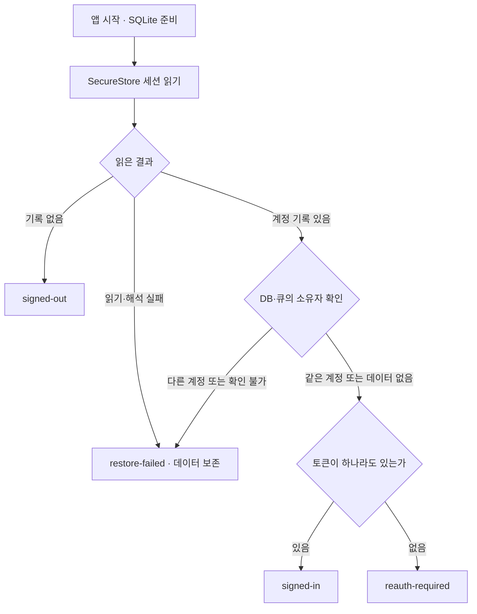
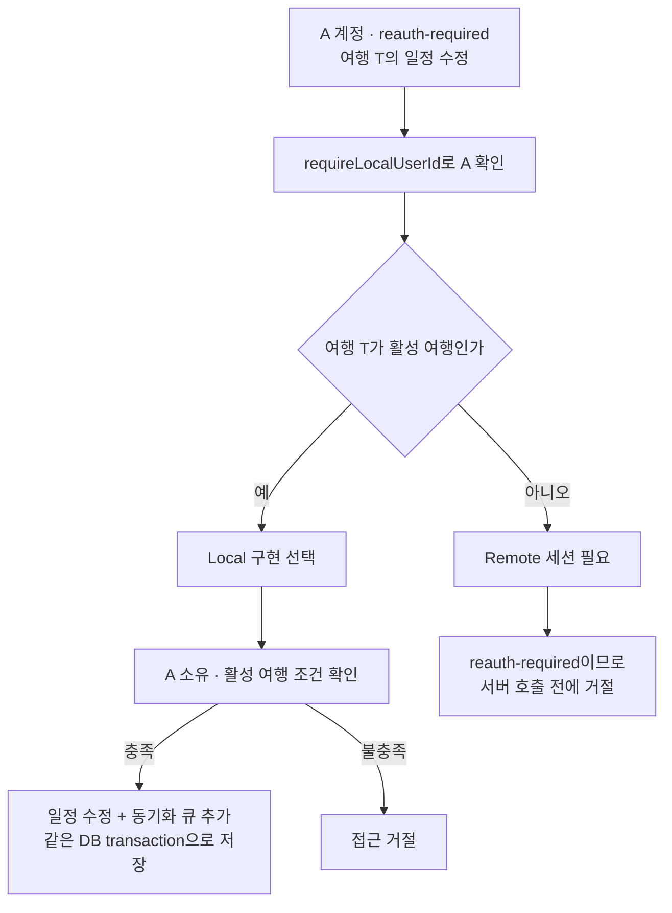
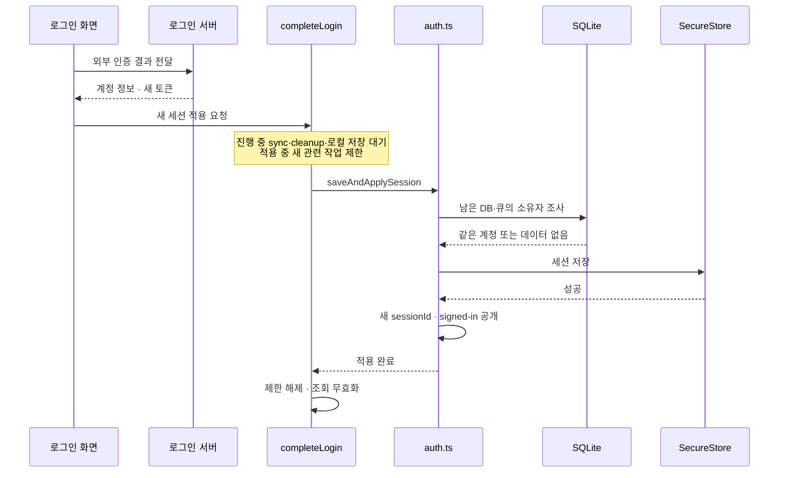

당시 인증 작업의 핵심은 **서버 인증이 끊겨도 사용자의 계정과 활성 여행 작업을 유지하고, 같은 계정으로 재로그인한 세션을 기기에 저장한 뒤 서버 이용을 다시 허용하는 것**입니다. 이를 위해 ‘누구의 작업인가’, ‘서버에 요청할 인증 수단이 있는가’, ‘이 여행 데이터를 로컬에서 다뤄도 되는가’를 따로 판단하도록 구성했습니다.

아래는 당시 코드 조사 후 남겨진 [보존 설명](</Users/hammyeong-yeon/Desktop/ai-workspace/context/workspaces/014-ai-development-workflow-design/records/experiments/artifact-explanation-intent-2026-10-21/inputs/briefing/source.md>)을 재구성한 설명입니다. 원문에 등장하는 ‘현재’는 **그 조사가 이뤄진 당시 작업 트리**를 뜻합니다. 이번에 제품 코드나 실행 결과를 직접 확인한 것은 아니며, 도식도 보존 기록이 설명하는 연결을 나타냅니다.

**계정을 유지하는 것과 서버 인증을 유지하는 것을 분리했습니다.**

이전에는 `isAuthenticated`, `isSessionExpired`라는 두 참·거짓 값을 조합해 상태를 읽었습니다. 당시 구현은 `status` 하나로 다음 다섯 상태를 표현했습니다.

| 상태 | 의미와 사용자에게 생기는 차이 |
|---|---|
| `initializing` | 저장된 세션을 판정하는 중이므로 초기 준비를 기다립니다. |
| `signed-out` | 세션 기록이 없거나 명시적 삭제가 끝난 상태로, 로그인 화면을 표시합니다. 여행 DB가 비었다는 뜻까지 포함하지는 않습니다. |
| `signed-in` | 계정과 access 또는 refresh token이 있어 서버 요청이나 자동 갱신을 시도할 수 있습니다. 서버가 방금 토큰을 검증했다는 뜻은 아닙니다. |
| `reauth-required` | 계정은 알지만 서버 인증 수단을 사용할 수 없습니다. 활성 여행의 로컬 작업은 유지하고 보호된 서버 요청은 차단합니다. |
| `restore-failed` | 저장소 읽기·해석 또는 남은 데이터와 계정의 일치 확인에 실패했습니다. 데이터를 보존하고 로그인 화면에서 복원을 재시도합니다. |

여기서 가장 중요한 상태가 `reauth-required`입니다. 토큰이 없다는 이유만으로 계정까지 없애면, 남아 있는 여행을 누구의 작업으로 다뤄야 할지 불분명해집니다. 당시 구조에서는 계정 ID를 유지하므로 소유권을 확인하며 로컬 작업을 계속할 수 있습니다.

기기에는 저장 대상도 둘로 나뉩니다. **SecureStore**는 운영체제의 보안 저장소로, 계정 정보와 토큰을 `noline_session`이라는 JSON 값에 보관합니다. **SQLite**는 여행·일정·경비와 나중에 서버로 보낼 변경 목록인 동기화 큐를 보관합니다. 인증 만료는 SQLite의 여행 데이터를 지우는 동작이 아닙니다.

예를 들어 SecureStore에 `userId=A`, 두 토큰은 모두 `null`인 세션을 저장할 수 있습니다. 다음 실행에서는 이를 A 계정의 `reauth-required`로 복원합니다. 다만 이전 버전의 낱개 저장 키에서 사용자 ID만 발견한 경우까지 같은 정상 형식으로 간주하지는 않고, 복원 실패로 처리했습니다.

앱 시작 시에는 `AppInitialization`이 SQLite 준비를 먼저 끝내고 인증 Store에 복원을 요청합니다. **Store는 실행 중인 세션을 보관하고 세션을 받아들일 조건을 판단하는 주체**입니다. 기록상 복원 흐름은 다음과 같습니다.

이것은 보존 기록의 시작 경로만 펼친 도식이며 실기기 실행 추적은 아닙니다. 복원이 진행 중이면 호출자들이 같은 Promise, 즉 같은 비동기 작업의 완료 결과를 공유했습니다. 화면 이동이나 네트워크 변화마다 저장소를 다시 복원하지 않고, `restore-failed`에서 사용자가 재시도할 때 다시 읽는 구조였습니다. 이 부분의 근거는 보존 설명의 1·2절입니다.

**인증 Store는 사용할 계정을 정하고, 로컬 접근 코드는 그 계정의 데이터인지 확인합니다.**

비슷한 이름의 파일들이 있지만 질문이 다릅니다.

| 파일 | 맡은 질문과 실제 연결 |
|---|---|
| `auth.ts` | 지금 어떤 계정으로 로컬 작업을 할 수 있고, 서버 요청을 시도할 수 있는가? 계정 판단과 세션 수락·저장·상태 반영을 맡습니다. |
| `token-storage.ts` | 세션을 기기에 어떤 형식으로 읽고 저장하고 삭제하는가? Store가 이 기능을 사용합니다. |
| `local-account.ts` | 이미 남아 있는 DB와 큐는 누구 것인가? Store가 로그인·복원을 받아들이기 전에 조사 결과를 사용합니다. |
| `local-access.ts` | 지금 접근하는 행이 현재 계정 소유이고 활성 여행에 속하는가? Store에서 얻은 계정 ID로 SQL 조건을 만들고, 여행·일정·경비의 로컬 구현이 사용합니다. |

특히 `selectLocalUserId`는 당시 `auth.ts`에 있었습니다. 별도 상태를 저장하는 action이 아니라, 전달받은 상태에서 계정 ID를 계산하는 함수입니다. `signed-in`과 `reauth-required`에서 계정 ID를 반환하고 그 밖에는 `null`을 반환합니다.

`requireLocalUserId`도 같은 계정 기준을 사용하지만, 사용할 계정이 없으면 오류를 냅니다. 생성 요청이 현재 계정과 다른 `userId`를 지정해도 거절합니다. 조회를 생략할 수 있는 소비자와, 허용되지 않은 쓰기를 중단해야 하는 소비자가 서로 다른 처리 방식을 쓰는 것입니다.

그다음 `local-access.ts`가 실제 행의 `userId`, 삭제 여부, 여행 활성 여부를 SQL 조건으로 확인합니다. 따라서 이 파일이 계정 ID를 읽는 것은 SQL 비교에 쓰기 위해서입니다. 어떤 인증 상태에서 계정을 허용할지를 여기서 다시 정하지는 않습니다.

로그인 때의 소유자 검사는 별도입니다. `local-account.ts`는 DB와 큐를 조사해 `empty`, `same`, `different`, `unresolved` 중 하나를 반환합니다. 큐에 별도 계정 컬럼을 추가한 방식이 아니라 큐가 가리키는 원본 행과 payload를 대조했습니다. **‘현재 계정이 A다’와 ‘남아 있는 데이터도 A의 것이다’는 각각 확인해야 하는 조건**입니다. 이 책임 구분은 보존 설명 3절에 나옵니다.

**서버 요청은 자동 갱신을 시도하고, 복구할 수 없을 때 재로그인을 요구합니다.**

`auth-interceptor.ts`는 일반 API와 동기화 API가 공유하는 요청 전후 처리입니다. 요청 전에 사용할 세션을 확인하고, 인증 거부가 오면 토큰 갱신과 원래 요청의 재전송을 담당합니다.

기록상 첫 401, 즉 서버의 인증 거부 응답만으로 즉시 `reauth-required`로 바꾸지는 않았습니다. refresh token으로 갱신하고, 새 세션을 기기에 저장한 다음 원래 요청을 한 번 다시 보냅니다. 갱신 수단이 없거나 갱신이 401·403으로 거부되거나 재전송도 401이면 복구 불가로 판단합니다. 갱신 중 통신 실패나 서버 장애가 생겼다면 이번 요청을 실패시키되 `signed-in`은 유지합니다.

이때 세 가지 순서가 중요합니다.

- 같은 세션의 여러 요청이 동시에 갱신을 요구하면 진행 중인 갱신 결과를 공유합니다.
- 서버가 새 토큰을 줘도 기기 저장이 성공해야 갱신을 성공으로 적용합니다.
- 복구 불가로 판단하면 메모리 토큰을 먼저 비우고 상태를 바꿔 새 보호 요청을 막은 뒤 그 상태를 기기에 저장합니다.

요청용 토큰은 실행 중 Store 내부의 `currentSession`에서 얻습니다. 매 요청마다 SecureStore를 다시 읽는 방식이 아니므로, 만료를 메모리에 반영한 뒤 디스크에 옛 토큰이 남아 있어도 같은 실행의 새 요청이 이를 다시 가져다 쓰지는 않습니다.

여기서 인증 갱신에 따른 재전송과 일반 오류 재시도는 구별해야 합니다. React Query는 `AuthRequiredError`에 대해서는 조회를 재시도하지 않고, 다른 조회 오류는 기본 한 번 재시도하며 mutation 재시도는 0회였습니다. 별도로 기록된 2·4·8초의 5xx 재시도는 동기화 HTTP 클라이언트의 설정입니다. 모든 일반 API에 적용되는 정책으로 읽으면 안 됩니다. 이 구분의 근거는 보존 설명 4절입니다.

**인증 만료 후에도 가능한 작업은 ‘현재 계정의 활성 여행에 대한 로컬 작업’입니다.**

설명용으로 A 계정의 여행 T에서 일정 제목을 바꾸는 경우를 보겠습니다. `status=reauth-required`, `userId=A`, 두 토큰은 없는 상태입니다. 여행 T가 활성화돼 있고 A 소유라면, Router가 로컬 구현을 선택하고 해당 구현이 소유권·활성 조건을 확인한 뒤 일정 수정과 큐 추가를 같은 DB transaction에서 처리합니다. Transaction은 두 변경을 한 묶음으로 저장하는 단위입니다.

같은 일정 수정 요청이라도 T가 비활성 여행이면 결과가 달라집니다.

이 도식도 기록에서 재구성한 해당 수정 경로입니다. 인터넷 연결 여부만으로 서버 작업이 허용되는 것은 아닙니다.

화면과 동기화도 이 구분을 따릅니다. 탭 진입은 로컬 세션을 인정하므로 화면을 유지하고, 만료 배너는 변경이 기기에 저장되며 동기화에는 재로그인이 필요하다고 안내합니다. 화면 정책은 활성 여행의 로컬 작업과 비활성 여행의 제한을 구분합니다. 동기화 시작 조건은 `signed-in`을 요구하므로 만료 후 새 동기화는 시작하지 않습니다. 화면 안내뿐 아니라 Router와 SQL 접근 조건에서도 제한이 적용되는 구조입니다. 근거는 보존 설명 5절입니다.

**재로그인의 완료 지점은 서버 응답 수신보다 뒤에 있습니다.**

Google·Apple 인증 후 서버가 계정 정보와 토큰을 돌려줘도, 앱은 곧바로 로그인 완료를 공개하지 않았습니다. `completeLogin` 서비스가 세션 변경 절차를 조율하고, Store의 `saveAndApplySession`이 남은 데이터의 계정 검사와 기기 저장을 수행합니다.

성공 경로만 표시한 것으로, 기록의 호출 관계를 재구성한 도식입니다. 같은 계정이면 여행 데이터와 큐를 유지하고 새 인증 수단으로 서버 이용을 재개할 수 있습니다. 조회를 다시 읽게 하고, DB 준비·실제 온라인 상태·debug override 해제 등 다른 조건까지 충족하면 동기화를 시작합니다. 같은 계정이고 돌아갈 화면이 있으면 이전 화면으로 복귀합니다.

반면 다른 계정이거나 큐 소유자를 확인할 수 없으면 세션 적용을 거절합니다. 기기 저장이 실패하면 기존 `reauth-required` 상태를 유지합니다. 로그인 취소는 적용 절차에 들어가지 않습니다. 적용하지 못한 토큰은 서버에 폐기를 시도하며, 세션 저장이 끝난 뒤 조회 갱신만 실패했다고 로그인 자체를 실패로 되돌리지는 않습니다. 근거는 보존 설명 6절입니다.

**작업 순서 제어와 `sessionId`는 서로 다른 충돌을 막습니다.**

`auth.ts`의 `pendingWrites`는 복원·로그인 적용·토큰 갱신 저장·만료 저장·세션 삭제를 순서대로 처리합니다. 예를 들어 로그아웃으로 인증 기록을 삭제한 뒤 앞서 시작한 옛 토큰 저장이 끝나 기록을 되살리는 일을 막는 역할입니다.

`session-lifecycle.ts`의 `withSessionChange`는 로그인·로그아웃·탈퇴 전체와 DB 작업의 겹침을 조율합니다. 새 동기화와 로컬 transaction 접수를 제한하고, 이미 진행 중인 동기화·정리·저장을 기다린 다음 세션을 바꿉니다. 로그아웃에서 미전송 작업이 없음을 확인한 직후 새 일정 저장이 끼어들어 곧바로 삭제되는 문제는 토큰 저장 순서만으로 해결할 수 없기 때문입니다.

다만 기록상 Store action 자체는 공개돼 있어 모든 호출자가 반드시 이 절차를 거치도록 타입으로 강제된 것은 아닙니다. 당시 로그인·로그아웃·탈퇴 서비스가 이를 사용하도록 연결됐다는 범위로 이해해야 합니다.

이미 서버로 나간 요청에는 추가 구분이 필요합니다. A의 옛 세션에서 갱신 요청을 보낸 뒤 로그아웃하고 다시 A로 로그인하면, 계정 ID는 같아도 이전 응답을 새 세션에 적용해서는 안 됩니다. 이를 구별하는 실행 중 식별자가 `sessionId`이며, 메모리의 `Symbol`로 생성됐습니다. 토큰 접근·갱신 적용·보호된 HTTP 성공 응답과 여행 활성화의 DB 저장 직전에 세션 동일성을 확인했습니다. 정상 갱신은 같은 세션 안에서 이뤄집니다.

따라서 이 장치의 의미는 **늦게 온 옛 세션의 결과를 현재 세션에 적용하지 않는 것**입니다. 이미 전송된 요청이 서버에서 수행한 일까지 취소한다는 뜻은 아닙니다. 근거는 보존 설명 7절입니다.

**기록으로 확인할 수 있는 구현 설명과 검증의 한계도 남아 있습니다.**

첫째, 만료 상태의 기기 저장이 실패한 채 앱이 종료되면 다음 실행은 디스크에 남은 옛 토큰으로 일단 `signed-in`을 복원할 수 있습니다. 이후 요청에서 다시 인증 거부를 확인할 수 있지만, 다음 실행부터 반드시 `reauth-required`라는 보장은 기록에 없습니다.

둘째, 로그아웃은 SQLite 초기화, 기기 인증 기록 삭제, 화면 선택·캐시 정리 순서입니다. 서로 다른 저장소를 한 번에 성공시키거나 되돌리는 작업은 아닙니다. DB 정리는 성공하고 인증 기록 삭제가 실패하면 데이터는 이미 정리된 상태일 수 있으며, 코드는 서버 인증을 허용하지 않고 종료 재시도가 가능한 계정 상태를 남긴다고 기록돼 있습니다. 강제 종료 뒤 정리를 이어가는 장치는 당시 구현 범위에서 제외됐습니다.

셋째, 원문은 다섯 상태 복원, 재로그인 저장 실패, 동시 로그인·늦은 갱신 응답, 자동 갱신과 복구 불가, 만료 후 로컬 수정과 큐 저장, 다른 계정 접근 거절, 화면 복귀 등을 다룬 테스트를 보고합니다. 이전 검증 로그에서 **30개 테스트 묶음·277개 테스트 통과를 확인했다**는 보고도 있습니다. Store·HTTP 테스트는 저장소와 통신을 대체했고, 로컬 접근 테스트는 실제 Drizzle SQL과 Node 메모리 SQLite를 사용했다고 합니다. 이번에는 해당 로그나 코드를 다시 확인하지 않았으므로, 이 숫자는 보존 기록의 보고로 남습니다. 실제 OAuth·native SecureStore 실패·서버 토큰 교체·실기기 화면의 검증으로 확대할 수 없습니다.

마지막으로 원문은 일부 Ticket의 ‘커밋 완료’ 문구와 당시 커밋을 해제한 작업 트리가 달랐다고 명시합니다. 그러므로 이 자료는 **당시 작업 트리에서 조사됐다고 보고된 인증 구조와 테스트 범위를 이해하는 근거**이며, 현재 제품 상태나 전체 인증 작업의 최종 완료를 확정하는 자료는 아닙니다.
