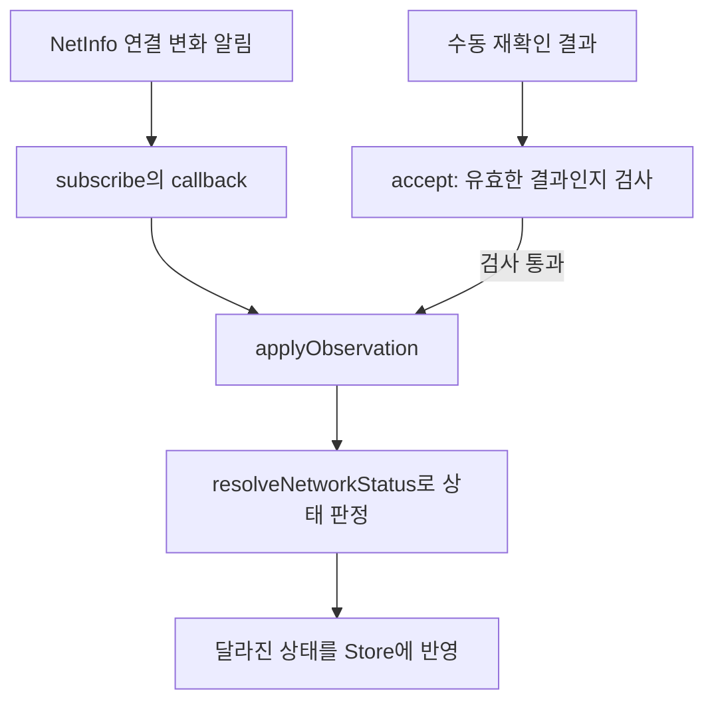

이 파일은 **기기에서 받은 인터넷 연결 정보를 앱이 읽을 상태로 보관하고, 연결 변화 감지와 수동 재확인의 시작·종료를 관리하는 코드**입니다. 화면은 여기 저장된 값을 구독해 표시를 바꿉니다.

흐름이 복잡하게 느껴지는 이유는 평소 연결 상태를 받는 코드와, 늦게 도착하는 재확인 결과를 처리하는 코드가 함께 있기 때문입니다. **앱 시작 → 관측 반영 → 수동 재확인 → 종료** 순서로 읽으면 연결됩니다. 아래는 9월 17일 보존 소스와 사용처로 재구성한 설명이며, 실기기 실행을 관찰한 것은 아닙니다.

**먼저, 저장하는 값 네 개를 구별하면 됩니다.** [상태 선언과 초기값](/private/tmp/0402-network-body-20261022/r18/code/network.ts:23)

| 값 | 무엇을 뜻하나 | 초기값 |
|---|---|---|
| `realStatus` | 기기 관측으로 판단한 연결 상태 | `unknown` |
| `overrideStatus` | debug에서 화면에 강제로 적용할 상태. `null`이면 강제 설정 없음 | `null` |
| `checkStatus` | 연결을 아직 모를 때 확인 안내를 어느 단계로 보여 줄지 | `checking` |
| `isRefreshing` | 수동 재확인 요청의 완료를 기다리는 중인지 | `false` |

예를 들어 `realStatus: unknown`, `checkStatus: unavailable`은 **“연결 상태를 아직 모르고, 확인도 오래 걸리거나 실패했다”**는 뜻입니다. `offline`으로 판정했다는 뜻은 아닙니다.

`useNetworkStore = create(...)`는 Zustand라는 상태 관리 도구로 이 값들과 함수를 함께 만듭니다. 여기서 `set`은 상태 변경, `get`은 최신 상태 읽기입니다.

`...createNetworkActions(set, get)`는 반환받은 `init`, `cleanup`, `refresh` 함수를 Store에 넣는 표현입니다. **이때 `init()`을 실행하는 것은 아닙니다.** 내부의 `currentSession`은 이 함수들이 함께 사용하는 비공개 변수로 남습니다.

**1. 앱이 시작하면 `init()`이 연결 감지를 켭니다.** [초기화](/private/tmp/0402-network-body-20261022/r18/code/network.ts:73)

제공된 Root 사용처에는 화면이 마운트될 때 `networkStore.init()`, 해제될 때 `networkStore.cleanup()`을 호출하는 effect가 있습니다.

`init()`의 순서는 다음과 같습니다.

1. 이미 `currentSession`이 있으면 종료합니다. 중복 초기화로 감지를 여러 번 등록하지 않게 합니다.
2. 새로운 `session` 객체를 만들고 `currentSession`에 저장합니다.
3. `beginUnknownCheck()`로 상태를 `unknown / checking`으로 놓고 10초 안내 타이머를 시작합니다.
4. `subscribe()`로 NetInfo의 연결 변화 알림을 등록합니다.

NetInfo는 기기의 연결 정보를 제공하는 라이브러리입니다. 이 코드는 `addEventListener()` 등록으로 첫 관측도 받는다는 전제로 작성돼 있어, 초기화 때 별도의 `fetch()`는 호출하지 않습니다.

여기서 `session`은 **이번 초기화에서 생긴 감지·타이머·재확인 요청을 묶어 관리하는 객체**입니다. 로그인 세션과는 관계없습니다. 화면에 보여 줄 값은 Store에, 감지 해제 함수나 타이머 같은 내부 관리 정보는 session에 둡니다.

**2. 연결 정보가 오면 `applyObservation()`이 Store를 갱신합니다.** [구독과 관측 반영](/private/tmp/0402-network-body-20261022/r18/code/network.ts:155)

아래는 관측 결과가 상태에 반영되는 부분만 보여 준 것입니다. 구독과 재확인이 같은 처리 함수를 사용합니다.

`resolveNetworkStatus()`는 두 입력을 봅니다.

- `isConnected`: 기기가 네트워크에 연결됐는가.
- `isInternetReachable`: 인터넷에 도달할 수 있는가.

둘 중 하나라도 명시적으로 `false`면 `offline`, 둘 다 `true`면 `online`, 나머지는 `unknown`입니다. 예를 들어 Wi-Fi 연결이 `true`여도 인터넷 도달 여부가 `null`이면 `unknown`입니다. [판정 함수](/private/tmp/0402-network-body-20261022/r18/code/network.ts:11)

판정 뒤에는 다음처럼 처리합니다.

- 지금과 같은 상태면 그대로 둡니다.
- 새 상태가 `online` 또는 `offline`이면 안내 타이머를 없애고 `checkStatus`를 `idle`로 바꿉니다.
- 확정 상태에서 다시 `unknown`이 되면 새 10초 안내를 시작합니다.

**같은 `unknown`이 반복해서 들어오면 타이머를 다시 시작하지 않습니다.** 그래서 불확실한 관측이 계속 와도 안내가 영원히 “확인 중”에 머물지 않습니다. 10초가 지나면 `markUnavailable()`이 `checkStatus`만 `unavailable`로 바꿉니다. 이후 확정 관측이 도착하면 다시 정상적으로 반영합니다.

**3. 사용자가 재확인을 누르면 `refresh()`가 별도 요청을 시작합니다.** [재확인 진입](/private/tmp/0402-network-body-20261022/r18/code/network.ts:103)

평소에는 listener가 정보를 보내고, `refresh()`는 사용자가 명시적으로 다시 확인하는 경로입니다.

1. `init()`을 호출해 감지가 준비돼 있는지 확인합니다.
2. 이미 진행 중인 재확인이 있으면 **그 요청의 Promise를 그대로 반환**합니다. 연타해도 새 요청을 추가하지 않습니다.
3. 현재 상태가 `unknown`이면 확인 안내의 10초를 다시 시작합니다. 이미 `online/offline`이면 그 상태를 유지합니다.
4. 구독이 없으면 다시 등록합니다. 등록 실패 시에는 여기서 끝냅니다.
5. `startRefreshRequest()`로 요청 관리 객체를 만들고 `isRefreshing`을 `true`로 바꿉니다.
6. `NetInfo.refresh()`를 실행해 응답은 `accept`, 실패는 `fail`로 보냅니다.

요청 객체 안의 함수는 세 역할입니다.

- `accept`: 유효한 결과라면 `applyObservation()`으로 반영한 뒤 끝냅니다.
- `fail`: 유효한 요청이고 여전히 `unknown`이라면 확인 불가 안내로 바꾼 뒤 끝냅니다.
- `finish`: 요청 타이머와 진행 중 표시를 정리하고 기다리는 Promise를 완료합니다.

여기에는 **서로 목적이 다른 10초 타이머 두 개**가 있습니다. `CHECK_NOTICE_DELAY`는 unknown의 안내 문구를 바꾸는 시간이고, `REFRESH_WAIT_LIMIT`는 수동 재확인을 끝없이 기다리지 않게 하는 시간입니다. 후자가 지나면 앱의 대기를 끝내며, NetInfo의 실제 작업을 취소하지는 않습니다.

또한 `await refresh()`가 끝났다고 online이라는 뜻은 아닙니다. 실패·시간 초과·cleanup에서도 Promise는 완료됩니다. 결과 연결 상태는 `realStatus`에서 읽습니다.

**4. 내부 검사가 많은 이유는 오래된 응답이 새 상태를 덮지 못하게 하기 위해서입니다.** [결과 적용 조건](/private/tmp/0402-network-body-20261022/r18/code/network.ts:197)

`canApplyResult()`는 세 가지를 모두 확인합니다.

| 검사 | 막으려는 상황 |
|---|---|
| `currentSession === session` | 감지를 종료하고 다시 시작했는데 이전 실행의 응답이 도착함 |
| `session.refreshRequest === request` | 이전 요청이 시간 초과된 뒤 새 요청을 시작했는데 이전 응답이 도착함 |
| `observationVersion`이 요청 시작 때와 같음 | 요청을 기다리는 사이 listener가 이미 새 관측을 전달함 |

예를 들어 재확인을 시작한 뒤 listener가 `online`을 알렸는데, 그 뒤 재확인 응답으로 `offline`이 도착했다고 가정하겠습니다. listener가 올 때 `observationVersion`이 증가했으므로 재확인 응답은 상태를 덮지 못합니다. 이 코드는 **요청 이후에 도착한 listener 관측을 우선하는 규칙**입니다.

그래서 `observationVersion`은 상태가 실제로 바뀌었는지와 무관하게 listener 알림마다 증가합니다. 결과 반영을 건너뛰더라도 `finish()`는 호출해 해당 요청의 대기를 끝냅니다.

**5. `cleanup()`은 이번 감지의 자원을 정리합니다.** [정리 함수](/private/tmp/0402-network-body-20261022/r18/code/network.ts:90)

먼저 `currentSession = null`로 만들어 이전 callback이 더는 유효하지 않게 합니다. 그다음 안내 타이머를 없애고, 진행 중 재확인의 대기를 끝내고, listener 구독을 해제합니다. Store는 `unknown / checking / isRefreshing: false`로 돌립니다. 이 함수는 `overrideStatus`는 지우지 않습니다.

**6. 파일 아래쪽은 다른 코드가 이 Store를 사용하는 방법입니다.** [외부 사용 API](/private/tmp/0402-network-body-20261022/r18/code/network.ts:257)

`networkStore`와 `useNetworkStore`가 별개의 상태를 갖는 것은 아닙니다. `networkStore`는 같은 Zustand Store를 React 바깥에서도 읽고 호출할 수 있게 감싼 객체입니다.

| 사용 방법 | 읽거나 하는 일 |
|---|---|
| `networkStore.realStatus` | 호출한 시점의 실제 상태 읽기. 변경을 구독하지는 않음 |
| `useRealNetworkStatus()` | React 화면에서 실제 상태를 구독 |
| `useDisplayNetworkStatus()` | 강제 설정이 있으면 그 값, 없으면 실제 상태를 구독 |
| `useNetworkCheck()` | 확인 안내 상태·재확인 중 여부·재확인 함수 사용 |
| `useNetworkControl()` | debug 강제 설정과 해제 |

예를 들어 실제 상태가 `offline`인데 debug에서 `online`을 강제하면 `useDisplayNetworkStatus()`는 `online`, `useRealNetworkStatus()`와 `networkStore.realStatus`는 계속 `offline`입니다. 제공된 사용처에서 헤더의 `NetworkStatusIndicator`는 표시용 값을, debug의 `DashboardView`는 실제 값과 표시용 값을 함께 읽습니다. 이 파일 자체가 서버 요청을 실행하거나 차단하는 것은 아니며, 실행 여부를 판단할 코드는 이 값들을 읽어 사용합니다.
