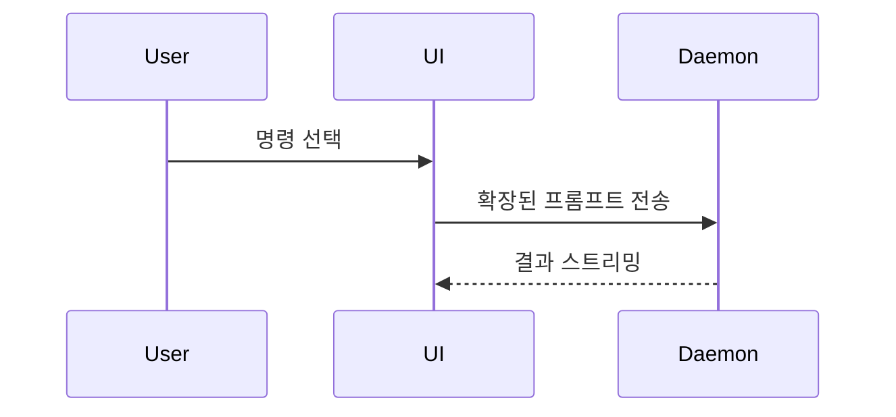

PR 본문에는 다음 템플릿을 사용합니다.

```markdown
## 요약

<다이어그램, diff 스케치 또는 트리>

## 근거

- **변경 전:** <스크린샷/출력/실패한 테스트 실행 결과>
  **변경 후:** <스크린샷/출력/통과한 테스트 실행 결과>

## 병합 위험

**문:** <한 방향 또는 양방향>

<선택 설명>

**영향 범위:** <한 단어로 설명>

<선택 사항: 병합으로 생길 수 있는 영향>
```

## 섹션

서두는 생략하고 문장은 간결하게 씁니다. 사용자의 `GLOSSARY.md`에 있는 도메인 용어를 사용합니다.

### 요약

핵심을 분명하게 전달하는 가장 간결한 표현을 선택합니다.

- 로직이나 알고리즘은 의사 코드로 보여줍니다.

```text
on(save)
  if content is unchanged
    return cached result
  write new content
  return fresh result
```

- 런타임 제어 흐름은 호출 트리로 보여줍니다.

```text
submitForm
  createSession
    persistPrompt
    launchAgent
  navigateToSession
```

- 중요한 상태와 모듈 경계를 포함해 UI 구조를 컴포넌트 트리로 보여줍니다.

```text
<SessionPage> (apps/example/src/routes/session.tsx)
  useSessionEvents()
  <SessionToolbar>
    <RunSkillButton> (packages/ui)
```

- 파일별 책임이나 큰 리팩터링은 간단한 파일 트리로 보여줍니다.

```text
src/
├── commands/       # 사용자 동작을 해석
├── sessions/       # 세션 상태를 관리
└── transport/      # API 요청을 전송
```

- 컴포넌트 간 상호작용, 제어 흐름 또는 데이터 흐름은 Mermaid로 보여줄 수 있습니다.



- 핵심이 무엇이 바뀌는지 보여주는 데 있고 기존 구조가 이미 있다면 `diff`를 사용합니다. 주제에 맞는 diff 형태를 고릅니다.

컴포넌트 변경:

```diff
 <SessionPage>
   useSessionEvents()
   <SessionToolbar>
+    <RunSkillButton />
   <SessionTimeline>
+    <SkillResultCard />
```

파일 배치 변경:

```diff
 src/
 ├── commands/
+│   └── show-me.ts       # 슬래시 명령을 확장
 ├── sessions/
-└── transport.ts
+└── transport/
+    ├── client.ts
+    └── stream.ts
```

호출 트리 또는 호출 스택 변경:

```diff
 submitForm
   createSession
     persistPrompt
+    expandSkillMention
     launchAgent
-  navigateToSession
+  navigateToSession
+    subscribeToEvents
```

상태 또는 제어 흐름 변경:

```diff
 on(save)
-  write content
+  if content is unchanged
+    return cached result
+  write new content
+  invalidate cache
```

- 대부분 새로 추가된 내용이거나, 생략된 문맥 때문에 책임이나 순서가 불분명해지거나, 복사해 사용할 수 있는 목표 형태가 필요하다면 블록 전체를 보여줍니다.

```ts
function expandSkill(command: string): string {
  const skillName = command.slice(1);
  return `use the ${skillName} skill`;
}
```

#### 안내

각 시각 자료는 이를 뒷받침하는 짧은 설명 바로 옆에 둡니다. 사용자의 현재 질문에 답하거나 논의 중인 쟁점을 해결할 선택지를 설명하는 데 필요한 호출, 파일, props, 상태, 경계만 포함합니다.

이 중 하나를 사용할 수도 있고 여러 개를 사용할 수도 있습니다. 모두 사용하는 경우는 드뭅니다. 판단에 따라 선택하고 사용자에게 너무 많은 정보를 주지 않습니다.

### 근거

변경이 작동한다는 구체적인 근거를 제시합니다. 변경 전과 변경 후를 보여줍니다.

환경이 갖춰져 있고 변경 사항이 시각적인 것이라면 스크린샷이 최상급 근거입니다.

실행에 기반한 근거도 높은 등급입니다. 테스트 결과나 콘솔 출력을 보여줍니다. 의사 코드를 사용해 어떤 테스트가 실패했다가 통과하는지 정확히 보여줍니다.

### 병합 위험

변경이 한 방향으로만 진행되는 결정인지, 되돌릴 수 있는 양방향 결정인지 설명합니다. 양방향 결정은 되돌릴 수 있습니다. 쉽게 롤백할 수 있는 PR은 위험도가 낮습니다. 파괴적인 작업이나 되돌리기 어려운 결정은 한 방향 결정입니다.

영향 범위는 이 PR이 초래할 수 있는 잠재적 영향의 규모입니다. 가능한 경우를 고려합니다. 예를 들면 레이아웃 이동, 소비자 측 오류, 모바일 대응 문제 등이 있습니다.
