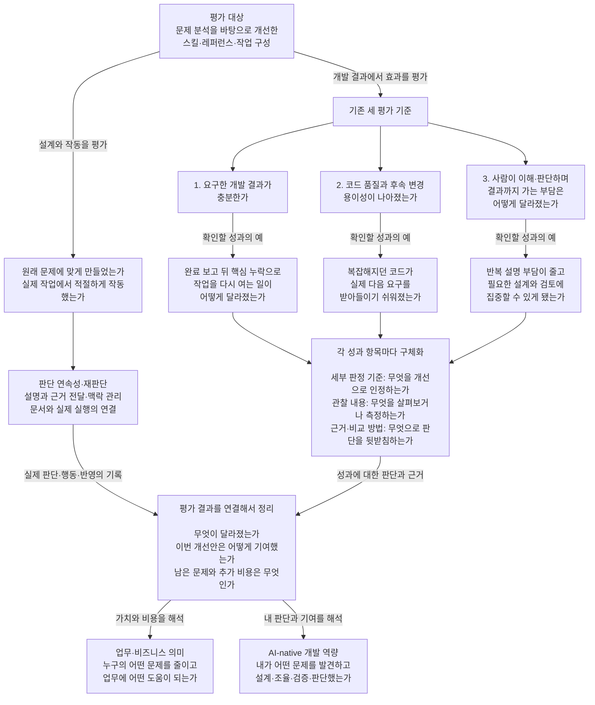

# 개선안 평가의 전체 구조

2026-09-09 대화에서 정리하고 사용자가 문서 보존을 요청한 전체 구조다. 기존 분석의 평가 대상과 세 기준을 유지하면서, 성과·판정·근거·개선 요소·해석 관점의 관계를 명시한다. [평가 방법](02-evaluation-method.md)을 사용해 성과별 판정과 근거를 채운 후속 제안은 [06 확인할 성과와 평가안](06-outcomes-and-evaluation-plan.md)에 있다.

## 평가 대상과 목적

평가 대상은 **05·07의 문제 분석을 바탕으로 개선한 스킬·레퍼런스·작업 구성**이다. 해당 개선안이 문제에 맞게 만들어지고 작동하는지, 실제 개발에서 무엇을 바꾸는지 확인한다. 여러 프로젝트와 작업에서 적용할 수 있어야 하며, 특정 프로젝트의 실험 하나나 모든 AI 개발 도구를 대상으로 하는 일반 평가 체계를 만드는 것은 이 연구의 범위가 아니다.

성과의 우선 사용처는 이력서이고 면접·포트폴리오·블로그에도 이어질 수 있다. 그 목적 때문에 평가 전체를 ‘AI-native 역량 입증’의 하위로 재분류하지 않는다. 업무·비즈니스 의미와 AI-native 역량은 개선 과정과 평가 결과를 해석하는 관점으로 연결한다.

## 한 번에 보는 연결

아래 연결은 개념의 관계를 보여 준다. 성과 항목과 그 의미는 적용 전에 함께 정할 수 있다. 세부 관찰과 판단은 실제 작업의 목표·조건·확보 가능한 근거에 맞춘다.

### 설계와 작동에서는 무엇을 보는가

이 부분은 우리가 만든 개선안 자체를 확인한다. 실제 관찰·판정 방법은 [평가 방법](02-evaluation-method.md)에 있다. [기존 11의 해당 제안](archive/2026-09-09-before-organization/11-general-ai-development-evaluation.md#개선안이-잘-만들어졌는지-확인하는-방법)에 구성·설계 이유의 검토와 실제 판단·행동 확인이 있었다. ‘설계와 작동 평가’는 그 내용을 대화에서 묶어 설명한 이름이다.

- **설계:** 원래 문제에 필요한 판단과 책임이 스킬·참조·문서 관계에 들어 있는가. 호출 조건·읽을 자료·후속 반영 책임이 맞물리고 불필요한 개입을 만들지 않는가.
- **작동:** 실제 상황에서 필요한 정보를 읽고 적절한 판단을 했는가. 채택한 판단이 문서·구현·완료 보고·다음 실행에 반영됐는가.
- **효과와의 연결:** 그 행동을 실제 결과와 대조해 이번 개선안의 기여와 비용을 살펴본다. 스킬 호출 횟수나 지침 준수만으로 효과를 판정하지 않는다.

예를 들어 핵심 기능이 빠진 채 완료되는 문제라면, 완료 전 요구와 구현을 대조하도록 만든 구성은 설계 검토 대상이다. 실제 작업에서 누락을 발견하고 필요한 구현으로 이어 갔는지는 작동의 근거다. 완료 시점의 누락과 사용자의 재작업 부담이 어떻게 달라졌는지는 개발 성과에서 판단한다.

### 개발 성과에서 유지할 세 기준

**1. 요구한 개발 결과가 충분한가.** 핵심 작업의 완성, 개별 구현과 전체 제품 목적의 연결, 중요한 예외·실패 조건, 완료 시점의 누락을 본다. 범위가 한정된 작업의 정당한 부분 완료와 전체 목표의 달성을 구분한다.

**2. 코드 품질과 후속 변경 용이성이 나아졌는가.** 책임·규칙·상태·실패 처리, 중복과 의존 관계, 변경 위치와 영향의 파악, 실제 후속 수정의 어려움과 회귀를 본다. 현재 구조를 검토한 판단과 실제 변경 부담의 관찰은 각각 근거를 갖는다.

**3. 사람이 이해·판단하며 결과까지 가는 부담은 어떻게 달라졌는가.** 결과를 이해하고 다음 판단을 할 수 있는지, 반복 설명·교정·재탐색·재작업, 시간과 도구·문서 관리 부담을 본다. 인지부담은 현재 이해·작업에 드는 노력이고, 인지부채는 필요한 이해가 빠진 채 진행해 나중에 다시 복구해야 하는 비용이다. 필요한 설계·검토 참여를 모두 줄일 대상으로 세지 않는다.

세 질문의 이름을 유지하는 것과 분석 범위를 세 항목으로 제한하는 것은 다르다. 개발 효율과 총비용은 세 번째에서 명시적으로 살펴보고 다른 결과와의 교환도 함께 해석한다. 새 네 번째 기준을 설명 과정에서 임의로 만들지 않는다. 예컨대 핵심 누락으로 재개한 작업은 1번의 결과 충족과 3번의 부담을 함께 설명할 수 있다. 같은 사례와 근거를 공유하면 된다.

### 각 기준을 구체화하는 공통 구성

‘평가 기준’은 위의 큰 질문에도, 실제 판정 조건에도 사용돼 혼동을 만들었다. 이 문서에서는 큰 질문을 **세 평가 기준**, 실제 개선 인정 조건을 **세부 판정 기준**으로 구별한다.

- **확인할 성과 항목:** 그 기준 안에서 어떤 변화를 확인할 것인가. 대화에서 ‘성과 후보’, ‘확인할 후보’, ‘확인할 성과 후보’라고 부르던 구체적인 변화가 이 자리에 들어간다. 평가할 내용으로 정한 항목까지 계속 미정 후보로 남겨 두지는 않는다.
- **세부 판정 기준:** 어떤 상태를 충분함·개선됨으로 인정할 것인가. 현재 결과의 충분성과 이전보다 나아졌는지를 구분한다.
- **관찰 내용:** 실제로 무엇을 살펴보거나 측정할 것인가. 코드·작업 장면·사람의 경험·시간 등의 역할을 해당 질문에 맞춘다.
- **근거·비교 방법:** 판단을 뒷받침할 자료와 대조 방법. 정성·정량 자료를 함께 사용할 수 있고 모든 작업에 같은 실험을 요구하지 않는다.

그림의 공통 상자는 각 성과 항목마다 따로 구체화할 내용을 한 번 표시한 것이다. 서로 다른 성과를 하나의 합격선이나 종합 점수로 합쳤다는 뜻은 아니다.

대화에서 제시한 세 문장은 다음 위치에 연결된다. 이것만이 각 기준에서 볼 전체 성과 목록은 아니다.

| 큰 평가 기준 | 연결된 성과 항목 |
| --- | --- |
| 요구한 개발 결과가 충분한가 | AI가 완료했다고 한 뒤 사람이 핵심 누락을 찾아 작업을 다시 열던 일이 어떻게 달라졌는가. |
| 코드 품질과 후속 변경 용이성이 나아졌는가 | 수정할수록 복잡해지던 코드가 실제 다음 요구를 받아들이기 쉬워졌는가. |
| 사람이 이해·판단하며 결과까지 가는 부담은 어떻게 달라졌는가 | 사람이 같은 의도와 판단을 반복해서 설명하던 부담이 줄고, 필요한 설계와 검토에 집중할 수 있게 됐는가. |

### 평가 결과와 작업을 해석하는 관점

**업무·비즈니스 의미**는 확인하려는 변화가 누구에게 왜 중요한지, 업무·유지보수·운영과 비용에 어떤 차이를 주는지 살펴본다. 매출 수치만을 뜻하지 않으며 연결이 약하다는 이유만으로 문제 개선을 미리 제외하지 않는다.

**AI-native 개발 역량**은 그 과정에서 개발자가 어떤 문제를 발견하고 어떤 선택·설계·조율·검증·판단을 했는지 살펴본다. 성과 항목 그 자체와 동일한 분류가 아니다. 실제 판단과 개선의 기록을 성과의 근거와 연결해 설명한다.

예를 들어 ‘완료 판단 방식을 왜 어떻게 개선했는가’는 개발자의 기여이고, ‘핵심 누락으로 다시 작업하는 일이 어떻게 달라졌는가’는 확인할 성과다. 그 변화가 결과 제공과 재작업 비용에 갖는 의미는 업무 관점에서, 문제 진단·선택·검증의 내용은 AI-native 역량 관점에서 해석한다. 두 관점은 적용 전 성과 항목을 선택할 때부터 함께 고려할 수 있다.

외부 회사 사례와 연구는 문제의 중요성, 설계 이유, 판정·비교 방식, 결과와 비용의 해석을 보완한다. 외부 자료의 분류나 수치를 현재 구조와 성과로 그대로 가져오지 않는다. 구체적인 회사·연구 분석과 선택 이유는 [외부 자료 분석](03-external-reference-analysis.md)에서 찾는다.

## 구체화로 돌아갈 지점

지금 큰 구성을 삭제하거나 새로 분류할 이유는 확인되지 않았다. 기존 분석에서 각 성과 항목을 선별하고 세부 판정 기준·관찰·근거·비교 방법을 채운 제안은 06에서 확인한다. [기존 12 리뷰](archive/2026-09-09-before-organization/12-evaluation-refinement-review.md)의 기준은 그 구체화 작업의 품질을 검토하는 입력이며, 개발 효과의 합격선이 아니다.

이 문서는 구조를 소유하며, 성과별 구체화 결과는 06에서 읽는다. 실제 프로젝트를 선택할 때는 작업의 목표·시작 상태·개입 판본·확보 가능한 자료를 구체화한다. 구조 정리, 세부 평가안의 수용, 실사용 효과의 확인은 각각 해당 근거로 판단한다.
