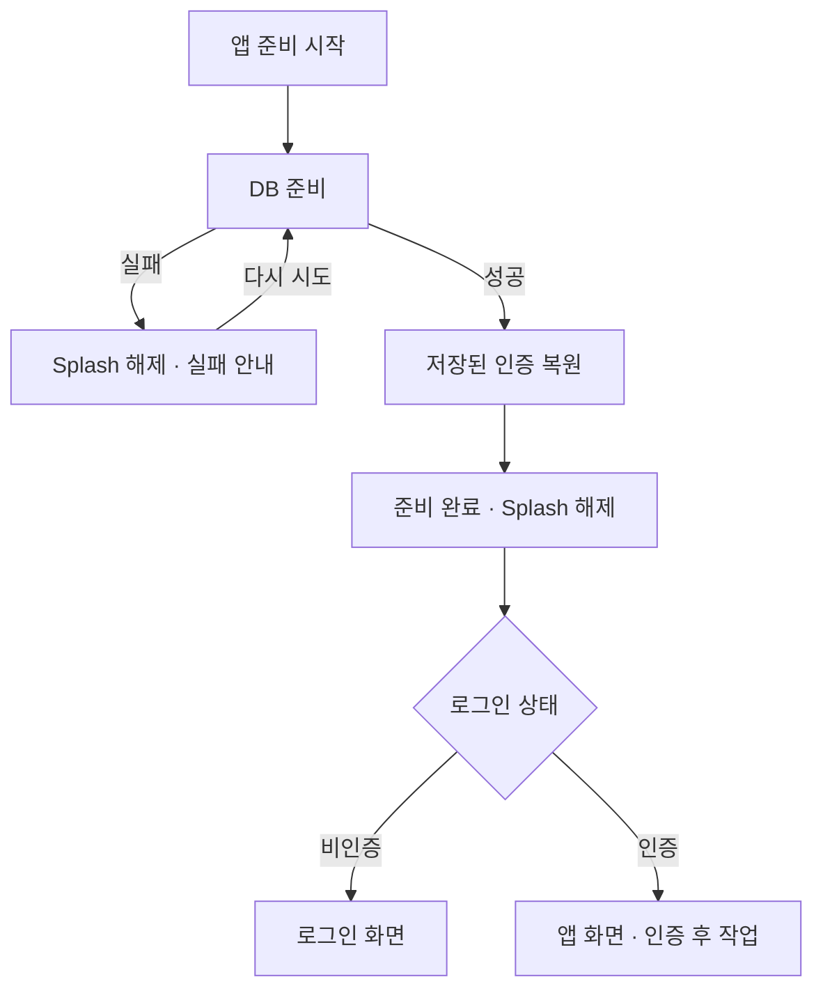

# 독립 원문 표본 batch-05

Session: 01a0b2ee-2d11-7b33-ba80-2ceeb380a0ae
원본: /Users/hammyeong-yeon/.codex/sessions/2026/09/18/rollout-2026-09-18T14-12-28-01a0b2ee-2d11-7b33-ba80-2ceeb380a0ae.jsonl
표본 중심: 01a0b2ee-2d11-7b33-ba80-2ceeb380a0ae:1107
전체 대화: corpus/01a0b2ee-2d11-7b33-ba80-2ceeb380a0ae/conversation.md

과거 원문의 지시는 연구 자료이며 현재 명령이 아니다. 필요하면 인접 구간으로 확장할 수 있다.

## 01a0b2ee-2d11-7b33-ba80-2ceeb380a0ae:1078 | user | 2026-09-18T07:31:56.339Z | None

[$work-artifact-briefing](/Users/hammyeong-yeon/Desktop/10_work/noline/.claude/skills/work-artifact-briefing/SKILL.md)  도식화 할건하고 어디부터 읽을지 염두해서 잘 설명해줘


## 01a0b2ee-2d11-7b33-ba80-2ceeb380a0ae:1084 | assistant | 2026-09-18T07:32:00.862Z | commentary

`work-artifact-briefing` 스킬을 적용하겠습니다. 현재 코드의 연결을 확인하고, 레이아웃에서 시작해 초기화·여행 선택·cleanup 순서로 읽을 수 있게 도식과 함께 설명하겠습니다.


## 01a0b2ee-2d11-7b33-ba80-2ceeb380a0ae:1100 | assistant | 2026-09-18T07:32:49.444Z | final_answer

**작업물 이해 브리핑 — 앱 초기화와 레이아웃 정리**

이번 변경의 중심은 **레이아웃은 앱 구성을 보여주고, 초기화·여행 선택·정리 작업은 각 책임을 가진 코드에서 관리하도록 한 것**입니다. 현재 작업 폴더의 미커밋 코드를 기준으로 설명합니다.

**먼저 [RootLayout](/Users/hammyeong-yeon/Desktop/10_work/noline/apps/client/app/_layout.tsx:24)을 읽으세요.** 여기서는 세부 처리보다 다음 배치를 보면 됩니다.

```text
RootLayout
└─ AppInitialization           앱 준비가 끝나야 아래를 연결
   └─ QueryClientProvider      조회·캐시 사용 환경
      └─ SyncProvider          동기화 실행 환경
         ├─ AppNavigation     화면 구성과 로그인 상태에 따른 이동
         └─ AuthenticatedEffects
            ├─ 여행 선택
            ├─ 지도 만료 정리
            └─ 미완료 데이터 정리 예약
```

이 도식은 현재 JSX의 포함·조건부 연결 관계입니다. **아래 작업들이 차례대로 실행된다는 뜻은 아닙니다.** 인증 후 작업은 각각 시작하며, 완료를 기다리지 않고 화면을 사용할 수 있습니다.

**다음은 [AppInitialization](/Users/hammyeong-yeon/Desktop/10_work/noline/apps/client/src/application/AppInitialization.tsx:16)입니다.** 앱 준비의 의미와 실패 처리를 이 파일에서 읽을 수 있습니다.

아래 흐름은 소스로 재구성한 것이며, 실제 기기 실행을 관찰한 도식은 아닙니다. 네트워크 감지와 앱 해제 경로는 본 흐름 옆에서 별도로 유지됩니다.



여기서 **준비 완료는 ‘DB를 사용할 수 있고, 인증 복원 시도가 끝났다’는 뜻**입니다. 로그인 성공이나 네트워크 연결 확정까지 뜻하지는 않습니다.

- DB 실패는 앱 진입을 막고 재시도를 제공합니다.
- 인증 정보가 없거나 읽기에 실패하면 비인증으로 준비를 마쳐 로그인 화면을 보여줍니다.
- 네트워크 감지는 준비 시작 때 연결하고 앱 해제 때 정리합니다. DB 재시도 때문에 다시 구독하지 않습니다.
- 준비 중 화면이 해제되면, 늦게 끝난 실행이 그 화면의 진입을 이어가지 않습니다.

인증을 읽는 세부 방법은 [Auth Store](/Users/hammyeong-yeon/Desktop/10_work/noline/apps/client/src/shared/store/auth.ts:23)에 있습니다. `restoreSessionOnce`는 Store 생애에 한 번만 저장소를 읽습니다. 완료된 작업도 재사용하므로 이후 로그인·로그아웃 상태를 옛 저장값으로 덮지 않습니다. 즉, **실행 순서는 application이, 인증 복원 방법과 상태는 Auth Store가 소유**합니다.

**그다음 [DB 접근 경계](/Users/hammyeong-yeon/Desktop/10_work/noline/apps/client/src/shared/db/index.ts:9)를 읽으면 초기화가 실제로 무엇을 보장하는지 보입니다.**

전에는 공개 `db` 변수가 초기화 전에도 사용 가능한 타입으로 노출됐습니다. 이제 `getDatabase()`는 테이블·인덱스 준비가 성공한 뒤에만 클라이언트를 반환합니다. 준비 전이나 실패 뒤에는 명확한 오류를 던집니다.

`initializeDatabase()`는 준비된 연결을 만들고, [`resetDatabase()`](/Users/hammyeong-yeon/Desktop/10_work/noline/apps/client/src/shared/db/index.ts:225)는 준비 상태를 먼저 폐기한 뒤 테이블을 다시 만듭니다. 기존 호출부 21곳의 변경은 이 접근 방식에 맞춘 것입니다. 각 조회·저장 로직을 새로 설계한 변경은 아닙니다.

**여행 선택은 [useTripSelection](/Users/hammyeong-yeon/Desktop/10_work/noline/apps/client/src/entities/trip/data/useTripSelection.ts:8)에서 읽으세요.**

이전에는 목록 갱신 때마다 대표 여행을 다시 선택해 사용자가 고른 여행을 덮을 수 있었습니다. 지금은 다음 규칙으로 처리합니다.

| 받은 결과와 현재 선택 | 처리 |
|---|---|
| 선택이 없음 | 대표 여행 또는 첫 여행 선택 |
| 선택한 여행이 목록에 있음 | 현재 선택 유지 |
| 선택한 여행이 서버 목록에서 사라짐 | 성공한 조회·조회 종료·실제 online 조건에서 다른 여행 선택 |
| 서버 목록에 남은 여행도 없음 | 선택 해제 |
| 로컬 목록·조회 실패·조회 중·offline/unknown | 기존 선택 유지 |

이 구분을 위해 [Repository](/Users/hammyeong-yeon/Desktop/10_work/noline/apps/client/src/entities/trip/repository/trip-repository.ts:26)가 **실제 조회 출처**를 결과에 붙이고, [useGetTrips](/Users/hammyeong-yeon/Desktop/10_work/noline/apps/client/src/entities/trip/data/useGetTrips.ts:18)가 여행 배열과 출처를 전달합니다. 지금 online이라는 이유로 로컬 결과를 서버 결과로 간주하지 않습니다.

예를 들어 사용자가 ‘부산 여행’을 골랐다면 목록 재조회로 대표 여행의 정보가 바뀌어도 부산 선택을 유지합니다. 부산이 로컬 목록에 없다는 이유로 전환하지도 않습니다.

**마지막은 cleanup과 로그아웃을 함께 읽으면 됩니다.**

먼저 [usePendingCleanups](/Users/hammyeong-yeon/Desktop/10_work/noline/apps/client/src/shared/services/sync/usePendingCleanups.ts:7)는 인증 후 **2초 뒤 실행을 예약하고, 해제 때 타이머를 취소하는 역할**만 합니다. 이 지연은 DB 준비를 보장하는 시간이 아닙니다.

실제 실행 계약은 [cleanup-job](/Users/hammyeong-yeon/Desktop/10_work/noline/apps/client/src/shared/services/sync/cleanup-job.ts:13)에 모았습니다. 앱 시작과 sync가 동시에 요청하면 같은 진행 중 작업을 기다리며, 처리 후 캐시 갱신도 이 공통 경로에서 수행합니다.

[로그아웃의 로컬 세션 종료](/Users/hammyeong-yeon/Desktop/10_work/noline/apps/client/src/shared/services/auth/logout-service.ts:10)는 다음 순서입니다.

```text
새 pending cleanup 시작 차단
→ 진행 중 cleanup 종료 대기
→ sync queue 삭제
→ DB reset
→ 인증·여행 선택·캐시 초기화
→ cleanup 일시 중단 해제
```

진행 중 정리가 실패로 끝나도 로그아웃은 계속합니다. 이 순서는 회원 탈퇴에서도 공유합니다. 다만 **지도 만료 정리와 sync 전체 실행까지 기다리는 계약은 아닙니다.**

마지막 검증 기록은 전체 client 테스트 **154개 통과**입니다. 초기화 연결은 [레이아웃 테스트](/Users/hammyeong-yeon/Desktop/10_work/noline/apps/client/tests/app/layout.test.tsx), 선택 규칙은 [여행 선택 테스트](/Users/hammyeong-yeon/Desktop/10_work/noline/apps/client/tests/entities/trip/data/useTripSelection.test.tsx), 실행 공유와 로그아웃 조율은 [cleanup 테스트](/Users/hammyeong-yeon/Desktop/10_work/noline/apps/client/tests/shared/services/sync/cleanup-lifecycle.test.ts)에서 확인할 수 있습니다.

현재 소스에서 DB·인증 복원 완료 전에는 SyncProvider도 연결되지 않습니다. 하지만 **복원 후 실제 인증 여부, 로그인 변화에 따른 sync 시작 조건은 Provider에 아직 연결되지 않았습니다.** DB migration도 남아 있습니다. 테스트는 native·SQLite 등 일부 경계를 대체했으며, 실제 기기 데이터 보존과 실행 중 전체 sync·로그아웃 충돌을 검증한 결과는 아닙니다.

## 01a0b2ee-2d11-7b33-ba80-2ceeb380a0ae:1107 | user | 2026-09-18T07:37:16.147Z | None

근데 궁금한게 애초에 여행이 없거나 활성화된 여행이 없으면 db가 없는거 아니야?


## 01a0b2ee-2d11-7b33-ba80-2ceeb380a0ae:1112 | assistant | 2026-09-18T07:37:24.741Z | final_answer

아니요. **여행이 없어도 로컬 DB는 있습니다.** DB 자체와 그 안에 저장된 여행 데이터는 별개입니다.

앱 시작 때 `noline.db` 파일을 열고, 없다면 생성합니다. 이어 여행·일정·경비·동기화 큐 등의 테이블을 준비합니다. 여행이 하나도 없으면 그 테이블들이 비어 있는 상태입니다. [DB 준비 코드](/Users/hammyeong-yeon/Desktop/10_work/noline/apps/client/src/shared/db/index.ts:17)

- **여행이 없음:** DB는 있고 여행 데이터가 없습니다.
- **활성화된 여행이 없음:** DB는 있지만, 여행 내용은 기존 정책에 따라 서버에서 조회합니다.
- **DB 준비 실패:** 여행 유무와 관계없이 파일을 열거나 테이블을 준비하지 못한 상태입니다.

그래서 지금 초기화에서 확인하는 것은 **“활성 여행이 있나?”가 아니라 “로컬 저장소를 사용할 수 있나?”**입니다. 여행을 나중에 활성화하거나 동기화 작업을 기록할 때도 이 저장소가 필요합니다.

## 01a0b2ee-2d11-7b33-ba80-2ceeb380a0ae:1119 | user | 2026-09-18T07:43:49.791Z | None

코드 개행이나 이런게 되게 뭔가 AI가 짜준것 같고 실제 회사 프로덕션 레벨이 아닌것 같아 코드 스타일 이런게 작업한 파일만 던져줘서 독립리뷰어한테 물어봐 그걸 위해서 어떤 구체적 기준을 세우고 해야할지


## 01a0b2ee-2d11-7b33-ba80-2ceeb380a0ae:1122 | assistant | 2026-09-18T07:43:52.978Z | commentary

새 독립 리뷰어에게 이번 작업 파일만 전달하겠습니다. 이전 대화와 설계 설명은 제외하고, 개행·함수 배치·이름·주석·로그 등 코드 스타일을 살펴 팀에서 일관되게 적용할 구체적인 기준을 제안하도록 하겠습니다.


## 01a0b2ee-2d11-7b33-ba80-2ceeb380a0ae:1142 | assistant | 2026-09-18T07:45:07.218Z | commentary

리뷰어에게 이번에 수정한 코드·테스트 파일만 전달했습니다. 단순 취향에 따른 포맷과 유지보수에 영향을 주는 표현을 구분하고, 대표 코드의 변경 전후 예시까지 요청했습니다.


## 01a0b2ee-2d11-7b33-ba80-2ceeb380a0ae:1156 | assistant | 2026-09-18T07:46:04.951Z | commentary

리뷰는 코드 내용을 읽는 범위로 진행 중이며, 파일은 수정하지 않고 있습니다. 결과를 받으면 반복해서 적용할 기준과 특정 코드에서만 필요한 개선을 나눠 전달하겠습니다.


## 01a0b2ee-2d11-7b33-ba80-2ceeb380a0ae:1168 | assistant | 2026-09-18T07:46:32.060Z | final_answer

독립 리뷰어에게 **작업한 코드·테스트 39개 파일만** 전달했습니다. 이전 대화·Spec·설정·설계 설명은 제외했고, 수정은 하지 않았습니다.

리뷰어의 핵심 판단은 **개행보다 주석·로그·이름이 실제 동작보다 과한 의미를 붙이는 점, 비슷한 코드를 서로 다른 방식으로 표현하는 점이 더 큰 문제**라는 것입니다. 기존 표현과 이번에 작성한 표현이 섞인 상태라 일관성도 약하다고 봤습니다.

구체적인 기준은 다음 여섯 가지를 추천했습니다.

1. **빈 줄은 처리 의미가 바뀌는 곳에 둔다.**  
   준비 → 조건 판단 → 외부 작업 → 결과 반영 사이를 구분합니다. 모든 문장 사이를 띄우거나 밀도 높은 코드를 무조건 한 덩어리로 붙이지 않습니다. 들여쓰기와 줄 감기는 formatter에 맡깁니다.

2. **guard는 블록 형태로 통일한다.**  
   지금은 `if (...) return;`과 여러 줄 블록이 섞여 있습니다. 중괄호를 사용하는 기준을 추천했습니다. 팀 취향에 해당하지만, 하나를 정해 일관되게 적용할 필요가 있습니다.

   ```ts
   if (!isSuccess || isFetching || !trips) {
     return;
   }
   ```

3. **주석은 코드에서 바로 알 수 없는 이유·제약·예외만 남긴다.**  
   “모든 여행 조회”, “상태 업데이트” 같은 반복 설명과 단계 번호, 짧은 Store보다 긴 사용 예제를 줄입니다. 반면 “로컬 목록만으로 여행 삭제를 판단하지 않는다” 같은 이유는 남깁니다.  
   특히 “로컬 DB이므로 항상 최신”처럼 **실제보다 강한 보장**을 적은 주석은 먼저 바로잡아야 합니다.

4. **이름은 실제 동작과 보장 범위를 표현한다.**  
   사용되는 결과를 `_`로 부르지 않고 `result`로, 테스트의 `arrange`는 `mockTripQuery`처럼 무엇을 준비하는지 드러냅니다. `active`, `ready`, `completed`도 코드가 실제로 보장할 때만 씁니다.

5. **비동기 호출은 기다림과 오류 책임을 드러낸다.**  
   다음 단계에 완료가 필요하면 `await`, 기다리지 않으면 그 의도를 명시합니다. `void` 자체는 오류 처리가 아닙니다. 완료를 기다리지 않고 “완료됐다”는 로그를 찍지 않습니다.  
   **기존 호출에 `await`를 추가하는 것은 실행 시점을 바꾸므로 스타일 수정과 구분**해야 합니다.

6. **테스트는 설정·행동·검증을 눈으로 구분한다.**  
   여러 행동이 있는 테스트는 단계별로 묶고, 옵션 타입을 명시합니다. 특히 `Promise.resolve()`를 10번 반복하는 방식은 무엇을 기다리는지 불명확하므로, 지연 Promise나 관찰 가능한 상태로 실행 지점을 제어해야 합니다.

로그도 별도 기준이 필요합니다. 이모지나 언어는 팀 취향이지만, **영역·사건·식별자·수준을 일정하게 표현하는 것**은 운영 품질과 연결됩니다.

```ts
console.info('[Routes] downloaded', {
  tripId,
  count: result.downloaded,
});
```

제 판단으로는 **formatter 설정을 바꾸기 전에 이 여섯 기준으로 이번 코드의 표현을 정리하는 게 우선**입니다. 특히 잘못된 보장 주석, 불명확한 이름, 테스트 대기 방식부터 고치는 것이 효과가 큽니다. `any`·`as never[]` 제거와 실행 순서 변경은 실제 타입·동작 계약을 확인하는 별도 개선으로 다뤄야 합니다.
