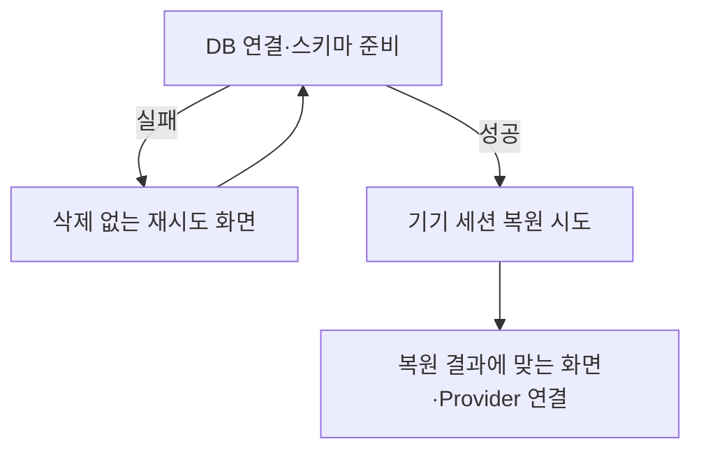

# 앱 준비와 초기 작업을 바꿀 때

앱 시작 순서, 준비 실패·재시도, Root 구성과 인증 후 작업의 수명을 변경할 때 읽는다. 준비 완료는 **DB를 사용할 수 있고 기기 세션 복원 시도가 끝난 상태**다. 로그인 성공, 네트워크 확정, 지도 다운로드나 sync 성공까지 기다리는 상태가 아니다. 기기 세션의 제품 의미는 [기기 세션과 로컬 지속](../common/device-session.md), 실제 배치와 연결은 [현재 구조](../current/architecture.md)에 있다.

## 준비가 끝나야 DB 소비자를 연결한다

- **DB 준비:** module import만으로 연결을 열지 않는다. `getDatabase()`는 준비 성공 전 접근을 거절한다. 열기·스키마 실패는 빈 DB나 빈 목록으로 처리하지 않는다.
- **DB 재시도:** 같은 준비 함수를 다시 실행한다. 기존 여행을 지우는 reset이 아니다.
- **인증 복원:** 기록 부재는 signed-out, 읽기·해석·계정 확인 실패는 restore-failed다. 후자는 로그인 화면에서 안내·명시적 재시도·기기 정리 진입을 제공한다. DB 실패와 합쳐 전체 진입을 막거나 정상 signed-out으로 숨기지 않는다.

기기 기록과 DB 귀속 검사는 [인증 가이드](authentication-and-session.md)가 소유한다.

## 준비 UI와 재시도의 수명을 함께 관리한다

`AppInitialization`은 준비 순서, 중복 실행, 늦은 완료, 준비·실패 UI와 Splash 전환을 함께 소유한다. Splash는 성공 시 앱을, DB 실패 시 재시도 화면을 볼 수 있게 해제한다. 준비 실패 뒤에도 네트워크 감지의 mount 수명은 유지하고 DB·인증 준비만 다시 시도한다.

명시적 재시도는 준비 책임의 실행 함수를 호출해 순서와 실패를 한곳에서 읽을 수 있게 한다. 단지 effect를 다시 실행하기 위한 카운터가 꼭 필요한지 먼저 확인한다. 진행 중 중복 호출과 unmount 이후의 늦은 완료는 시도 참조로 구별해 이전 실행이 새 화면 상태를 덮지 않게 한다. 이 배치는 다른 모든 effect 기반 재시도를 금지하는 규칙은 아니다.

초기 인증 복원은 진행 중 Promise와 완료 결과를 재사용한다. 탭 이동, 일반 rerender, foreground, 연결 변화, 로그인·로그아웃 뒤에 초기 복원을 다시 실행해 현재 세션을 덮지 않는다. `restore-failed`의 명시적 재시도는 실패 복구를 위해 새 읽기를 여는 별도 동작이다.

## 준비, 화면 이동, 인증 후 작업의 책임을 나눈다

| 책임 | 배치 | 맡는 범위 |
| --- | --- | --- |
| 앱 구성 | Root | Provider·화면 조립 |
| 준비 | `src/application/AppInitialization.tsx` | 준비 수명·실패·재시도 |
| 화면 이동 | `AppNavigation` | Stack·인증 상태에 따른 이동 |
| 세션 중 작업 연결 | `AuthenticatedEffects` | Local 세션을 가진 동안 여행 선택·정리 hook의 수명 |
| 각 작업의 실행 규칙 | 기존 entity·service | 여행 선택·DB 저장·auth·sync·cleanup 상세 |

Reauth-required도 Local 세션이 있으므로 활성 여행 화면을 유지한다. 인증 후 작업의 mount를 서버 요청 허용과 동일하게 취급하지 않는다. 예를 들어 sync는 mount 이후에도 DB·인증·실제 네트워크·override·종료 조건을 검사한다.

인증 후 조회·정리·sync의 완료는 앱 진입을 기다리게 하는 조건이 아니다. 후속 실패로 앱 준비 완료를 취소하지 않는다. 선택 변경은 [Network·Policy](network-and-policy.md), sync 시작은 [데이터 가이드](local-data-and-sync.md)의 기준을 따른다.

`src/application`은 이 프로젝트에서 Expo route와 준비 책임을 구별한 배치다. 새 범용 FSD 계층이나 모든 initializer의 파일 분리 규칙으로 확대하지 않는다. Expo `app/`의 일반 TSX도 route로 탐색될 수 있으므로 이동 전 설정을 확인한다. FSD 의존 관계는 [client guide](../../../apps/client/CLAUDE.md)가 소유한다.

## 실패 지점과 실행 수명을 확인한다

준비 코드를 바꾸면 DB 열기·스키마 준비 실패에서 소비자가 실행되지 않는지, 재시도가 reset 없이 같은 데이터를 사용하는지, 준비 중 연타와 unmount 뒤 완료가 화면을 덮지 않는지 확인한다. DB 준비 후 복원 기록 부재·복원 실패·재인증 필요가 각각 올바른 화면으로 이어지는지도 구별한다.

테스트는 단순히 microtask를 여러 번 비우기보다 실제 준비 단계 진입·완료를 관찰한다. SafeArea나 native mock 때문에 화면이 렌더되지 않은 실패를 제품 정책 실패로 오인하지 않는다. 모듈 수준 검사, React 연결 검사와 Expo native DB·SecureStore·Splash 실제 동작은 서로 다른 증거다.

직접 근거는 [AppInitialization](../../../apps/client/src/application/AppInitialization.tsx), [Root layout](../../../apps/client/app/_layout.tsx), [DB 준비](../../../apps/client/src/shared/db/index.ts), [Auth Store](../../../apps/client/src/shared/store/auth.ts), [DB 시작 검사](../../../apps/client/tests/shared/db/startup.test.ts)다. 2026-09-25 현재 코드와 [기존 시작 결정](../../../.claude/decisions/2026-09-18-app-startup-failure-recovery.md)을 대조했다. 초기 layout 내부 유지와 복원 실패 단순화는 후속 선택으로 바뀌었으며 이유는 [앱 준비 결정](../decisions/0004-startup-failure-and-retry.md)에서 확인한다.
