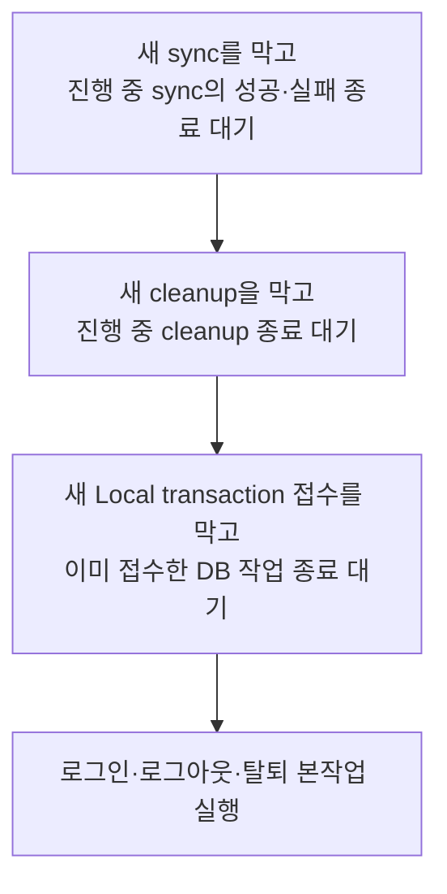

# 인증 상태와 기기 세션 전환을 바꿀 때

세션 복원, 토큰 저장·갱신, 로컬 접근, 로그인·로그아웃·계정 삭제를 변경할 때 읽는다.

**보존할 사용자 흐름**

- **인증 거부 확인:** 보호된 Remote 요청은 멈추고, 같은 계정의 활성 여행 Local 작업은 이어 간다.
- **같은 계정으로 재로그인:** 기존 로컬 데이터를 유지하며, 기기 저장까지 성공하면 정상 인증 흐름으로 돌아간다.

**작업별 바로가기**

- 책임을 어디에 둘지: [Store·DB·서비스](#상태-판단-db-사실-전체-절차를-구별한다)
- 앱 시작·계정 확인을 바꿀 때: [기기 기록 복원](#기기-기록의-의미와-복원-실패를-보존한다) · [DB·queue 귀속](#귀속을-확인하지-못한-데이터를-자동으로-버리지-않는다)
- 인증 전환을 바꿀 때: [로그인](#로그인은-검사저장공개까지-같은-순서로-끝낸다) · [인증 거부](#인증-거부는-저장을-기다리지-않고-요청부터-막는다) · [늦은 응답](#사용자-id와-요청-세션의-동일성은-다르다)
- 로그아웃·탈퇴를 바꿀 때: [종료 순서와 실패 결과](#세션-기록의-순서와-전체-종료-절차의-순서를-함께-보호한다) · [복구 화면](#실패-화면에서도-복구와-명시적-정리에-접근할-수-있어야-한다)

다섯 인증 상태와 계정 변경의 제품 의미는 [기기 세션](../common/device-session.md), 실제 코드 경로의 보호 범위와 남은 차이는 [세션과 로컬 데이터의 현재 연결](../current/session-and-local-data.md)에서 확인한다.

## 상태 판단, DB 사실, 전체 절차를 구별한다

인증 상태에 근거한 판단은 Auth Store, 실제 데이터 소속과 SQL 접근 조건은 DB 접근 모듈, 로그인·로그아웃·탈퇴 전체의 조율은 서비스가 맡는다.

- **같은 인증 판단은 함께 둔다.** 값을 돌려주는지 오류를 던지는지에 따라 정책의 책임을 나누지 않는다.
- **DB 사실은 실제 데이터로 확인한다.** 인증 상태 selector가 DB 조사까지 맡지 않게 한다.
- **새 진입점도 전체 세션 변경 서비스를 사용한다.** 화면마다 저장소 검사와 종료 순서를 조립하거나 Store action만으로 전체 절차를 대신하지 않는다.

**접근 기준**

- Local: `signed-in` 또는 `reauth-required`.
- 보호된 Remote: `signed-in`.
- raw `userId`의 존재만으로 접근을 허용하지 않는다.

**초기 복원은 인증 상태를 만드는 과정**이므로 처음부터 signed-in guard를 붙이지 않는다.

토큰과 UI용 인증 상태는 하나의 인증 책임이 일관되게 갱신한다. 토큰을 일반 상태 조회·로그에 넓게 노출하지 않되, 이 배치를 OS 보안 경계로 오인하지 않는다. 이 책임 구분을 dependency injection·facade·별도 Store의 일반 금지나 의무로 확대하지 않는다.

## 기기 기록의 의미와 복원 실패를 보존한다

**계정과 인증 수단을 하나의 검증된 기기 기록으로 함께 관리한다.** 토큰이 없어도 계정 소속을 보존해야 인증 만료 뒤 활성 여행의 로컬 작업을 이어 갈 수 있다. SQLite의 userId만으로 로그인 세션을 새로 만들지는 않는다.

저장·복원을 바꿀 때 지킬 기준은 다음과 같다.

- 기록을 읽지 못했거나 불완전한 상태를 **정상적인 기록 없음으로 처리하지 않는다.**
- 세션을 공개하기 전에 DB·남은 queue의 계정 귀속을 확인한다. 이 검사를 선택 사항으로 만들지 않는다.
- 이전 형식을 읽은 것과 새 형식 저장이 끝난 것을 구별한다. 삭제한 인증이 남은 이전 기록에서 다시 복원되지 않게 한다.
- 저장·삭제 오류를 정상 완료로 숨기지 않는다.

저장 필드·키·버전과 이전 형식의 판독·삭제 절차는 [기기 저장 코드](../../../apps/client/src/shared/services/auth/token-storage.ts)에서 확인한다. 복원 수명과 명시적 재시도는 [앱 준비 가이드](app-startup.md)를 따른다.

## 귀속을 확인하지 못한 데이터를 자동으로 버리지 않는다

로그인·복원에서는 **메모리의 계정과 실제 DB·queue의 소속을 함께 확인한다.** 삭제 표시된 원본도 queue의 계정 귀속을 판단하는 근거이므로 보존·정리 기준과 연결된다.

- **다른 계정 데이터가 있음:** 같은 계정 재로그인으로 해결할 수 없다.
- **누구의 변경인지 확인할 수 없음:** 다른 계정 데이터라고 단정할 수 없다. 원본 누락, payload 해석 실패·계정 충돌이 여기에 포함된다.

두 결과 모두 자동 계정 교체나 데이터 폐기의 근거가 아니다. 다른 계정 row를 발견해도 귀속 불명 queue의 존재까지 확인한다.

Local SQL에서도 **현재 계정·삭제되지 않은 대상·현재 계정의 활성 여행** 조건을 확인한다. 인증 상태 판단이나 화면이 전달한 tripId가 이 검사를 대신하지 않는다. 인증 만료 뒤 별도 Local 이용 기한을 추가하지 않으며, 기존 활성화 기한은 계속 적용한다.

## 로그인은 검사·저장·공개까지 같은 순서로 끝낸다

**로그인 완료는 기기 저장과 상태 적용까지 성공한 시점이다.** 서버 로그인 성공 후에는 다음 순서를 지킨다.

1. 기존 계정과 DB·queue 귀속을 확인한다. 다른 계정은 명시적 로그아웃 뒤 로그인해야 한다.
2. 검사한 세션을 기기에 저장한다.
3. 저장이 성공하면 새 토큰과 `signed-in` 상태를 공개한다.

이 순서로 저장에 실패한 인증을 로그인 완료로 공개하지 않게 한다.

**실패했을 때 보존할 결과**

- **기기 저장 실패:** 이전 인증 상태와 로컬 데이터를 보존한다. 이 실패만을 위한 새 전역 인증 상태를 늘리지 않는다.
- **새 서버 토큰을 적용하지 못함:** 방금 받은 새 refresh token의 폐기를 시도하고 원래 로그인 실패를 전달한다. 기존 세션의 토큰은 폐기하지 않는다.
- **저장·상태 적용 후 Query 갱신 실패:** 인증 복구는 이미 완료됐다. 인증 저장 실패로 다시 분류하지 않는다.

**계정 검사부터 저장·공개까지 순서를 보호한다.** 검사와 저장을 따로 직렬화하면 두 로그인이 모두 이전 계정이 없다고 판단한 뒤 다른 계정으로 덮어쓸 수 있다. 뒤 요청의 시작·실패 때문에 앞선 저장 성공을 버리지 않는다. 세션 삭제 성공도 뒤 로그인 실패와 관계없이 `signed-out`으로 적용한다.

## 인증 거부는 저장을 기다리지 않고 요청부터 막는다

**인증 거부가 확정되면 메모리를 `reauth-required`로 바꾸고 세션 세대를 변경해 보호된 요청을 차단한다.** 기기 저장이 지연·실패해도 거부된 인증으로 요청을 계속하지 않기 위해서다. 로그인 성공의 '저장 후 공개' 순서를 여기에 적용하지 않는다.

거부된 토큰을 뺀 기기 기록 저장은 직렬화된 순서로 뒤따른다. 진행 중이던 refresh 저장이 나중에 성공해도 거부 이전 세션을 다시 열지 않으며, 저장 실패 뒤에도 호출자에게 재인증이 필요하다는 의미를 유지한다.

통신 실패·일반 서버 장애·기기 저장 실패는 자격 증명 거부의 증거와 구별한다. HTTP에서 거부를 판정하는 정확한 조건과 오류 전파는 [API 가이드](api-contracts.md)를 따른다.

## 사용자 ID와 요청 세션의 동일성은 다르다

**같은 계정으로 재로그인해도 새 세션이다.** 이전 세션의 늦은 응답은 버린다.

응답 적용·토큰 저장·원요청 재전송에서는 요청을 시작한 세션이 여전히 유효한지 확인한다. Activation·sync의 Local 저장에서도 현재 세션과 계정을 함께 확인한다.

userId를 한 번 읽어 넘기는 것만으로 `await` 이후의 동일성을 보장하지 않는다. 인증 거부·로그아웃·탈퇴·새 로그인 뒤 오래된 결과가 현재 상태를 다시 열지 못하게 한다. 네트워크 최신성과 세션 동일성도 각각 확인한다.

## 세션 기록의 순서와 전체 종료 절차의 순서를 함께 보호한다

직렬화할 범위는 두 가지다.

- **인증 저장:** 저장된 인증과 공개 상태를 일관되게 적용하는 순서.
- **전체 세션 변경:** sync·cleanup·Local 저장과 로그인·종료가 충돌하지 않게 조율하는 순서.

기기 저장 순서만 보호했다고 전체 로그인·종료 절차까지 보호되는 것은 아니다. 두 범위를 고려해 변경하며 큐 개수만 보고 합치지 않는다.

### 세션을 변경하기 전에 기다리는 순서

**이 순서가 필요한 이유:** sync와 cleanup도 transaction을 사용할 수 있다. Local transaction을 먼저 차단하면 서로의 종료를 기다리는 상황을 만들 수 있다.

### 로그아웃·탈퇴의 본작업

- **미전송 확인은 대기 뒤에 한다.** 종료 버튼을 누른 뒤 완료된 Local 저장도 포함해야 한다. `PENDING`·`IN_PROGRESS`·`FAILED` 모두 서버 반영을 확인하지 못한 변경이다.
- **일반 종료는 미전송 데이터가 있으면 보류한다.** 강제 종료는 사용자가 손실을 확인하고 명시적으로 선택한 경우에 허용한다. 강제 종료도 진행 중 작업의 대기는 거친다.
- **보류·실패 뒤 일시 차단을 해제한다.** 사용자가 작업이나 복구를 이어 갈 수 있어야 한다.

### 실패 위치에 따라 남는 상태

**종료 전체가 하나의 원자적 transaction인 것은 아니다.** 로컬 정리는 DB reset 후 기기 인증 삭제를 진행하므로, 뒤의 실패가 이미 비운 DB를 복구하지는 않는다.

- **서버 요청 실패:** 로그아웃이면 로컬 종료를 계속한다. 계정 삭제이면 로컬 세션·데이터를 유지한다.
- **DB reset 내부 실패:** DB transaction 안의 변경을 되돌린다. 서버 요청·SecureStore까지 함께 되돌리는 보장은 아니다.
- **DB reset 후 인증 삭제 실패:** DB는 이미 비었다. 선택 여행·Query cache도 그 사실에 맞춰 정리하고, 보호된 요청 차단과 종료 재시도 가능 상태를 유지한다. `signed-out` 성공으로 처리하지 않는다.

이 구분은 실패 안내와 복구를 바꿀 때 함께 지킨다. 실제 보호 범위·남은 연결은 [세션 구현 현황](../current/session-and-local-data.md)에서 확인한다. 앱 강제 종료 중간 상태를 durable journal로 복구하는 기능과 원격 기기 세션 관리는 현재 범위에 포함하지 않는다. 선택 이유·비용은 [기기 세션 결정](../decisions/0003-device-session-and-local-continuity.md)에 있다.

## 실패 화면에서도 복구와 명시적 정리에 접근할 수 있어야 한다

**로그인 화면에서도 복원 재시도와 기기 정리에 접근할 수 있어야 한다.** `restore-failed`나 `signed-out`에 잔존 DB가 있으면 프로필 화면에 도달하지 못할 수 있기 때문이다.

기기 정리는 데이터 손실을 확인한 사용자의 명시적 선택으로 실행한다. 소유자 불명 데이터를 자동 삭제하거나 정리 실패를 성공 안내·화면 이동으로 숨기지 않는다.

## 변경 후 확인할 시나리오

- **계정·데이터:** 정상 재로그인, 다른 계정 거절, 소유자 불명 queue.
- **기기 저장:** 저장 실패, 겹친 저장에서 앞 성공·뒤 실패.
- **요청·세션:** refresh 저장 중 인증 거부, 같은 계정의 새 세션 뒤 도착한 옛 응답.
- **종료 대기:** 대기 중 완료된 Local 저장까지 미전송 확인에 포함.

토큰·HTTP 대역과 React 검사로 확인한 범위를 실제 SecureStore·OAuth·서버 토큰 회전·기기 전체의 검증으로 넓히지 않는다.

## 코드와 검증 근거

- 상태·저장: [Auth Store](../../../apps/client/src/shared/store/auth.ts), [기기 저장](../../../apps/client/src/shared/services/auth/token-storage.ts)
- Local 귀속·접근: [local-account](../../../apps/client/src/shared/services/auth/local-account.ts), [local-access](../../../apps/client/src/shared/services/auth/local-access.ts)
- 전체 절차: [로그인](../../../apps/client/src/shared/services/auth/login-service.ts), [세션 절차](../../../apps/client/src/shared/services/auth/session-lifecycle.ts), [종료](../../../apps/client/src/shared/services/auth/logout-service.ts)

2026-09-25 위 코드와 [책임·회귀 근거](../../work/workspaces/002-code-readability-refactoring/records/2026-09-21-04-auth-responsibilities-and-regression-fixes.md)를 대조했다. 테스트의 실제 실행 이력과 승인 범위는 Workspace 기록에 남는다.
